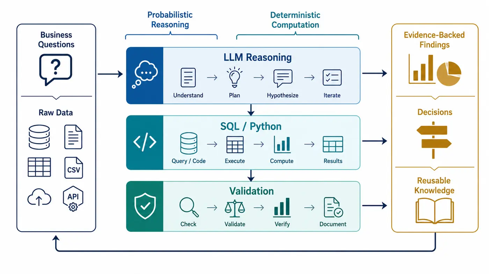
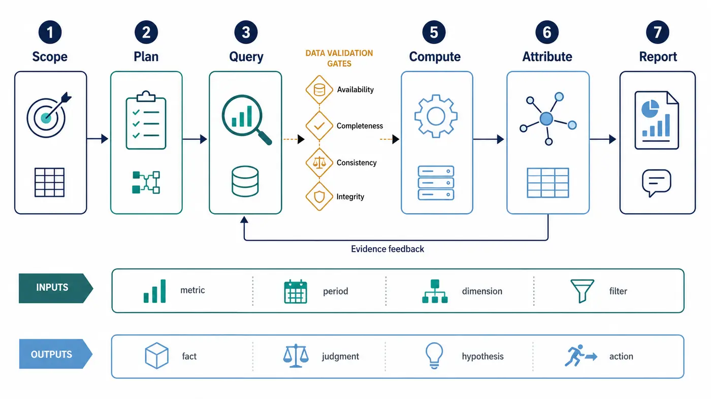
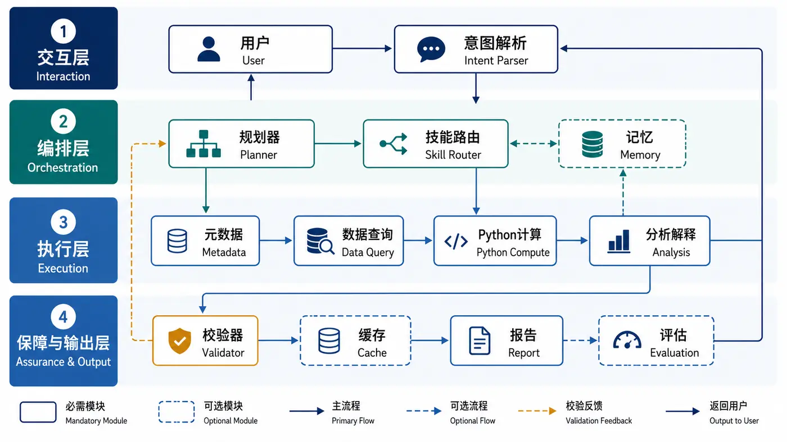
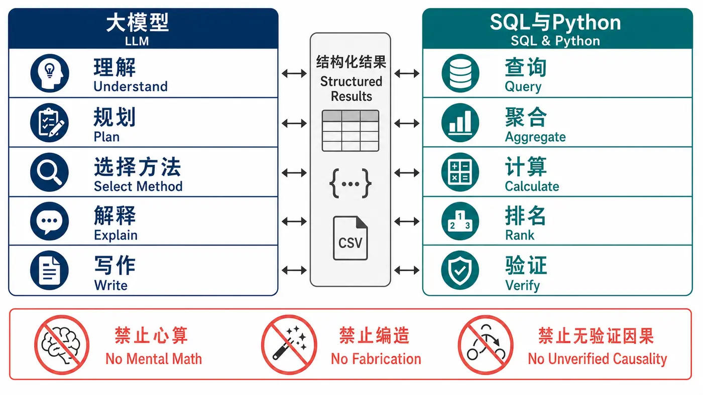
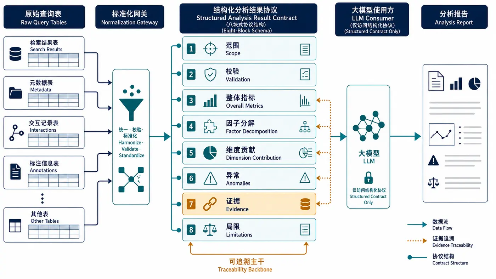
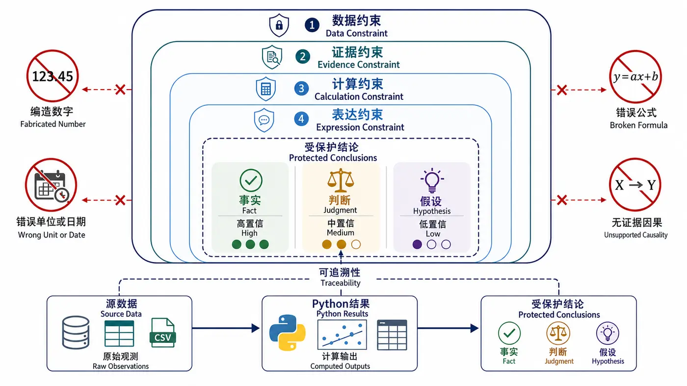
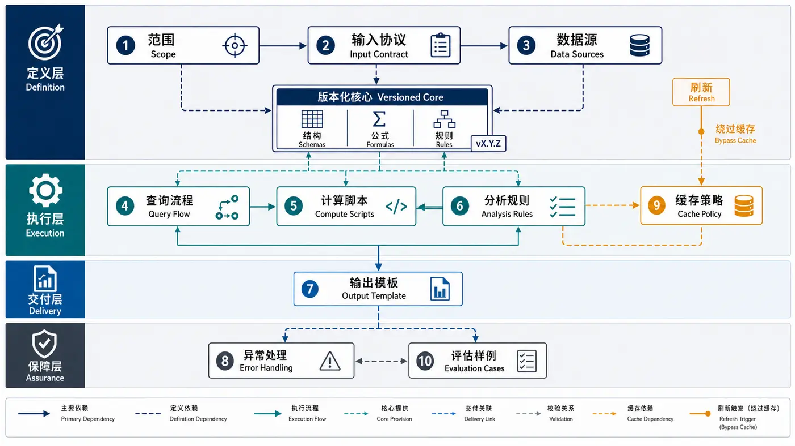
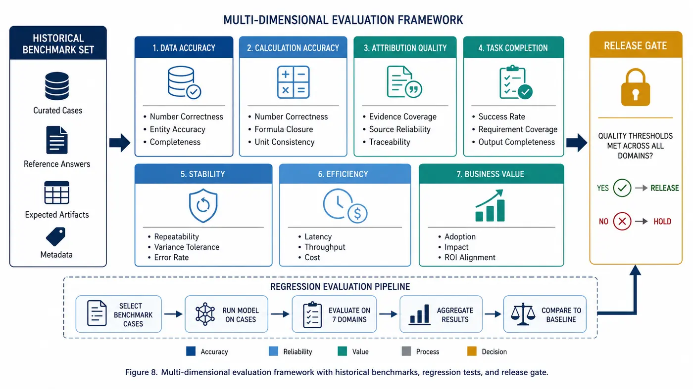
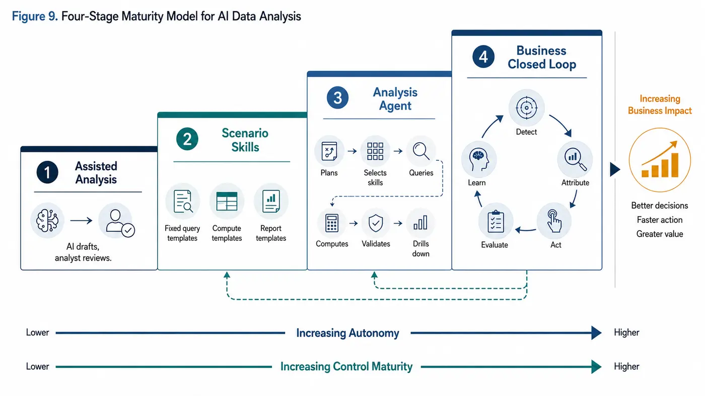
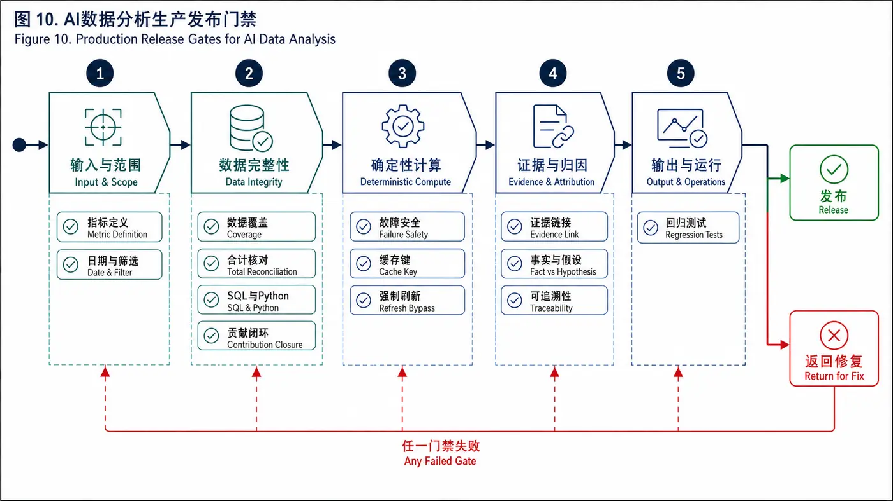

# AI数据分析指南

## 1. 什么是AI数据分析

*图1｜AI数据分析的混合系统：大模型负责概率性推理，SQL/Python负责确定性计算，验证层保证证据闭环。*

AI数据分析不是让大模型直接“看数字并猜原因”，而是把大模型的理解、规划和表达能力，与SQL、Python、数据平台等确定性计算能力组合起来，形成可重复执行、可验证、可追溯的分析流程。

它主要解决四类问题：

1. **降低分析门槛**：用户通过自然语言提出问题，系统自动识别指标、维度、日期和筛选条件。
2. **提高分析效率**：自动完成取数、计算、异常识别、归因拆解和报告生成。
3. **沉淀分析方法**：把成熟分析思路固化为Skill、工作流或Agent，而不是依赖个人经验。
4. **提升交付稳定性**：通过计算工具、数据校验和证据引用，减少大模型幻觉。

AI适合负责理解问题、规划步骤、选择方法、解释结果和生成报告；SQL、Python等工具负责查询、聚合、计算和校验。核心原则是：**能通过程序确定的内容，不交给大模型心算。**

## 2. 标准分析流程

*图2｜端到端分析流程：从问题定义、查询和校验，到计算、归因与报告输出，并通过证据反馈继续下钻。*

### 2.1 理解问题

从用户问题中提取：

- 分析对象：业务、产品、用户、渠道、应用、榜单等。
- 核心指标：活跃、收入、消耗、曝光、转化率、eCPM等。
- 时间范围：本期、对照期、同比、环比。
- 分析维度：来源、设备、地区、分类、客户等。
- 筛选条件：手机/平板、设备系列、业务场景等。
- 输出目标：趋势说明、异常定位、原因归因、优化建议。

如果关键条件缺失且会明显改变结果，应先向用户确认；如果可以采用稳定默认值，应明确记录默认规则。

### 2.2 制定分析计划

根据问题生成可执行的分析计划：

1. 查询整体指标，确认变化是否真实。
2. 拆解结果指标，判断主要由哪个因子驱动。
3. 按业务维度计算变化贡献，定位主要对象。
4. 对关键对象继续下钻，验证候选原因。
5. 汇总证据，区分事实、推断和待验证假设。
6. 输出结论、建议和后续动作。

计划中的每一步都应对应明确的数据来源、计算方法和输出字段。

### 2.3 查询数据

查询前应明确：

- 数据表、数据卡片或API来源。
- 指标口径及单位。
- 日期字段与分区字段。
- 合计行和明细行的识别规则。
- 空值、重复值、异常值处理方式。
- 数据权限和最大查询范围。

查询结果应保留来源信息，例如卡片名称、查询条件、执行时间和数据版本，便于后续审计。

### 2.4 数据校验

分析前至少完成以下校验：

- 返回数据是否为空。
- 实际日期是否覆盖目标日期。
- 筛选条件是否真正生效。
- 合计值与明细汇总是否一致。
- 指标单位是否一致，例如元/万元、比例/百分比。
- 分母是否为零，是否存在无穷值。
- 本期与对照期口径是否一致。
- 数据是否存在明显缺失、重复或突变。

校验失败时不应继续生成确定性结论，应返回具体问题及修复建议。

### 2.5 程序化计算

所有可确定计算应由Python或SQL完成，包括：

- 同比、环比、变化量和变化率。
- 占比、排名、Top N和累计贡献。
- 加法分解、乘法分解、结构与效率拆解。
- 异常检测、相关性、回归和显著性检验。
- 图表所需的汇总数据。
- 合计值与明细值的交叉验证。

以eCPM归因为例：

- 结构影响 = (本期曝光占比 - 对照期曝光占比) × (对照期对象eCPM - 对照期整体eCPM)
- 效率影响 = 本期曝光占比 × (本期对象eCPM - 对照期对象eCPM)
- 总影响 = 结构影响 + 效率影响

上述公式应由Python逐行计算并返回排序后的结果，大模型只负责解释主要贡献项，不重新计算数值。

### 2.6 分析与归因

归因应遵循“整体—拆解—下钻—验证”的层次：

1. **整体层**：指标变化多大，是否超过正常波动范围。
2. **因子层**：通过公式拆解，识别流量、转化率、单价等因子的影响。
3. **维度层**：计算不同渠道、应用、榜单、分类的贡献。
4. **对象层**：定位具体异常对象和发生时间。
5. **机制层**：结合业务规则、策略变更和外部事件解释原因。
6. **验证层**：使用补充数据验证候选原因，避免把相关性当作因果性。

结论应分为：

- **数据事实**：数据能够直接证明的结果。
- **分析判断**：基于多项证据形成的解释。
- **待验证假设**：当前证据不足，需要新增数据或实验验证。

### 2.7 生成报告

推荐报告结构：

1. 分析范围与口径。
2. 核心结论摘要。
3. 整体指标变化。
4. 关键因子拆解。
5. 主要维度贡献。
6. 重点对象下钻。
7. 原因总结及证据。
8. 优化建议。
9. 风险、限制与待验证事项。

报告中的每个关键数字都应能追溯到计算结果，每个原因判断都应给出对应证据。

## 3. AI数据分析Agent架构

*图3｜数据分析Agent的分层架构：交互、编排、执行、保障与输出共同构成完整运行闭环。*

一个可用的数据分析Agent通常包括以下模块：

| 模块 | 主要职责 | 是否必需 |
|---|---|---|
| 意图解析 | 提取指标、时间、维度、筛选条件和输出要求 | 必需 |
| 元数据检索 | 查找指标口径、表结构、卡片和可用字段 | 必需 |
| 分析规划 | 生成查询、计算、下钻和验证步骤 | 必需 |
| 数据查询 | 调用SQL、数据卡片或API获取数据 | 必需 |
| Python计算 | 完成所有确定性计算、排序和校验 | 必需 |
| 分析解释 | 根据计算结果识别主要变化和候选原因 | 必需 |
| 结果验证 | 检查口径、数据完整性、等式和证据链 | 必需 |
| 报告生成 | 按固定结构生成Markdown、HTML或PPT | 必需 |
| 缓存管理 | 复用相同条件下的数据和报告 | 可选 |
| 记忆与反馈 | 记录用户偏好、修正结果和业务知识 | 可选 |
| 评估监控 | 监控准确率、执行成功率和用户采纳率 | 推荐 |

推荐的数据流为：

**用户问题 → 意图解析 → 元数据匹配 → 查询数据 → 数据校验 → Python计算 → 大模型分析 → 规则复核 → 报告输出**

## 4. 大模型与计算工具的职责边界

*图4｜职责边界：大模型承担理解与解释，SQL/Python承担查询与计算，双方通过结构化结果交互。*

| 工作内容 | 推荐执行者 |
|---|---|
| 理解自然语言问题 | 大模型 |
| 识别日期、指标和筛选条件 | 大模型 + 规则校验 |
| 选择分析方法 | 大模型 + 预设方法库 |
| SQL生成 | 大模型生成，SQL引擎执行 |
| 聚合、变化率、贡献度 | Python或SQL |
| 排名和Top N | Python或SQL |
| 公式一致性验证 | Python |
| 异常解释和业务归因 | 大模型 |
| 结论证据检查 | 规则程序 + 大模型 |
| 报告表达 | 大模型 |

禁止让大模型直接完成大量数值计算、凭印象补全缺失数据、虚构数据来源，或在没有验证的情况下给出确定性因果结论。

## 5. 中间数据标准

*图5｜结构化分析结果协议：将原始查询结果标准化为可校验、可追溯、可直接解释的八类数据块。*

Python不应只返回原始明细，而应返回经过整理、可直接分析的结构化结果。建议包括：

- analysis_scope：分析日期、对照日期、筛选条件和口径。
- validation：数据完整性、合计校验、异常提示。
- overall_metrics：整体指标及变化量、变化率。
- factor_decomposition：各因子影响值及贡献率。
- dimension_contribution：各维度对象的结构、效率和总影响。
- anomalies：异常对象、异常时间和异常程度。
- evidence：支持每项结论的指标与数据来源。
- limitations：数据限制和不能确认的事项。

这样可以让大模型专注于解释结果，减少重复计算和上下文消耗。

## 6. 幻觉控制

*图6｜四层幻觉控制框架：以数据、证据、计算和表达约束保护结论，并区分事实、判断和假设。*

### 6.1 数据约束

- 所有关键数字必须来自查询结果或Python输出。
- 不允许使用报告中不存在的数据补充结论。
- 缺少关键数据时明确说明“无法判断”。
- 输出前检查数字单位、方向、日期和小数位。

### 6.2 证据约束

每项原因结论至少包含：

- 发生了什么变化。
- 哪些对象贡献最大。
- 对应数据证据是什么。
- 是确定原因、较强判断还是待验证假设。

### 6.3 计算约束

- 公式集中维护，不在提示词中多处重复。
- Python输出计算过程和最终结果。
- 总贡献与整体变化进行闭环校验。
- 因为舍入或交互项无法完全对齐时，明确说明残差。

### 6.4 表达约束

推荐使用以下措辞区分置信程度：

- “数据显示……”：直接事实。
- “主要由……贡献”：已完成贡献计算。
- “可能与……有关”：存在相关证据但未确认因果。
- “需要进一步验证……”：当前证据不足。

## 7. Skill设计规范

*图7｜专业数据分析Skill的十项组成及依赖关系，公式、结构和规则由版本化核心统一管理。*

一个专业数据分析Skill至少应包含：

1. **适用范围**：解决什么问题，不解决什么问题。
2. **输入协议**：日期、对象、指标、维度和筛选条件。
3. **数据源配置**：卡片、表、字段和口径。
4. **查询流程**：哪些查询可并行，哪些依赖前序结果。
5. **计算脚本**：全部确定性计算及校验规则。
6. **分析规则**：整体、拆解、下钻和归因逻辑。
7. **输出模板**：固定章节、表格、图表和结论格式。
8. **异常处理**：无数据、字段变化、筛选失败和超时处理。
9. **缓存规则**：缓存键、有效期、强制刷新和命中后的输出。
10. **评估样例**：正常案例、边界案例和错误案例。

缓存键应至少包括分析类型、日期、本期/对照期、筛选条件、指标口径和版本。用户明确说“重新查询”“重新分析”或“刷新数据”时，应跳过缓存。

## 8. 质量评估

*图8｜多维质量评估框架：基于历史基准集进行回归评测，并通过发布门禁控制版本质量。*

AI数据分析不能只评价报告是否“写得像”，应从以下方面评估：

| 维度 | 评价指标 |
|---|---|
| 数据准确性 | 数字正确率、口径一致率、合计校验通过率 |
| 计算准确性 | 公式正确率、贡献闭环率、Python执行成功率 |
| 归因质量 | 主要贡献项召回率、无证据结论率 |
| 任务完成度 | 查询成功率、报告完整率、异常处理成功率 |
| 稳定性 | 同输入结果一致性、字段变化适配能力 |
| 效率 | 分析耗时、人工介入次数、Token和查询成本 |
| 业务价值 | 建议采纳率、问题定位时间、实际增收或增活效果 |

建议建立一组真实历史案例作为评测集，对Agent每次升级进行回归测试。

## 9. 落地路径

*图9｜AI数据分析的四阶段成熟度路径：从辅助分析逐步演进到业务决策闭环。*

### 阶段一：辅助分析

AI负责生成SQL、Python和报告草稿，分析师审核全部结果。目标是提高个人效率。

### 阶段二：场景化Skill

选择高频、规则稳定的场景，例如活跃波动分析、eCPM归因、渠道贡献分析，固化查询、计算和报告模板。

### 阶段三：分析Agent

Agent自动理解问题、选择Skill、调用数据工具、完成计算和校验，并根据结果决定是否继续下钻。

### 阶段四：业务闭环

将分析结论与策略执行、实验评估和进展跟踪连接起来，形成：

**发现问题 → 定位原因 → 提出策略 → 推动执行 → 评估效果 → 沉淀方法**

AI数据分析真正的价值不是自动生成报告，而是缩短从业务问题到可执行决策的链路。

## 10. 上线检查清单

*图10｜生产发布门禁：任一质量检查失败即返回责任环节修复，全部通过后才能发布。*

- [ ] 指标口径和数据源已明确。
- [ ] 日期与筛选条件解析正确。
- [ ] 查询结果通过完整性校验。
- [ ] 合计行与明细行处理正确。
- [ ] 所有数值计算由Python或SQL完成。
- [ ] 整体变化与维度贡献能够闭环。
- [ ] 关键结论均有数据证据。
- [ ] 事实、判断和假设已明确区分。
- [ ] 异常情况不会生成虚假结论。
- [ ] 缓存键包含全部关键查询条件。
- [ ] 强制刷新能够绕过缓存。
- [ ] 报告能够追溯到数据和计算结果。
- [ ] 已通过真实案例和边界案例测试。

## 总结

高质量AI数据分析系统的核心不是提示词写得多复杂，而是建立可靠的工程闭环：**大模型负责理解、规划与解释，数据工具负责查询与计算，校验机制负责约束与纠错，业务流程负责推动结论落地。**
