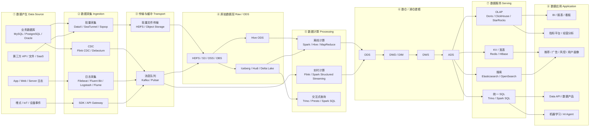
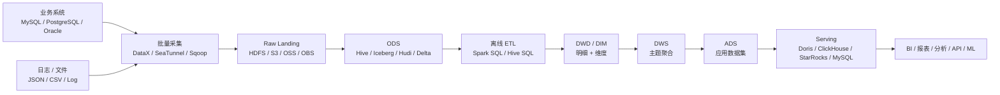
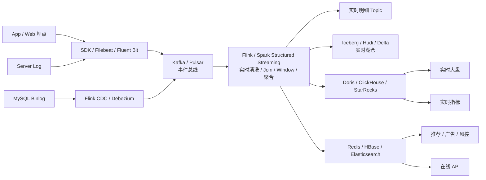
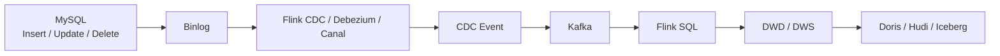
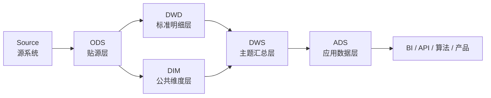
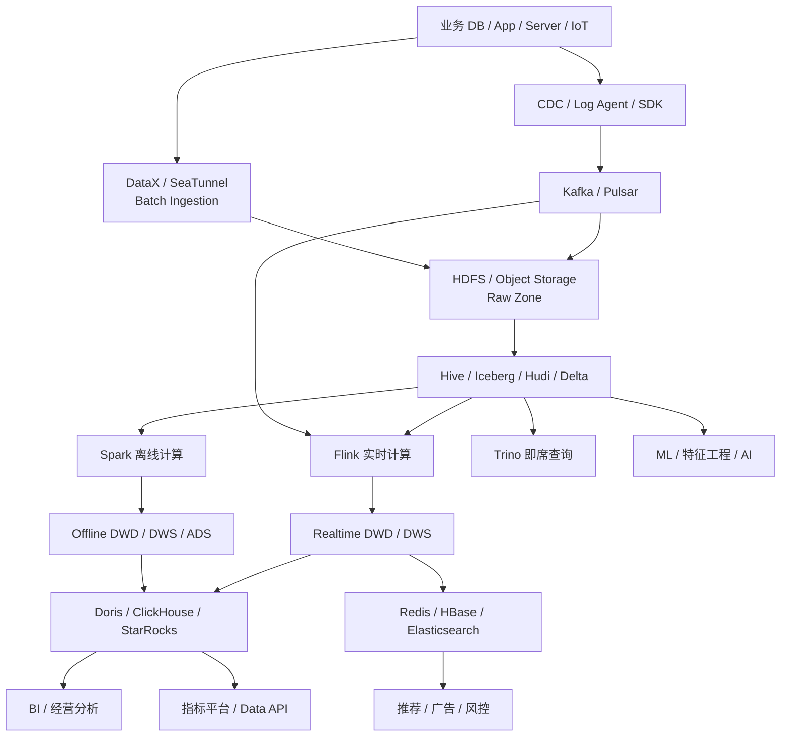
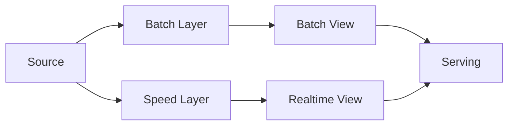
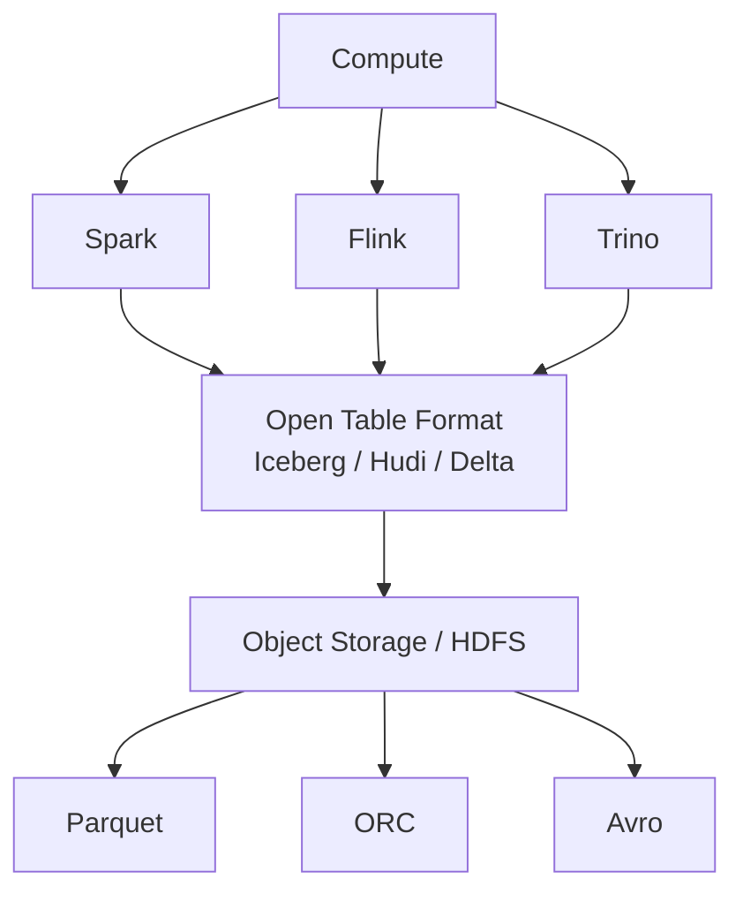
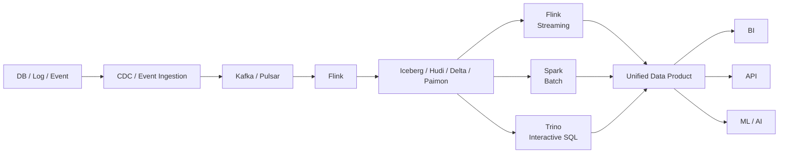
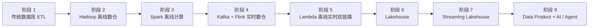

# 大数据数据链路图

> 从数据产生、采集、传输、存储、计算、建模，到最终数据服务与数据应用，系统梳理现代大数据平台的离线与实时数据链路，并说明各阶段常见工具、数据格式、数据组织方式以及后续架构演进方向。

---

## 1. 先看结论：完整的大数据链路到底是什么

一个完整的大数据系统，本质上是在解决下面这条链路：

**数据产生 → 数据采集 → 数据传输/缓冲 → 原始数据落地 → 数据清洗与计算 → 数仓/湖仓建模 → 数据服务 → 数据应用。**

在传统架构中，这条链路通常被拆成两套：

- **离线链路**：面向 T+1、小时级、分钟级批处理，重点是吞吐、成本、复杂计算和历史数据重算。
- **实时链路**：面向秒级甚至亚秒级数据处理，重点是低延迟、状态计算、事件时间、一致性和持续运行。

现代架构正在逐渐从“两套完全独立的链路”向 **批流统一、湖仓一体、增量计算、统一元数据和统一数据服务** 演进。

---

## 2. 全链路总图



这张图里最重要的一点是：**Kafka、HDFS、Hive、Iceberg、Spark、Flink、Doris 等组件并不是同一层的竞争关系，而是在解决完全不同的问题。**

例如：

- Kafka 主要解决事件流的缓冲、解耦和可重放。
- HDFS / S3 / OSS / OBS 解决大规模低成本持久化。
- Parquet / ORC 解决列式文件组织。
- Iceberg / Hudi / Delta Lake 解决“文件之上的表管理”。
- Spark / Flink 解决计算。
- Hive Metastore / Catalog 解决表和元数据管理。
- Doris / ClickHouse / StarRocks 解决低延迟分析查询。
- Redis / HBase 解决低延迟 KV、宽表或点查场景。

---

# 3. 数据格式：先区分四个容易混淆的概念

在讨论链路之前，需要先区分 **消息格式、文件格式、表格式、数据库内部存储格式**。

| 类型 | 典型技术 | 解决的问题 | 常见位置 |
|---|---|---|---|
| 消息序列化格式 | JSON、Avro、Protobuf、Thrift | 一条事件怎样编码 | Kafka / Pulsar / RPC |
| 文件格式 | CSV、JSON Lines、Avro、Parquet、ORC | 文件怎样组织数据 | HDFS / S3 / OSS / OBS |
| 表格式 | Hive Table、Iceberg、Hudi、Delta Lake | 多个数据文件怎样组成一张可靠的表 | 数据湖 / 湖仓 |
| 数据库内部格式 | ClickHouse Part、Doris Segment、HBase HFile、RocksDB SST | 数据库内部怎样存储和索引 | OLAP / KV / 状态存储 |

因此，**Iceberg 不是 Parquet 的替代品**。

典型的 Iceberg 表底层仍然可以存储 Parquet 文件，只是 Iceberg 在 Parquet 文件之上增加 Snapshot、Manifest、Schema、Partition Spec、事务提交等元数据能力。

可以理解为：

```text
对象存储 / HDFS
└── Iceberg Table
    ├── Metadata
    ├── Manifest List
    ├── Manifest Files
    └── Data Files
        ├── xxx.parquet
        ├── xxx.parquet
        └── xxx.parquet
```

---

# 4. 离线数据链路

## 4.1 离线链路总图



## 4.2 离线链路逐步骤说明

| 步骤 | 发生了什么 | 常见工具 / 平台 | 输入格式 | 输出 / 存储格式 | 典型时效 |
|---|---|---|---|---|---|
| 1. 数据产生 | 业务系统产生订单、用户、商品、广告、日志等数据 | MySQL、PostgreSQL、Oracle、MongoDB、应用日志 | 行记录、JSON、Log | InnoDB Page、WAL/Binlog、JSON Log 等 | 实时产生 |
| 2. 批量采集 | 周期性抽取数据库表或文件 | DataX、SeaTunnel、Sqoop、自研 ETL | JDBC Row、CSV、JSON | CSV、Avro、Parquet、ORC 或直接写目标表 | 分钟～天 |
| 3. 原始落地 | 保存源系统原貌，便于追溯和重算 | HDFS、S3、OSS、OBS、COS | CSV、JSON、Avro | 原始文件或 Parquet / ORC | 小时 / T+1 |
| 4. ODS | 建立贴源数据层，完成基础分区和表管理 | Hive、Iceberg、Hudi、Delta Lake | Raw Files | Parquet、ORC、Avro + 表元数据 | 小时 / T+1 |
| 5. 清洗标准化 | 去重、类型转换、异常处理、主键统一、字段标准化 | Spark SQL、Hive SQL | ODS Table | Parquet / ORC / 湖仓表 | 小时 |
| 6. DWD | 构建业务过程明细事实表 | Spark、Hive | ODS | Parquet / ORC / Iceberg / Hudi | 小时 / T+1 |
| 7. DIM | 构建用户、商品、组织、渠道等维度 | Spark、Hive | ODS / DWD | Parquet / ORC / Iceberg | 小时 / T+1 |
| 8. DWS | 主题域聚合，例如用户日活、商品日指标 | Spark SQL、Hive SQL | DWD + DIM | Parquet / ORC / Iceberg | 小时 / T+1 |
| 9. ADS | 为具体报表、应用和业务场景生成最终数据集 | Spark SQL、Hive SQL | DWS / DWD | Parquet / ORC，或直接写 OLAP | 小时 / T+1 |
| 10. Serving | 将结果加载到高并发查询系统 | Doris、ClickHouse、StarRocks、MySQL、Redis、Elasticsearch | Parquet / ORC / CSV / JDBC Row | 各引擎内部列存、索引或 KV 格式 | 秒～分钟查询 |
| 11. 应用 | 经营分析、BI、数据 API、模型训练 | Superset、Tableau、Power BI、FineBI、自研平台、Notebook | SQL / API | 图表、指标、特征、模型输入 | 人机交互 |

---

## 4.3 一个具体的离线例子：订单数据 T+1 数仓

假设业务库中有：

```text
MySQL.order
```

每天凌晨将前一天新增订单同步到数仓：

```text
MySQL
  ↓ DataX / SeaTunnel
HDFS / ODS
  ↓ Spark SQL
DWD_ORDER_DETAIL
  ↓ Join DIM_USER / DIM_PRODUCT
DWS_USER_ORDER_1D
  ↓ 聚合
ADS_BUSINESS_DASHBOARD
  ↓
Doris / ClickHouse
  ↓
经营分析看板
```

数据格式可能发生如下变化：

```text
MySQL 行存记录
    ↓ JDBC
DataX Row
    ↓
ODS Parquet / ORC
    ↓
DWD Parquet / Iceberg
    ↓
DWS Parquet / Iceberg
    ↓
Doris / ClickHouse 内部列存格式
    ↓
SQL ResultSet / JSON API
```

这里需要注意：**大数据链路并不要求每一步都转换文件格式。**

在成熟平台中，ODS、DWD、DWS 可能全部使用 Parquet，只是目录、表、分区、Schema 和表元数据不同。

---

# 5. 实时数据链路

## 5.1 实时链路总图



## 5.2 实时链路逐步骤说明

| 步骤 | 发生了什么 | 常见工具 / 平台 | 输入格式 | 输出 / 存储格式 | 延迟 |
|---|---|---|---|---|---|
| 1. 事件产生 | 曝光、点击、下载、支付、设备状态等事件不断产生 | App SDK、Web SDK、Server、IoT | 内存对象、JSON、埋点协议 | JSON / Protobuf / Avro | 毫秒 |
| 2. 日志采集 | Agent 从日志、应用或网关接收事件 | Filebeat、Fluent Bit、Logstash、Flume、自研 SDK | Log / JSON | JSON / Avro / Protobuf | 毫秒～秒 |
| 3. CDC | 从数据库事务日志捕获 Insert / Update / Delete | Flink CDC、Debezium、Canal | MySQL Binlog、PostgreSQL WAL | CDC Event，JSON / Avro / Protobuf | 秒级 |
| 4. 消息总线 | 对上下游解耦、削峰、持久化、重放 | Kafka、Pulsar | Event | Topic + Partition 中的消息记录 | 毫秒～秒 |
| 5. 实时清洗 | Parse、过滤、维表关联、字段标准化 | Flink、Spark Structured Streaming | Kafka Record | Kafka Record / Row | 秒级 |
| 6. 状态计算 | Window、去重、Session、累计指标、CEP | Flink State、RocksDB State Backend 等 | Event Stream | KV State + Checkpoint | 秒级 |
| 7. 实时 DWD | 将清洗后的标准事件作为统一实时明细层 | Kafka、Paimon、Iceberg、Hudi 等 | JSON / Avro / Protobuf | Topic 或湖仓表 | 秒～分钟 |
| 8. 实时 DWS | 按用户、商品、渠道、窗口等聚合 | Flink SQL / DataStream | 实时 DWD | Upsert Stream / Changelog | 秒级 |
| 9. Serving | 将聚合或明细结果写入在线分析系统 | Doris、ClickHouse、StarRocks、Redis、HBase、Elasticsearch | Row / Stream | 内部列存、KV、倒排索引 | 秒级 |
| 10. 应用 | 实时看板、实时风控、推荐、广告、告警 | BI、自研 API、推荐系统、规则引擎 | SQL / KV / API | 指标、策略、结果 | 亚秒～秒 |

---

## 5.3 Kafka 在链路中到底是什么角色

Kafka 更接近一个 **可持久化、可重放的分布式事件日志系统**，而不是最终数据仓库。

它通常解决四个问题：

1. **削峰**：上游瞬时流量很大时，下游可以按自己的速度消费。
2. **解耦**：生产者不需要知道到底有多少消费者。
3. **持久化**：消息不会消费后立即消失，可以按保留策略保存。
4. **重放**：消费者可以从历史 Offset 再次消费数据。

Kafka 中典型的数据结构：

```text
Topic
└── Partition
    ├── offset=1001, key=user_1, value=<event>
    ├── offset=1002, key=user_2, value=<event>
    └── offset=1003, key=user_1, value=<event>
```

`value` 常见序列化方式：

```text
JSON       → 可读性强，Schema 约束弱，体积偏大
Avro       → 紧凑，适合 Schema Registry
Protobuf   → 紧凑，强 Schema，跨语言
```

规模较大的实时平台通常会尽量避免长期依赖“任意 JSON”，而会逐步引入 **Schema Registry / Data Contract**，降低字段随意变化导致的下游故障。

---

# 6. CDC：数据库数据如何进入实时链路

以 MySQL 为例：



CDC 事件不能简单理解为“一条普通日志”。

例如：

```json
{
  "before": {"id": 1, "status": "created"},
  "after":  {"id": 1, "status": "paid"},
  "op": "u",
  "ts_ms": 1786070400000
}
```

它表达的是：

```text
id=1
status: created → paid
```

因此下游常常需要支持：

- Insert
- Update
- Delete
- Upsert
- Changelog

这也是为什么实时数据湖逐渐从“只追加 Parquet 文件”向 Iceberg / Hudi / Delta 等支持事务与变更管理的表格式演进。

---

# 7. 离线和实时数据是否都会经过 Kafka

**不会。**

这是理解数据链路时非常重要的一点。

### 情况一：传统离线链路

```text
MySQL
  ↓ DataX / Sqoop
HDFS
  ↓ Spark / Hive
离线数仓
```

这种情况下完全不需要 Kafka。

### 情况二：实时链路

```text
MySQL Binlog / App Event
  ↓
Kafka
  ↓
Flink
  ↓
Doris / Redis / Iceberg
```

Kafka 通常是核心组件。

### 情况三：统一采集后，一份事件同时服务离线和实时

```text
                ┌→ Flink → 实时 DWS → Doris
Source → Kafka ─┤
                └→ HDFS / Iceberg → Spark → 离线数仓
```

这种架构在互联网公司很常见。

Kafka 作为统一事件入口，实时计算直接消费 Kafka；同时事件持续沉降到 HDFS / 对象存储，供长期存储、离线计算、重算和审计。

因此更加准确的说法是：

> **实时数据大概率会经过消息队列；离线数据是否经过 Kafka 取决于采集架构。Kafka 不是离线数仓的必经环节。**

---

# 8. ODS、DWD、DIM、DWS、ADS 到底分别存什么



| 分层 | 核心目标 | 典型内容 | 常见粒度 | 常用格式 |
|---|---|---|---|---|
| ODS | 保存源数据 | MySQL 表同步、原始日志 | 接近源系统 | Parquet / ORC / Iceberg |
| DWD | 标准化业务事实 | 曝光、点击、订单、支付明细 | 最细业务粒度 | Parquet / ORC / Iceberg |
| DIM | 公共维度 | 用户、商品、组织、渠道 | Entity 粒度 | Parquet / ORC / Iceberg |
| DWS | 面向主题聚合 | 用户日活、渠道日消耗 | 日 / 小时 / 用户等 | Parquet / ORC / Iceberg |
| ADS | 面向应用 | BI 报表数据集、专题指标 | 根据应用定义 | Parquet / OLAP Table |

需要注意：这不是必须遵守的物理标准，而是一种 **数据建模和职责划分方法**。

现代湖仓中甚至可能不再严格叫 ODS / DWD / DWS，而改成：

```text
Bronze → Silver → Gold
```

其本质类似：

```text
原始数据 → 清洗标准数据 → 面向业务消费的数据
```

---

# 9. HDFS 上的数据为什么还能再进入 HBase / Doris / ClickHouse

HDFS 本身可以直接被 Spark、Hive、Trino 等计算引擎读取，因此：

```text
HDFS → Spark
```

完全没有问题。

但 HDFS 主要解决的是 **分布式大文件可靠存储**，并不擅长：

- 单条 Key 毫秒级查询
- 高并发在线查询
- 大量随机更新
- 亚秒级 OLAP
- 倒排搜索

因此同一份数据会根据消费方式进入不同 Serving System。

| 查询需求 | 更适合的平台 |
|---|---|
| 扫描 PB 级历史数据 | HDFS / S3 + Spark / Trino |
| 高并发 OLAP | Doris / ClickHouse / StarRocks |
| KV / RowKey 点查 | HBase / Redis |
| 文本检索 | Elasticsearch / OpenSearch |
| 事务查询 | MySQL / PostgreSQL |

这就是典型的 **Storage for Compute + Storage for Serving** 思路。

---

# 10. 一个更接近大型互联网公司的双链路架构



这个架构里有几个关键设计：

### 1. Kafka 负责实时事件总线

但数据最终仍然会沉降到长期存储。

### 2. HDFS / 对象存储负责低成本长期保存

保存几年历史数据通常比 Kafka 更经济，也更适合大规模历史扫描。

### 3. Spark 与 Flink 各自发挥优势

```text
Spark → 大规模离线 ETL、历史重算、复杂批处理
Flink → 长期运行的低延迟状态流计算
```

### 4. OLAP 数据库承担数据服务层

离线和实时结果最终都可以进入统一 OLAP 系统，实现：

```text
昨天以前的数据 + 今天实时数据
```

统一查询。

这通常被称为：

```text
离线 + 实时 Serving 层融合
```

---

# 11. 调度、资源和治理：主链路之外还有三条“隐形链路”

真正的生产级大数据平台，不只有数据流。

## 11.1 调度链路

```text
Airflow / DolphinScheduler / Azkaban
        ↓
任务 DAG
        ↓
Spark / Hive / DataX / SQL
```

负责：

- DAG 依赖
- 定时调度
- 补数
- 重跑
- 参数传递
- SLA
- 告警

实时任务通常不是“每天调度一次”，而是常驻进程，因此更多依赖 Flink Deployment、Kubernetes、YARN 等进行生命周期管理。

## 11.2 资源链路

```text
Application
   ↓
YARN / Kubernetes
   ↓
CPU / Memory / Disk / Network
```

主要负责：

- 资源隔离
- 调度
- 弹性伸缩
- 队列和优先级
- Container 生命周期

## 11.3 数据治理链路

```text
数据源
 ↓
元数据 Catalog
 ↓
血缘 Lineage
 ↓
质量 Quality
 ↓
权限 Security
 ↓
指标 Semantic / Metric
```

常见能力包括：

- Hive Metastore / Iceberg Catalog / Glue Catalog
- Apache Atlas / DataHub / OpenMetadata
- Ranger / IAM
- Great Expectations / Deequ 等质量校验
- 指标中心 / Semantic Layer
- Schema Registry / Data Contract

成熟的数据平台最终一定会从“任务平台”演进成“**数据资产平台**”。

---

# 12. 为什么传统 Lambda 架构越来越难维护

经典 Lambda Architecture：



优点：

- 离线链路稳定可靠。
- 实时链路延迟低。
- 可以利用不同引擎的优势。

但最大的缺点是：

```text
同一套业务逻辑需要写两遍
```

例如 GMV 指标：

```text
Spark SQL 实现一遍
Flink SQL 再实现一遍
```

长期会产生：

- 离线实时口径不一致
- 双份开发成本
- 双份测试成本
- 双份任务运维
- 数据回溯复杂
- 数据合并复杂

因此现代数据平台的重要演进方向就是减少 Batch / Streaming 两套逻辑的割裂。

---

# 13. Kappa：全部用流是否就解决了问题

Kappa Architecture 的思路可以简化成：

```text
所有数据都看作 Event Stream
```

理论上：

```text
Source → Kafka → Flink → Serving
```

历史重算时重新消费 Kafka。

但是大型系统中存在现实问题：

- Kafka 长期保存全部历史数据成本较高。
- PB 级历史数据重算并不适合全部从消息队列重放。
- 大规模 Ad-hoc 和复杂历史 Join，批处理仍然非常重要。
- 机器学习训练通常依赖大规模历史快照。

因此现实中的架构通常不是纯 Kappa，而是：

> **流式优先 + 湖仓长期存储 + 批流共享表和语义。**

---

# 14. 湖仓一体到底改变了什么

传统数仓链路：

```text
HDFS
 ↓
Parquet / ORC Files
 ↓
Hive Metastore
 ↓
Spark / Hive
```

当数据量越来越大、更新越来越多后，会遇到：

- 小文件
- Update / Delete 困难
- 分区修改困难
- 多任务并发写一致性
- Schema 演进
- Snapshot / Time Travel
- 流批同时读写

于是出现：

```text
Iceberg / Hudi / Delta Lake
```

新的结构更像：



其核心价值不是“换了一种文件格式”，而是：

```text
文件 → 表
```

即让廉价对象存储上的数据具备更接近数据库表的能力。

Iceberg 的典型能力包括：

- Schema Evolution
- Partition Evolution
- Snapshot
- Time Travel
- ACID Commit
- 多计算引擎共享

Hudi 更强调：

- Upsert / Delete
- 增量读取
- CDC / Streaming Ingestion
- Copy On Write / Merge On Read

Delta Lake 强调：

- ACID Transaction
- Schema Enforcement
- Batch + Streaming
- Time Travel
- MERGE / UPDATE / DELETE

---

# 15. 从“批处理”进一步演进到“增量计算”

传统 ETL：

```text
每天扫描 10 TB 历史表
↓
重新计算
↓
生成今天结果
```

实际上今天可能只变化 100 GB。

更现代的思路是：

```text
只处理变化的数据
```

即：

```text
Full ETL
   ↓
Partition Incremental
   ↓
CDC Incremental
   ↓
Streaming Incremental
```

例如：

```text
MySQL Binlog
    ↓
Flink CDC
    ↓
Kafka
    ↓
Flink
    ↓
Iceberg / Hudi
    ↓
Incremental ETL
```

这一变化非常重要，因为当数据规模不断增长时：

```text
全量计算成本 ∝ 历史数据总量
增量计算成本 ∝ 本次变化数据量
```

数据规模越大，增量计算价值越高。

---

# 16. Streaming Lakehouse：未来更值得关注的链路

传统模式：

```text
Batch Warehouse
+
Realtime Warehouse
```

下一阶段更可能变成：



核心变化：

### 过去

```text
实时数据 → Kafka → Flink → 实时库
离线数据 → HDFS → Spark → Hive
```

### 未来

```text
事件持续进入湖仓表
        ↓
Flink、Spark、Trino 等不同引擎
读取同一份开放数据
```

最终目标不是彻底消灭 Spark 或 Kafka，而是：

> **减少数据复制、减少双链路、统一 Schema、统一表、统一元数据、统一指标语义。**

---

# 17. 数据链路的技术演进路线



## 阶段 1：数据库 + ETL

```text
Oracle / MySQL
    ↓
ETL
    ↓
Data Warehouse
    ↓
BI
```

问题：单机数据库无法低成本支撑海量数据。

## 阶段 2：Hadoop

```text
Source
 ↓
Sqoop / Flume
 ↓
HDFS
 ↓
MapReduce / Hive
```

解决：海量数据分布式存储和计算。

问题：MapReduce 开发复杂、延迟高。

## 阶段 3：Spark

```text
HDFS
 ↓
Spark
 ↓
Hive Data Warehouse
```

解决：更高效的通用离线计算和 SQL ETL。

## 阶段 4：Kafka + Flink

业务开始要求：

```text
昨天发生了什么
```

变成：

```text
现在正在发生什么
```

于是产生实时数仓。

## 阶段 5：Lambda

同时维护：

```text
Spark Offline
+
Flink Realtime
```

问题是双链路越来越复杂。

## 阶段 6：Lakehouse

```text
Object Storage
+
Iceberg / Hudi / Delta
+
Spark / Flink / Trino
```

核心：计算存储解耦、开放表格式、多引擎共享。

## 阶段 7：Streaming Lakehouse

核心：

```text
CDC + Streaming + Lakehouse + Incremental ETL
```

批和流不再是两个完全独立的数据世界。

## 阶段 8：Data Product + AI

后续平台会进一步从“提供表”向“提供可消费的数据产品”演进：

```text
Raw Data
 ↓
Governed Table
 ↓
Metric / Semantic Layer
 ↓
Data API
 ↓
AI Agent / Application
```

AI Agent 不应该直接面对几千张未经治理的 Hive 表，而应该使用：

- 统一指标
- 语义层
- 元数据
- 血缘
- 权限
- 数据质量
- 可解释的数据服务接口

这也是未来 Data Agent 能否可靠落地的关键基础设施。

---

# 18. 未来 3～5 年值得关注的主要演进方向

## 18.1 计算与存储进一步解耦

过去：

```text
一套 Hadoop 集群 = 计算 + 存储
```

现在：

```text
Object Storage
      ↑
Iceberg / Hudi / Delta
      ↑
Spark / Flink / Trino / OLAP Engine
```

不同计算引擎可以弹性访问同一份数据。

## 18.2 批流统一

未来并不是所有任务都会改成 Streaming，而是：

```text
统一 SQL
统一 Schema
统一 Catalog
统一 Table
统一 Data Contract
```

然后根据 SLA 选择 Batch 或 Streaming 执行。

## 18.3 全量 ETL → 增量 ETL

这是降低数据平台成本非常关键的方向。

## 18.4 Hive Table → Open Table Format

越来越多平台会从传统 Hive 外表逐步迁移到：

```text
Iceberg / Hudi / Delta Lake / Paimon
```

尤其是在以下场景：

- CDC
- Upsert
- Schema 演进
- 多引擎访问
- 流批统一
- Time Travel

## 18.5 Hadoop 本地盘 → 云对象存储

```text
HDFS
 ↓
S3 / OSS / OBS / COS
```

推动计算、存储和资源生命周期进一步解耦。

## 18.6 数据仓库 → 数据产品

过去交付：

```text
一张表
```

未来交付：

```text
数据 + Schema + SLA + Owner + Quality + Lineage + Metric + API
```

## 18.7 AI Agent 成为新的数据消费端

传统消费端：

```text
人 → BI → SQL → Data
```

未来会增加：

```text
人
 ↓
Data Agent
 ↓
Semantic Layer / Metric Platform
 ↓
SQL / API
 ↓
Lakehouse / OLAP
```

因此大数据平台后续真正重要的不只是“把 SQL 跑快”，还包括：

- 指标语义统一
- 元数据机器可读
- 数据质量自动检测
- SQL / 数据资产搜索
- 自动归因
- 自动下钻
- 权限安全
- 结果可解释性

---

# 19. 一张表总结所有环节

| 链路层级 | 核心职责 | 常见平台 | 主流数据格式 / 形态 |
|---|---|---|---|
| 数据产生 | 产生业务事实 | MySQL、PostgreSQL、App、Server、IoT | Row、JSON、Log、Binlog |
| 日志采集 | 收集事件日志 | Filebeat、Fluent Bit、Logstash、Flume | JSON、Text、Avro |
| 数据库 CDC | 捕获数据变化 | Flink CDC、Debezium、Canal | Changelog、JSON、Avro、Protobuf |
| 批量采集 | 周期同步数据 | DataX、SeaTunnel、Sqoop | JDBC Row、CSV、Parquet |
| 消息队列 | 缓冲、解耦、重放 | Kafka、Pulsar | Record + JSON / Avro / Protobuf |
| 原始存储 | 低成本长期保存 | HDFS、S3、OSS、OBS | JSON、Avro、Parquet、ORC |
| 表管理 | 将文件组织成可靠表 | Hive、Iceberg、Hudi、Delta | Metadata + Parquet / ORC / Avro |
| 离线计算 | ETL、Join、聚合、重算 | Spark、Hive、Trino | DataFrame / Row / Columnar |
| 实时计算 | Window、State、实时 Join | Flink、Spark Structured Streaming | Stream / Changelog / State |
| 数仓建模 | ODS→DWD→DWS→ADS | Hive / Lakehouse | Parquet / ORC / Open Table |
| OLAP Serving | 高并发分析 | Doris、ClickHouse、StarRocks | 内部列存 Segment / Part |
| KV Serving | 在线点查 | Redis、HBase | KV / HFile / Memory Structure |
| 搜索 Serving | 检索 | Elasticsearch / OpenSearch | Document + Inverted Index |
| 数据消费 | BI、API、算法、Agent | Superset、Tableau、自研系统 | SQL Result、JSON API、Feature |
| 治理 | 元数据、血缘、质量、权限 | DataHub、Atlas、OpenMetadata、Ranger | Metadata / Graph / Policy |
| 调度 | DAG、补数、依赖、SLA | Airflow、DolphinScheduler、Azkaban | DAG / Task Metadata |

---

# 20. 推荐的现代大数据技术栈

如果今天从零构建一套通用数据平台，一个比较现代、同时又不过度激进的组合可以是：

```text
数据源
  │
  ├── DB CDC ── Flink CDC / Debezium
  ├── Log ───── Fluent Bit / Filebeat
  └── Batch ─── DataX / SeaTunnel
  │
  ▼
Kafka / Pulsar
  │
  ├───────────────┐
  ▼               ▼
Flink           Object Storage
  │               S3 / OSS / OBS
  │                 │
  └───────────────► Iceberg / Hudi
                    │
             ┌──────┼───────┐
             ▼      ▼       ▼
           Spark   Flink   Trino
             │      │       │
             └──────┼───────┘
                    ▼
          Doris / ClickHouse
                    │
        ┌───────────┼───────────┐
        ▼           ▼           ▼
       BI         Data API    AI Agent
```

可以概括成：

```text
Kafka             → 事件层
Flink             → 实时计算层
Object Storage    → 长期存储层
Iceberg / Hudi    → 湖仓表层
Spark             → 大规模批计算层
Trino             → 联邦 / 交互式 SQL 层
Doris / ClickHouse→ Serving 层
Catalog + Quality → 治理层
Semantic Layer    → 指标和语义层
Agent             → 新的数据消费层
```

---

# 21. 最终理解框架

如果只记住一套框架，可以记住下面这 8 层：

```text
① Source
业务库 / 日志 / 埋点 / 第三方

        ↓

② Ingestion
DataX / CDC / Log Agent

        ↓

③ Transport
Kafka / Pulsar

        ↓

④ Storage
HDFS / S3 / OSS / OBS

        ↓

⑤ Table + Compute
Hive / Iceberg / Hudi
Spark / Flink / Trino

        ↓

⑥ Modeling
ODS → DWD / DIM → DWS → ADS

        ↓

⑦ Serving
Doris / ClickHouse / Redis / HBase / Elasticsearch

        ↓

⑧ Application
BI / 指标 / API / 推荐 / 风控 / ML / AI Agent
```

而整个大数据架构的演进，本质上可以压缩成一句话：

> **从“分散的离线 ETL + 实时任务”，向“以事件和开放湖仓表为核心、批流共享数据与语义、增量计算、计算存储解耦、统一治理，并最终直接服务数据产品与 AI Agent”的架构演进。**

---

# 22. 参考资料

以下资料适合继续深入：

- Apache Spark Structured Streaming Documentation: https://spark.apache.org/docs/latest/streaming/
- Apache Flink Documentation: https://nightlies.apache.org/flink/flink-docs-stable/
- Apache Iceberg Documentation: https://iceberg.apache.org/docs/latest/
- Apache Hudi Documentation: https://hudi.apache.org/docs/overview/
- Delta Lake Documentation: https://docs.delta.io/
- Apache Kafka Documentation: https://kafka.apache.org/documentation/
- Debezium Documentation: https://debezium.io/documentation/
- Apache Doris Documentation: https://doris.apache.org/docs/
- Trino Documentation: https://trino.io/docs/current/

