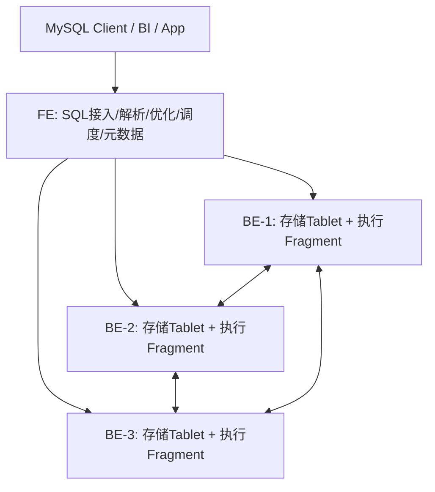
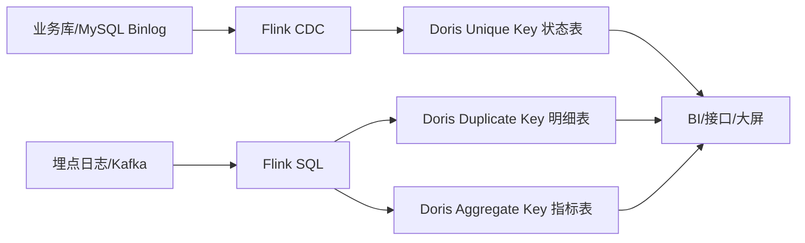

> [!abstract] 摘要
> 一句话记住 Doris：**面向实时分析的 MPP OLAP 数据库——用 MySQL 协议接入、列式存储 + 向量化执行 + 分布式并行查询，支撑明细查询、聚合分析、实时数仓和湖仓联邦分析。**

如果你刚开始学 Doris，可以先把它理解成一个“专门用来查分析结果的高速数据库”：数据可以从 Kafka、Flink、Spark、MySQL CDC、对象存储或湖表进入 Doris，业务侧再通过 SQL、BI 工具或接口查询。它不是用来替代 MySQL 做高频事务写入的 OLTP 数据库，而是用来解决“海量数据如何秒级/亚秒级分析”的问题。

本文建议按这条线阅读：先理解 Doris 的定位和架构，再理解表模型、分区分桶、导入方式、查询优化，最后再看物化视图、索引、湖仓、多表 Join 和面试问题。这样学到的不是零散命令，而是一套实时 OLAP 系统如何建模、写入、查询和优化的完整逻辑。

> [!info] 版本说明
> 本文按 Apache Doris 4.x 文档体系整理。官网 2026-06-30 检索时，下载页显示 Latest 为 4.1.2、Stable 为 4.0.6。面试或工作表达时不必死背小版本，重点讲清 Doris 的架构、表模型、导入和查询优化。

---

## 一、Doris 解决什么问题

Doris 的核心场景是 **实时 OLAP**。OLAP 的特点是读多写少、查询复杂、扫描数据量大，经常要做过滤、分组、聚合、Join、排序和多维分析。典型问题包括：

- 实时看板：订单金额、支付转化率、推广消耗、推广填充率、DAU、留存等指标分钟级更新。
- 明细分析：按用户、商品、渠道、地区、时间等维度下钻查询。
- 即席查询：业务同学临时改筛选条件，不想等离线任务重跑。
- 用户行为分析：点击、曝光、加购、下单链路分析。
- 日志/观测分析：海量日志按关键词、时间、服务、错误码检索。
- 湖仓联邦查询：直接查询 Hive、Iceberg、Hudi、Paimon、JDBC 等外部数据。

可以把 Doris 放在数据链路的服务层或分析层：

```text
业务库 / 日志 / Kafka / CDC / 湖表
        ↓
Flink / Spark / DataX / Routine Load / Stream Load
        ↓
Apache Doris
        ↓
BI 报表 / 实时大屏 / 数据接口 / 即席分析 / 告警平台
```

它和 Hive、Spark、Flink 的关系可以这样理解：

| 组件 | 更擅长什么 | 和 Doris 的关系 |
|---|---|---|
| **Hive** | 离线数仓、低成本存储、大批量离线计算 | Doris 可作为高性能查询服务层，也可通过 Catalog 查湖表 |
| **Spark** | 批处理、复杂 ETL、离线建模 | Spark 处理后把结果写入 Doris 查询 |
| **Flink** | 实时计算、状态计算、流式 ETL | Flink 实时清洗聚合后写入 Doris |
| **ClickHouse** | 高性能列式 OLAP、日志分析 | Doris 更强调 MPP SQL、实时写入、易用和联邦分析一体化 |
| **MySQL** | 事务处理、点查、增删改查 | Doris 兼容 MySQL 协议，但定位不是 OLTP |

> [!tip] 一句话区分 OLTP 和 OLAP
> MySQL 这类 OLTP 关注“单条记录正确地写进去、改出来”；Doris 这类 OLAP 关注“海量数据快速筛选、聚合、分析出来”。

---

## 二、核心概念速查

Doris 的很多概念都围绕一个核心问题：**如何把海量数据按列存好、切分好、复制好，再让多台机器并行扫描和计算**。

| 概念 | 一句话定义 | 面试常问方向 |
|---|---|---|
| **FE** | Frontend，负责 SQL 接入、解析、优化、调度、元数据管理 | Master/Follower/Observer、元数据、高可用 |
| **BE** | Backend，负责数据存储和查询执行 | Tablet、副本、Compaction、执行节点 |
| **CN** | Compute Node，存算分离场景下的计算节点 | 云原生、弹性计算、冷热分离 |
| **MPP** | 大规模并行处理，一条 SQL 拆到多节点并行执行 | 分布式执行、Shuffle、Join |
| **Tablet** | Doris 数据分片的基本单位 | 分区分桶、副本、调度 |
| **Replica** | Tablet 的副本 | 高可用、读写一致性、扩容均衡 |
| **Partition** | 分区，通常按时间或业务范围切数据 | 生命周期管理、分区裁剪 |
| **Bucket** | 分桶，通常按高基数字段 Hash 分散数据 | 并行度、数据倾斜、Join 优化 |
| **Duplicate Key** | 明细模型，保留原始明细，不去重不聚合 | 日志、流水、行为明细 |
| **Unique Key** | 唯一键模型，同 Key 保留最新值 | CDC、订单状态、用户画像 |
| **Aggregate Key** | 聚合模型，按 Key 预聚合指标 | 宽表汇总、指标表 |
| **Materialized View** | 物化视图，预先存储查询结果或聚合结果 | 查询加速、透明改写 |
| **Compaction** | 后台合并小版本/小文件 | 写入后查询性能、版本过多 |
| **Catalog** | 外部数据目录 | 湖仓联邦查询、多源查询 |

可以用一个例子串起来：Kafka 中的用户行为日志通过 Routine Load 或 Flink 写入 Doris，Doris 按日期做 `Partition`，按 `user_id` 或 `device_id` 做 `Bucket`，底层切成多个 `Tablet`，每个 Tablet 有多个 `Replica` 分布在 BE 上。查询时，FE 解析 SQL 并生成执行计划，多个 BE 并行扫描列存数据、过滤、聚合、Join，最后把结果返回给 BI 或接口。

---

## 三、整体架构

Doris 的经典架构可以分成两类角色：**管理入口 FE** 和 **存储执行 BE**。如果使用存算分离架构，还会引入专门的计算节点和远程对象存储。入门阶段先掌握 FE/BE 架构即可。



| 组件 | 主要职责 | 入门理解 |
|---|---|---|
| **FE** | SQL 接入、权限、元数据、查询规划、任务调度、集群管理 | “大脑 + 入口” |
| **BE** | 数据存储、列式扫描、表达式计算、聚合、Join、Compaction | “仓库 + 工人” |
| **Broker** | 早期用于访问外部存储的辅助服务，部分场景仍会遇到 | “外部文件访问助手” |
| **CN** | 存算分离架构下偏计算的节点 | “弹性计算工人” |

### 3.1 查询执行流程

一条查询大致会经历这几步：

1. **客户端提交 SQL**：通过 MySQL 协议连接 Doris。
2. **FE 解析和优化 SQL**：语法解析、语义分析、统计信息估算、生成执行计划。
3. **FE 拆分执行计划**：把一条 SQL 拆成多个 Fragment，分发给不同 BE。
4. **BE 并行执行**：各 BE 扫描本地 Tablet，做过滤、投影、聚合、Join、排序。
5. **结果汇总返回**：中间结果经过 Exchange/Shuffle 汇总，最终返回客户端。

面试里问“Doris 为什么查询快”，不要只说“列式存储快”。更完整的回答是：Doris 通过列式存储减少无关列读取，通过分区分桶减少扫描范围，通过 MPP 并行执行提升吞吐，通过向量化执行提高 CPU 利用率，通过物化视图、索引和统计信息进一步优化查询计划。

### 3.2 高可用逻辑

Doris 的高可用主要体现在两层：

- **FE 高可用**：FE 有 Master、Follower、Observer 等角色，元数据通过多数派机制保证一致性。Master 负责写元数据，Follower 参与选举和元数据复制，Observer 更偏读扩展。
- **BE 数据高可用**：数据被切成 Tablet，每个 Tablet 可以有多个 Replica。某个 BE 故障后，只要副本数满足要求，集群仍可读取和调度恢复。

生产里要注意：副本数不是越高越好。副本数高会增加存储和写入成本；副本数低会降低容错能力。常见生产表会设置 3 副本，测试环境可能设置 1 副本。

---

## 四、表模型：Doris 最容易问的核心

Doris 建表时不是只定义字段，还要选择表模型。表模型决定相同 Key 的数据写入后如何存储和合并，这是 Doris 和普通 MySQL 表很不一样的地方。

### 4.1 Duplicate Key：明细模型

**Duplicate Key 保留所有明细，不去重、不预聚合。** 即使两行 Key 完全相同，也会作为两条记录保存。

适合场景：

- 日志明细：访问日志、错误日志、埋点日志。
- 用户行为明细：曝光、点击、浏览、加购、搜索。
- 交易流水：订单流水、支付流水、退款流水。
- 后续需要灵活按不同维度重新聚合的原始事实表。

```sql
CREATE TABLE user_event_detail (
    event_time DATETIME,
    user_id BIGINT,
    event_type VARCHAR(50),
    product_id BIGINT,
    channel VARCHAR(50),
    amount DECIMAL(18,2)
)
DUPLICATE KEY(event_time, user_id, event_type)
PARTITION BY RANGE(event_time) (
    PARTITION p202606 VALUES [('2026-06-01 00:00:00'), ('2026-07-01 00:00:00'))
)
DISTRIBUTED BY HASH(user_id) BUCKETS 32
PROPERTIES (
    "replication_num" = "3"
);
```

> [!note] Duplicate Key 的 Key 不是唯一约束
> 它更像“排序键”。Key 列用于组织数据、提升查询效率，不表示这几列必须唯一。

### 4.2 Unique Key：唯一键模型

**Unique Key 按 Key 去重，同一个 Key 通常保留最新版本。** 它适合 CDC 和状态更新类数据，比如订单状态从“待支付”更新成“已支付”。

适合场景：

- 订单当前状态表。
- 用户画像宽表。
- 商品库存快照。
- MySQL CDC 同步到 Doris。
- 需要按主键 Upsert 的分析表。

```sql
CREATE TABLE order_current_state (
    order_id BIGINT,
    user_id BIGINT,
    status VARCHAR(20),
    pay_amount DECIMAL(18,2),
    update_time DATETIME
)
UNIQUE KEY(order_id)
DISTRIBUTED BY HASH(order_id) BUCKETS 32
PROPERTIES (
    "replication_num" = "3"
);
```

Unique Key 的核心是“最终看到一条最新记录”。但要注意，它不是 OLTP 里的事务主键，不能把 Doris 当成高频单行更新数据库。Doris 更适合批量写入、批量更新、分析查询。

### 4.3 Aggregate Key：聚合模型

**Aggregate Key 会按 Key 预聚合 Value 列。** 相同 Key 的数据写入后，指标列会按指定聚合函数合并，比如 `SUM`、`MAX`、`MIN`、`REPLACE`。

适合场景：

- 指标汇总表：每天每渠道曝光、点击、消耗。
- 只关心聚合结果，不需要保留全部明细。
- 写入时就能提前聚合，降低查询扫描量。

```sql
CREATE TABLE ad_channel_daily_metric (
    dt DATE,
    channel VARCHAR(50),
    campaign_id BIGINT,
    impressions BIGINT SUM,
    clicks BIGINT SUM,
    cost DECIMAL(18,2) SUM,
    last_update_time DATETIME MAX
)
AGGREGATE KEY(dt, channel, campaign_id)
PARTITION BY RANGE(dt) (
    PARTITION p202606 VALUES [('2026-06-01'), ('2026-07-01'))
)
DISTRIBUTED BY HASH(campaign_id) BUCKETS 16
PROPERTIES (
    "replication_num" = "3"
);
```

### 4.4 三种模型怎么选

| 需求 | 推荐模型 | 原因 |
|---|---|---|
| 保留全部明细，后续灵活分析 | **Duplicate Key** | 不丢原始记录，适合事实明细表 |
| 同一个业务主键只保留最新状态 | **Unique Key** | 支持 Upsert/CDC，适合状态表 |
| 写入时就按维度聚合指标 | **Aggregate Key** | 减少存储和查询计算量 |
| 不确定后续怎么分析 | **Duplicate Key** | 最稳妥，先保留明细 |
| 面向实时订单状态查询 | **Unique Key** | 订单状态会更新 |
| 面向日报/小时报指标 | **Aggregate Key** | 查询时直接扫聚合结果 |

> [!warning] 常见误区
> 不要一上来所有表都建 Unique Key。Unique Key 有更新合并成本；如果业务只是追加明细，Duplicate Key 更简单、更自然。

---

## 五、分区与分桶：性能和稳定性的基础

表模型决定“相同 Key 怎么处理”，分区分桶决定“数据怎么切开、放到哪里”。Doris 查询慢、导入慢、数据倾斜，很多时候不是引擎问题，而是分区分桶设计不合理。

### 5.1 Partition：按范围管理数据

分区通常按时间字段做，比如天、周、月。它解决两个问题：

1. **查询裁剪**：查询最近 7 天时，只扫最近 7 个分区，不扫全表。
2. **生命周期管理**：历史分区可以删除、冷热分层或迁移。

```sql
PARTITION BY RANGE(dt) (
    PARTITION p20260628 VALUES [('2026-06-28'), ('2026-06-29')),
    PARTITION p20260629 VALUES [('2026-06-29'), ('2026-06-30')),
    PARTITION p20260630 VALUES [('2026-06-30'), ('2026-07-01'))
)
```

生产中常见做法：

- 日志/行为表：按天分区。
- 订单/支付表：按订单创建日期或业务日期分区。
- 指标汇总表：按 `dt` 分区。
- 数据量特别大：可以按小时分区，但分区过多会增加元数据压力。

### 5.2 Bucket：按 Hash 分散数据

分桶通常选择高基数、查询常用、分布均匀的字段，例如 `user_id`、`order_id`、`device_id`、`campaign_id`。

```sql
DISTRIBUTED BY HASH(user_id) BUCKETS 32
```

分桶的核心作用：

- 把一个分区内的数据继续切成多个 Tablet。
- 提高并行扫描能力。
- 避免单个 Tablet 过大。
- 如果 Join 两边分桶键一致，可能减少数据 Shuffle。

### 5.3 分区分桶设计原则

| 设计点 | 建议 |
|---|---|
| 分区字段 | 优先选择时间字段，如 `dt`、`event_date`、`create_time` |
| 分区粒度 | 日分区最常见；小时分区适合超大流量；月分区适合低频历史数据 |
| 分桶字段 | 选择高基数、均匀、常用于过滤或 Join 的字段 |
| 分桶数 | 根据单分区数据量、BE 数量、查询并发来定，不要盲目过大 |
| 倾斜风险 | 避免用性别、状态、省份这类低基数字段分桶 |
| Tablet 数量 | 过少并行度不足，过多元数据和调度压力变大 |

> [!tip] 面试表达
> 分区解决“扫不扫这批数据”的问题；分桶解决“这批数据怎么并行扫”的问题。

---

## 六、数据导入：实时链路和离线链路

Doris 支持多种导入方式。学习时不要背一堆名词，而要按场景理解：小批量、实时流、离线文件、外部系统同步分别用什么。

| 导入方式 | 适合场景 | 特点 |
|---|---|---|
| **Stream Load** | 程序或脚本推送小到中等批量数据 | HTTP 接口，简单直接，常用于微批写入 |
| **Routine Load** | Kafka 持续消费 | 内置消费 Kafka，适合实时日志/事件流 |
| **Broker Load** | HDFS/S3 等外部文件批量导入 | 离线大批量文件导入 |
| **Insert Into** | SQL 内部写入或小规模导入 | 简单，但不适合超大规模频繁写 |
| **Flink Connector** | Flink 实时清洗后写入 Doris | 实时数仓常见组合 |
| **Spark Load / Connector** | Spark 离线处理后写入 Doris | 离线批处理结果入库 |
| **CDC 同步** | MySQL/PostgreSQL 等业务库同步 | 常和 Flink CDC + Doris Unique Key 组合 |

### 6.1 Kafka 到 Doris：Routine Load

Routine Load 适合 Doris 直接消费 Kafka。典型链路：埋点日志 → Kafka → Doris 明细表。

```sql
CREATE ROUTINE LOAD example_db.load_user_event ON user_event_detail
COLUMNS(event_time, user_id, event_type, product_id, channel, amount)
PROPERTIES
(
    "desired_concurrent_number" = "3",
    "format" = "json"
)
FROM KAFKA
(
    "kafka_broker_list" = "broker1:9092,broker2:9092",
    "kafka_topic" = "user_event_topic",
    "property.group.id" = "doris_user_event_consumer"
);
```

Routine Load 的优点是链路简单；缺点是复杂清洗能力有限。如果需要复杂字段转换、维表 Join、去重、窗口聚合，通常先用 Flink 处理，再写入 Doris。

### 6.2 Flink 到 Doris：实时数仓常见组合

典型场景：

```text
MySQL Binlog / Kafka 日志
        ↓
Flink CDC / Flink SQL
        ↓
清洗、去重、维表关联、窗口聚合
        ↓
Doris 明细表 / 状态表 / 指标表
        ↓
BI 查询 / 接口查询
```

表模型选择：

- 明细行为日志：Doris Duplicate Key。
- 订单状态同步：Doris Unique Key。
- 实时指标汇总：Doris Aggregate Key 或 Duplicate 明细 + 物化视图。

### 6.3 导入常见问题

| 问题 | 可能原因 | 处理思路 |
|---|---|---|
| 导入慢 | 批次太小、并发不足、BE 压力大、分桶不合理 | 合理批量、提高并发、检查 BE 负载 |
| 数据重复 | 上游重放、Unique Key 未选对、幂等设计不足 | 明确业务主键、用 Unique Key 或导入事务语义 |
| 数据延迟高 | Kafka 堆积、Routine Load 并发不足、Compaction 压力 | 看消费进度、调并发、检查 BE compaction |
| 查询突然变慢 | 刚导入大量小批次，版本过多 | 观察 compaction，减少碎片化写入 |
| 字段错位/解析失败 | JSON/CSV 格式不匹配、类型不兼容 | 建立导入质量监控和错误样本抽查 |

---

## 七、查询优化：从 SQL 到物理设计

Doris 查询优化不是只靠一个参数，而是一个组合：**少扫数据、并行扫数据、提前算数据、避免大 Shuffle、让优化器有统计信息**。

### 7.1 先让查询少扫数据

最有效的优化通常不是调参数，而是减少扫描范围：

- WHERE 条件必须带分区字段，例如 `dt >= '2026-06-01'`。
- 高频过滤列尽量放入排序键或建立合适索引。
- 只查需要的列，避免 `SELECT *`。
- 明细表太大时，用物化视图或汇总表承接固定查询。

### 7.2 排序键和前缀索引

Doris 的 Key 列不仅影响表模型，也会影响数据排序和索引利用。高频过滤字段放在排序键前面，查询更容易裁剪数据。

例如用户行为表常查：

```sql
WHERE event_time >= '2026-06-01'
  AND event_type = 'click'
  AND user_id = 10001
```

那么排序键可以考虑 `event_time, event_type, user_id`，但具体顺序要结合基数、查询模式和分区字段综合判断。

### 7.3 物化视图：把常用计算提前存好

物化视图适合固定聚合模式，比如：

- 每天每渠道的曝光、点击、消耗。
- 每小时每商品的 GMV。
- 按地区、品类、渠道的销售额汇总。

```sql
CREATE MATERIALIZED VIEW mv_channel_daily AS
SELECT
    dt,
    channel,
    SUM(impressions) AS impressions,
    SUM(clicks) AS clicks,
    SUM(cost) AS cost
FROM ad_event_detail
GROUP BY dt, channel;
```

物化视图的价值不是“少写一个 SQL”，而是把查询时的大量扫描和聚合，提前变成可复用的存储结果。对固定看板类查询特别有效。

### 7.4 索引：不是越多越好

Doris 支持多种索引能力，其中倒排索引对文本检索、日志检索、多条件过滤很有价值。

适合倒排索引的场景：

- 日志全文检索：按关键词查错误日志。
- 文本字段过滤：商品标题、评论、异常信息。
- 多维等值过滤：状态、标签、枚举字段组合查询。

但索引会增加写入成本和存储成本。不要所有字段都加索引，要根据查询频率、过滤选择性和写入压力选择。

### 7.5 Join 优化

多表 Join 是 OLAP 查询里最容易慢的部分。常见优化方向：

- 小表维表 Join：使用 Broadcast Join，让小表广播到各执行节点。
- 大表 Join：尽量让 Join Key 分布均匀，避免 Shuffle 倾斜。
- 事实表和维表：维表可提前打宽，减少查询时 Join。
- 高频 Join：考虑物化视图或预聚合宽表。
- SQL 层：过滤条件尽量下推到 Join 前，减少参与 Join 的数据量。

> [!warning] 不要迷信“全都现场 Join”
> Doris 能做 Join，不代表所有指标都应该查询时 Join。高频看板、核心指标、复杂多表关联，很多时候应该在建模阶段提前打宽或预聚合。

---

## 八、Doris 在实时数仓里的位置

Doris 常见落点是 ADS/服务层，也可以承接部分 DWD/DWS 明细和汇总查询。一个比较典型的实时数仓链路：



以“华为应用市场推广填充率”这类业务指标为例，可以这样设计：

### 8.1 明细层

保留每次广告请求、返回、曝光、点击的明细事件：

- 表模型：Duplicate Key。
- 分区：按事件日期 `dt`。
- 分桶：按 `app_id`、`ad_slot_id` 或 `request_id`，看查询主路径。
- 用途：排查某个应用、广告位、渠道的请求链路。

### 8.2 状态层

如果有推广计划、广告位、素材、预算状态等维表或状态表：

- 表模型：Unique Key。
- Key：计划 ID、广告位 ID、素材 ID。
- 来源：MySQL CDC 或接口同步。
- 用途：和明细事件关联，补充业务维度。

### 8.3 指标层

按天/小时、应用、广告位、渠道聚合：

- 请求数。
- 返回数。
- 曝光数。
- 点击数。
- 填充率 = 返回数 / 请求数。
- 点击率 = 点击数 / 曝光数。

可以用 Aggregate Key 表，也可以保留明细表后建立物化视图。面试中要说明选择原因：如果指标口径稳定、查询频繁，预聚合更合适；如果分析维度变化大，先保留明细更稳。

---

## 九、Doris vs ClickHouse：常见横向对比

这类问题面试里很常见，不要简单说“谁更快”。更好的回答是比较定位、架构和使用体验。

| 维度 | Doris | ClickHouse |
|---|---|---|
| 架构 | MPP 分布式 SQL，FE/BE 管理相对一体 | 强列式引擎，集群能力依赖表引擎和分布式表设计 |
| 接入 | MySQL 协议，BI 接入门槛低 | 原生协议/HTTP/MySQL 兼容能力，生态也成熟 |
| 实时写入 | 支持多种 Load、Unique Key、Routine Load、Flink Connector | 写入性能强，但更新/去重模型需要结合 MergeTree 系列表引擎理解 |
| SQL/Join | 分布式 Join 和优化器能力是重点 | 单表分析极强，复杂 Join 场景需要设计 |
| 湖仓 | Catalog 联邦查询能力较突出 | 也支持外部表/对象存储，但路径和生态不同 |
| 使用感 | 更偏“一套实时数仓/服务层” | 更偏“极致列式分析引擎” |

简化表达：如果场景是日志明细、宽表聚合、极致列式扫描，ClickHouse 很强；如果团队希望 MySQL 协议接入、实时写入、物化视图、联邦查询、复杂 SQL 和数仓服务层一体化，Doris 往往更容易落地。实际选型还要看团队经验、数据规模、写入模型、运维能力和查询类型。

---

## 十、生产问题与排查思路

### 10.1 查询慢怎么排查

优先按这条链路排查：

1. SQL 是否带了分区过滤？是否 `SELECT *`？
2. 是否扫描了过多分区或过多 Tablet？
3. WHERE 条件有没有命中排序键、索引或物化视图？
4. Join 是否发生大表 Shuffle？是否有数据倾斜？
5. 统计信息是否过期，优化器是否估算错误？
6. BE CPU、内存、磁盘 IO、网络是否到瓶颈？
7. 最近是否有大量导入导致 Compaction 压力变大？

### 10.2 写入慢怎么排查

1. 单批数据是否太小，造成版本过多？
2. 并发是否过低或过高？
3. 分桶是否导致某些 BE 热点？
4. Unique Key 更新是否太频繁？
5. BE Compaction 是否积压？
6. Kafka/Routine Load 是否消费堆积？
7. 上游 Flink 是否反压？

### 10.3 数据倾斜怎么处理

倾斜通常来自分桶字段或 Join Key 不均匀。处理方式：

- 重新选择更均匀的分桶字段。
- 增加分桶数，但不要盲目过大。
- 热点 Key 单独拆分或加盐打散。
- 大小表 Join 用 Broadcast。
- 在 Flink/Spark 入 Doris 前先做预聚合或热点拆解。

### 10.4 Compaction 是什么

Doris 写入后会形成多个数据版本，后台需要通过 Compaction 把小版本合并，减少查询时要读取的版本数量。可以把它理解为“后台整理数据文件”。

Compaction 积压的表现：

- 刚导入后查询变慢。
- 写入版本过多。
- BE 磁盘 IO 持续较高。
- 查询需要合并太多 rowset/version。

处理思路：减少过小批次写入、控制导入并发、观察 BE 负载、给后台合并留出资源。

---

## 十一、面试高频问答

### Q1：Doris 是什么？适合什么场景？

Doris 是基于 MPP 架构的实时分析型数据库，主要用于 OLAP 查询、实时数仓、报表分析、即席查询、日志分析和湖仓联邦查询。它通过列式存储、向量化执行、分区分桶、物化视图、索引和分布式并行执行，实现海量数据上的低延迟分析。它不适合替代 MySQL 做高频事务更新，更适合作为分析服务层。

### Q2：Doris 的 FE 和 BE 分别做什么？

FE 负责 SQL 接入、解析、优化、元数据管理、查询调度和集群管理；BE 负责实际数据存储、列式扫描、表达式计算、聚合、Join 和 Compaction。可以简单理解为 FE 是大脑和入口，BE 是仓库和执行工人。

### Q3：Doris 为什么查询快？

可以从五层回答：

1. 列式存储，只读查询需要的列。
2. 分区分桶，减少扫描范围并提升并行度。
3. MPP 执行，多节点并行扫描和计算。
4. 向量化执行，提高 CPU 批量处理效率。
5. 物化视图、索引、统计信息和优化器，减少重复计算和无效扫描。

### Q4：Duplicate Key、Unique Key、Aggregate Key 怎么选？

Duplicate Key 保留明细，适合日志、流水、用户行为；Unique Key 按业务主键保留最新状态，适合 CDC、订单状态、用户画像；Aggregate Key 写入时预聚合指标，适合日报、小时报、固定维度汇总。选择时先问：我要保留明细、保留最新状态，还是提前聚合指标？

### Q5：分区和分桶有什么区别？

分区是按范围把数据切成大块，常按时间切，主要用于分区裁剪和生命周期管理；分桶是在分区内部继续按 Hash 切成 Tablet，主要用于并行查询、负载均衡和减少倾斜。分区解决扫不扫，分桶解决怎么并行扫。

### Q6：Doris 如何接入 Kafka 实时数据？

简单链路可以用 Routine Load 直接消费 Kafka；复杂链路可以用 Flink 消费 Kafka，完成清洗、去重、维表 Join、窗口聚合后，通过 Doris Connector 写入 Doris。表模型上，明细日志多用 Duplicate Key，状态更新多用 Unique Key，指标汇总多用 Aggregate Key 或物化视图。

### Q7：Doris 和 ClickHouse 怎么选？

不能只比较单条 benchmark。ClickHouse 在列式扫描、日志分析和单表聚合上很强；Doris 更强调 MySQL 协议接入、MPP SQL、实时写入、物化视图、联邦查询和实时数仓服务层一体化。选型要看数据模型、更新需求、Join 复杂度、团队运维经验、BI 接入和湖仓需求。

### Q8：Doris 查询慢怎么办？

先看 SQL 是否带分区过滤、是否扫了过多列和分区；再看排序键、索引、物化视图是否命中；然后看 Join 是否 Shuffle 太大或数据倾斜；最后看 BE 的 CPU、内存、IO、网络和 Compaction 状态。不要一上来就调参数，先确认是不是模型和 SQL 问题。

### Q9：Doris 适合直接做明细大宽表吗？

适合，但要看查询模式。如果业务经常按多个维度灵活分析，明细大宽表能减少 Join、提升查询体验；但宽表字段过多、更新频繁、口径变化大时，维护成本会上升。常见做法是保留明细事实表，同时对高频指标做物化视图或汇总表。

### Q10：Doris 4.x 有什么值得关注的方向？

4.x 继续强化实时分析、湖仓、全文检索和 AI 场景。官方 4.0 发布说明重点提到向量检索、AI Functions、全文检索能力增强。面试里可以把它作为加分项：Doris 不只是传统 BI 查询引擎，也在向日志检索、混合搜索、AI 数据分析和湖仓一体方向扩展。

---

## 十二、学习小结

> [!abstract] 面试必背清单
>
> **定位层**
> - Doris = 实时 OLAP / MPP 分析数据库，不是 OLTP 数据库。
> - 适合实时数仓、BI、即席查询、日志分析、湖仓联邦查询。
>
> **架构层**
> - FE：SQL 接入、元数据、优化、调度。
> - BE：存储、扫描、计算、Compaction。
> - Tablet + Replica：分片和副本是数据高可用与并行计算基础。
>
> **建模层**
> - Duplicate Key：明细追加。
> - Unique Key：主键更新/CDC/状态表。
> - Aggregate Key：预聚合指标表。
> - 分区按时间，分桶按高基数均匀字段。
>
> **查询层**
> - 快的核心：列存 + 分区分桶 + MPP + 向量化 + 物化视图/索引/优化器。
> - 查询慢先看扫描范围、排序键、Join、倾斜、统计信息、Compaction。
>
> **链路层**
> - Kafka 简单实时写入：Routine Load。
> - 复杂实时 ETL：Flink + Doris Connector。
> - CDC 状态更新：Flink CDC + Unique Key。
> - 固定报表指标：明细表 + 物化视图，或 Aggregate Key 汇总表。

---

## 十三、下一步学习路径

如果要继续深入 Doris，建议按这个顺序学：

1. **建表设计**：三种表模型、排序键、分区、分桶。
2. **导入链路**：Stream Load、Routine Load、Flink Connector、CDC。
3. **查询优化**：Explain、Profile、统计信息、Join 策略、物化视图。
4. **索引体系**：前缀索引、倒排索引、Bloom Filter、全文检索。
5. **运维治理**：扩容缩容、副本修复、Compaction、冷热数据、权限。
6. **湖仓能力**：Catalog、Hive/Iceberg/Hudi/Paimon 查询。
7. **和 ClickHouse 对比**：结合具体业务场景做选型，而不是背结论。

---

## 参考资料

- Apache Doris Overview：https://doris.apache.org/docs/4.x/getting-started/what-is-apache-doris/
- Apache Doris Download：https://doris.apache.org/download/
- Duplicate Key Model：https://doris.apache.org/docs/4.x/table-design/data-model/duplicate/
- Unique Key Model：https://doris.apache.org/docs/4.x/table-design/data-model/unique/
- Aggregate Key Model：https://doris.apache.org/docs/4.x/table-design/data-model/aggregate/
- Inverted Index：https://doris.apache.org/docs/4.x/table-design/index/inverted-index/overview/
- Apache Doris 4.0.0 Release：https://doris.apache.org/releases/v4.0/release-4.0.0/
