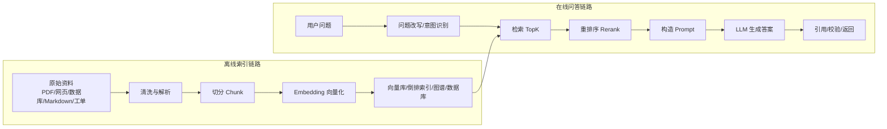

---
tags:
  - 数据工程
  - 大模型
  - RAG
  - 面试
  - AI应用
created: 2026-06-29
updated: 2026-06-29
source_note: "[[数据埋点-数据研发面试]]"
---

# RAG 指南：从原理、工程应用到面试与前沿

> **一句话总结**：RAG（Retrieval-Augmented Generation，检索增强生成）是一种把“外部知识检索”和“大模型生成”结合起来的方法：先从知识库、数据库、文档、网页或业务系统中找出与问题相关的内容，再让大模型基于这些内容生成答案，从而缓解大模型知识过期、幻觉、无法访问私有数据、答案不可追溯等问题。

## 一、为什么要学 RAG

大模型本身很强，但它有几个天然限制：

| 问题 | 说明 | RAG 如何缓解 |
| --- | --- | --- |
| 知识过期 | 模型训练完成后，参数里的知识不会自动更新 | 从外部知识库实时检索最新内容 |
| 私有知识缺失 | 公司制度、内部文档、客服知识库、业务数据不在模型训练集中 | 把私有知识接入检索系统 |
| 幻觉 | 模型可能编造看似合理但不存在的事实 | 要求回答基于检索证据，并返回引用来源 |
| 可追溯性差 | 只看模型输出，难判断答案依据来自哪里 | 返回 chunk、文档、链接、SQL 结果等证据 |
| 更新成本高 | 重新训练或微调模型成本高、周期长 | 更新知识库和索引即可 |

RAG 的核心价值不是“让模型变聪明一点”，而是：

```text
把大模型从“凭记忆回答”，变成“带资料回答”。
```

在企业落地中，RAG 常用于：

```text
知识库问答、智能客服、合同/制度查询、研发文档助手、数据分析助手、BI 助手、代码问答、搜索增强、报告生成、投研/法务/医疗辅助检索等。
```

---

## 二、RAG 的整体框架

一个完整 RAG 系统通常分成两条链路：

1. **离线索引链路**：把知识整理好，方便后续检索。
2. **在线问答链路**：用户提问后，检索相关内容，再生成答案。



可以把 RAG 理解成一个“开卷考试系统”：

```text
用户提问 = 考题
知识库 = 教材和资料
检索器 = 翻书找相关段落的人
大模型 = 组织语言作答的人
引用来源 = 答案依据
评估系统 = 判卷和质检
```

---

## 三、核心概念

### 1. Retrieval：检索

检索就是从知识库中找出和用户问题最相关的资料。

常见检索方式：

| 检索方式 | 原理 | 优点 | 缺点 | 适合场景 |
| --- | --- | --- | --- | --- |
| 关键词检索 / BM25 | 根据词频、逆文档频率等匹配关键词 | 精准、可解释、对编号/专有名词友好 | 语义理解弱 | 文档搜索、日志、法规条款、商品名 |
| 向量检索 / Dense Retrieval | 把问题和文本转成向量，按语义相似度查找 | 能理解语义相近表达 | 对数字、缩写、专名有时不稳 | 知识库问答、语义搜索 |
| 混合检索 / Hybrid Search | 关键词 + 向量共同召回 | 兼顾精确匹配和语义匹配 | 系统复杂度更高 | 企业知识库、客服、技术文档 |
| 图检索 / Graph Retrieval | 基于实体、关系、社区结构检索 | 适合多跳关系和全局总结 | 构图成本较高 | 组织知识、供应链、项目关系、投研 |
| SQL / 结构化检索 | 把问题转成 SQL 或 API 查询 | 对结构化事实准确 | 需要 schema 理解和权限控制 | BI 助手、指标查询、经营分析 |

面试里要特别注意：

```text
RAG 不等于向量数据库。
向量数据库只是 RAG 里的一种检索存储组件。
```

一个 RAG 系统可以用向量库，也可以用 Elasticsearch、传统数据库、知识图谱、API、搜索引擎，甚至几种组合起来。

### 2. Chunk：文本切片

大模型不能无限读取所有文档，所以要把长文档切成小片段，称为 chunk。

例如一份 100 页的制度文档，不能每次都全部塞给模型，而是切成：

```text
制度标题
章节标题
具体条款
附录说明
```

chunk 设计会直接影响召回质量：

| 设计项 | 影响 |
| --- | --- |
| chunk 太小 | 上下文不完整，模型看到一句话但不知道前因后果 |
| chunk 太大 | 检索不精准，塞进模型的无关内容多，成本高 |
| 没有 overlap | 跨段落信息可能断开 |
| overlap 太大 | 索引冗余、召回重复、成本上升 |
| 不保留标题层级 | 检索出来的片段缺少语义背景 |

常见经验：

```text
技术文档：按标题层级切分，保留代码块和表格上下文
制度文档：按章节/条款切分，保留条款编号
客服 FAQ：一问一答或问题组为单位切分
数据指标文档：按指标定义、口径、计算逻辑、数据来源切分
代码库：按函数、类、文件说明、README 结构切分
```

### 3. Embedding：向量化

Embedding 是把文本变成一组数字向量，让机器可以计算语义相似度。

例如：

```text
“RAG 如何减少幻觉？”
“检索增强生成为什么更可信？”
```

这两句话关键词不完全一样，但语义相近。Embedding 可以把它们映射到向量空间中较近的位置。

常见相似度计算：

```text
余弦相似度 Cosine Similarity
点积 Dot Product
欧氏距离 Euclidean Distance
```

面试表达：

> Embedding 的作用是把文本语义转成向量表示，使系统可以通过向量相似度完成语义召回。它解决的是“用户问法和文档写法不完全一致”的问题。

### 4. Vector Database：向量数据库

向量数据库用于存储向量并进行近似最近邻检索（ANN）。

常见能力：

```text
向量写入
相似度搜索
元数据过滤
分区/租户隔离
增量更新
删除和重建索引
TopK 查询
```

工程上不要只看“能不能存向量”，还要看：

| 维度 | 关注点 |
| --- | --- |
| 性能 | QPS、延迟、索引构建速度 |
| 准确性 | 召回率、近似搜索损失 |
| 更新 | 是否支持增量更新、删除、重建 |
| 权限 | 是否支持租户、用户、部门级过滤 |
| 成本 | 存储、内存、CPU/GPU、运维成本 |
| 生态 | SDK、监控、备份、高可用 |

### 5. Rerank：重排序

初次检索通常追求“召回”，会拿回一批候选文档；Rerank 负责把候选文档按与问题的真实相关性重新排序。

典型流程：

```text
向量/关键词检索召回 Top50
 -> Reranker 重新排序
 -> 取 Top5/Top10 放入 Prompt
```

为什么需要 Rerank？

```text
第一阶段检索通常快，但不够精细；
第二阶段重排序更慢，但更准确。
```

在企业知识库中，Rerank 常常是提升答案质量的关键步骤。

### 6. Prompt Augmentation：上下文增强

检索到资料后，需要把资料、问题、回答要求一起组织成 Prompt。

一个基础模板：

```text
你是公司知识库助手。
请只根据下面的资料回答用户问题。
如果资料不足，请说“当前资料不足，无法确定”。
回答时给出引用来源。

【资料】
{retrieved_context}

【用户问题】
{question}
```

Prompt 设计的关键不是越长越好，而是：

```text
资料要相关、边界要清楚、指令要稳定、引用要可追溯、缺资料时允许拒答。
```

---

## 四、RAG 的工作原理

### 1. 离线阶段：知识入库

离线阶段可以理解成“把资料变成可检索资产”。

#### 第一步：资料接入

常见数据源：

```text
PDF、Word、Markdown、网页、Confluence、飞书文档、企业微信文档、客服工单、数据库表、指标平台、代码仓库、日志、FAQ、产品手册
```

注意点：

```text
资料来源是否合法
是否包含敏感信息
是否需要权限隔离
是否有版本号和更新时间
是否能追踪到原始文档
```

#### 第二步：清洗与解析

原始资料通常不干净，例如：

```text
PDF 页眉页脚重复
表格被解析错位
HTML 导航栏混入正文
扫描件需要 OCR
代码块被拆乱
图片中的文字丢失
```

如果解析质量差，后面的检索和生成都会差。这就是 RAG 中常说的：

```text
Garbage in, garbage out.
```

#### 第三步：切片

切片时要尽量保留语义结构：

```text
标题 -> 小标题 -> 正文 -> 表格 -> 来源 -> 更新时间
```

推荐给每个 chunk 保存元数据：

| 字段 | 说明 |
| --- | --- |
| doc_id | 文档 ID |
| chunk_id | 片段 ID |
| title | 文档标题 |
| section | 所属章节 |
| source_url | 原文链接 |
| updated_at | 更新时间 |
| owner | 文档负责人 |
| permission_scope | 权限范围 |
| version | 文档版本 |

#### 第四步：向量化与索引

将 chunk 文本通过 embedding 模型转成向量，再写入索引。

```text
chunk_text -> embedding_model -> vector -> vector_index
```

同时可以建立：

```text
向量索引：用于语义召回
倒排索引：用于关键词召回
元数据索引：用于权限、时间、文档类型过滤
图索引：用于实体关系和多跳问题
```

### 2. 在线阶段：问题到答案

#### 第一步：问题理解

用户问题可能很短、很模糊：

```text
“这个怎么报销？”
“推广填充率怎么算？”
“为什么数据对不上？”
```

系统可以先做：

```text
意图识别
问题改写
补全上下文
拆分多跳问题
识别时间范围
识别权限和业务域
```

例如：

```text
原问题：推广填充率怎么算？
改写后：在华为应用市场推广业务中，推广填充率的指标定义、计算公式、分子分母口径是什么？
```

#### 第二步：召回

召回阶段目标是“别漏掉相关资料”。

常见策略：

```text
向量召回 TopK
关键词召回 TopK
标题/标签召回
元数据过滤
多路召回融合
```

多路召回示例：

```text
问题：下载转化率下降可能是什么原因？

召回来源：
1. 指标口径文档
2. 埋点事件说明
3. 最近版本发布记录
4. 数据质量告警记录
5. 历史故障复盘
```

#### 第三步：重排序与过滤

召回后要做筛选：

```text
相关性排序
去重
时间过滤
权限过滤
低质量 chunk 丢弃
过期文档降权
冲突文档标记
```

#### 第四步：构造上下文

上下文要控制在模型窗口内。常见优化：

```text
只放 TopN 关键 chunk
压缩长文档
保留标题和来源
同一文档合并相邻 chunk
对多跳问题按子问题组织证据
```

#### 第五步：生成与引用

生成时要求模型：

```text
基于资料回答
不确定时说明资料不足
给出来源引用
区分事实、推断和建议
不要编造不存在的制度、数字、链接
```

---

## 五、RAG 和其他方案的区别

### 1. RAG vs Prompt Engineering

| 对比 | Prompt Engineering | RAG |
| --- | --- | --- |
| 核心 | 写好提示词 | 检索外部知识再生成 |
| 解决问题 | 控制输出格式、角色、风格、推理步骤 | 补充事实、私有知识、最新知识 |
| 是否需要知识库 | 不一定 | 通常需要 |
| 更新知识 | 改 Prompt 很有限 | 更新知识库即可 |

Prompt Engineering 像“告诉学生怎么答题”，RAG 像“给学生发参考资料再答题”。

### 2. RAG vs Fine-tuning

| 对比 | RAG | Fine-tuning |
| --- | --- | --- |
| 主要作用 | 注入外部事实知识 | 改变模型行为、风格、任务能力 |
| 知识更新 | 快，更新索引即可 | 慢，需要重新训练或继续训练 |
| 可追溯性 | 强，可返回引用 | 弱，知识在参数中不易追踪 |
| 成本 | 主要是检索、存储、推理成本 | 训练成本较高 |
| 适合 | 企业知识问答、制度查询、最新信息 | 固定格式输出、分类、风格、专业任务适配 |

面试回答：

> 如果问题是“模型不知道某些外部事实”，优先考虑 RAG；如果问题是“模型会但输出风格、格式、任务习惯不符合要求”，可以考虑微调。很多生产系统会把两者结合起来。

### 3. RAG vs 长上下文模型

长上下文模型可以直接塞入大量资料，但不等于替代 RAG。

| 对比 | 长上下文 | RAG |
| --- | --- | --- |
| 优点 | 简化检索，适合一次性读大文档 | 成本可控、可更新、可权限过滤 |
| 缺点 | 成本高、延迟高、长上下文注意力不一定稳定 | 需要建设检索链路 |
| 适合 | 临时分析一批资料、长文档总结 | 企业长期知识库、客服、检索问答 |

更现实的趋势是：

```text
长上下文 + RAG 结合：
先用 RAG 找到最相关资料，再利用更长上下文放入更多证据。
```

---

## 六、RAG 的典型应用场景

### 1. 企业知识库问答

场景：员工问制度、流程、产品说明、技术文档。

示例：

```text
问：试用期员工可以申请年假吗？
系统检索：人事制度、假期管理办法、试用期条款
回答：根据制度第 X 条……如果资料不足则提示咨询 HR。
```

关键点：

```text
权限隔离
文档版本
引用来源
过期制度下线
冲突答案处理
```

### 2. 智能客服

场景：用户问退货、物流、质保、账号、计费问题。

RAG 价值：

```text
统一客服口径
减少人工查询知识库时间
新政策上线后快速生效
对话中引用具体规则
```

风险：

```text
不能乱承诺赔偿
不能编造政策
不能泄露用户隐私
高风险问题要转人工
```

### 3. 数据分析 / BI 助手

场景：业务问指标定义、数据口径、异常原因。

示例：

```text
问：为什么昨天推广流水下降？
RAG 检索：指标口径、埋点说明、任务调度记录、数据质量告警、活动日历
必要时调用 SQL：按渠道、版本、广告位拆解指标
回答：下降主要来自某渠道填充率下降，并附口径和数据来源。
```

这类场景常常不是纯文本 RAG，而是：

```text
文档 RAG + SQL 查询 + 指标平台 API + 数据质量告警
```

### 4. 研发文档和代码助手

场景：问项目架构、接口、错误码、代码逻辑。

关键点：

```text
代码按函数/类/文件切分
README、接口文档、注释一起索引
支持版本分支
回答要引用文件路径和行号
敏感仓库权限隔离
```

### 5. 法务、医疗、金融等高要求场景

这些场景不能把 RAG 当成“自动决策系统”，更适合作为辅助检索和初稿生成。

关键要求：

```text
来源权威
引用精确
保留证据
人工审核
风险提示
审计日志
拒答机制
```

### 6. 内容生产与研究助手

场景：基于多篇资料生成报告、竞品分析、投研摘要。

常见能力：

```text
多文档总结
跨文档对比
引用来源
按主题聚类
生成大纲和观点
```

---

## 七、一个数据研发视角的完整案例

### 场景：建设“数据研发知识助手”

目标：让数据研发、数据分析和业务同学可以询问：

```text
指标口径是什么？
某个埋点事件字段含义是什么？
某张表属于 ODS/DWD/DWS/ADS 哪一层？
数据质量异常怎么排查？
Flink 作业 checkpoint 失败怎么处理？
```

### 1. 数据源设计

| 数据源 | 内容 |
| --- | --- |
| 指标文档 | 指标定义、计算公式、维度、口径 |
| 埋点文档 | 事件名、字段、触发时机、上报链路 |
| 数仓模型文档 | 表名、层级、主键、分区、血缘 |
| 调度系统 | 任务依赖、执行状态、失败日志 |
| 数据质量平台 | 完整性、唯一性、及时性、波动告警 |
| 故障复盘 | 历史问题、根因、处理方案 |
| 代码仓库 | ETL SQL、Flink/Spark 任务代码 |

### 2. 索引设计

对指标文档，不应该随便按固定长度切分，而要按语义结构切：

```text
指标名称
业务定义
计算公式
分子口径
分母口径
统计周期
维度
数据来源
负责人
更新时间
```

对埋点文档，可以按事件切分：

```text
event_name: promotion_click
触发时机：用户点击推广应用
关键字段：user_id, app_id, position_id, material_id, event_time
上游：客户端 SDK
下游：ODS 埋点日志、DWD 用户行为明细
质量要求：能到、没漏、没重、字段对、口径清、链路通
```

### 3. 问答链路

用户问：

```text
为什么推广填充率和推广曝光量都下降了？
```

系统处理：

```text
1. 识别业务域：华为应用市场推广业务
2. 检索指标口径：推广请求量、推广填充率、曝光量
3. 检索埋点链路：promotion_request、promotion_fill、promotion_exposure
4. 检索数据质量：最近是否有日志延迟、字段为空、任务失败
5. 检索发布记录：是否有策略、版本、广告位调整
6. 必要时生成 SQL 查询各渠道、版本、广告位的分布
7. 生成解释：区分业务下降、策略变化、埋点异常、数据链路异常
```

### 4. 高质量回答应该长什么样

```text
根据当前检索到的指标口径和数据链路，推广曝光量下降可能来自两类原因：

1. 业务侧真实下降：推广请求量减少，或填充率下降，导致可曝光库存减少。
2. 数据链路异常：promotion_request / promotion_fill / promotion_exposure 某个事件上报异常，或 ODS 到 DWD 清洗任务延迟。

建议按以下顺序排查：
- 先看推广请求量是否下降；
- 再看填充率 = 填充成功量 / 推广请求量 是否下降；
- 再看 exposure 事件是否与 fill 事件的比例异常；
- 最后检查客户端版本、渠道、广告位、调度任务和质量告警。

引用来源：
- 指标文档：推广填充率定义
- 埋点文档：promotion_fill / promotion_exposure 事件说明
- 数据质量告警：2026-xx-xx ODS 日志延迟记录
```

这就是 RAG 在数据研发中的价值：

```text
把散落在指标文档、埋点文档、数仓模型、调度日志、质量平台里的知识串起来，帮助人更快定位问题。
```

---

## 八、RAG 的工程落地步骤

### 1. 先明确业务目标

不要上来就问“用哪个向量库”。先问：

```text
用户是谁？
他们问什么问题？
答案必须多准确？
是否需要引用？
是否涉及权限？
数据更新频率多高？
错误答案的成本有多大？
```

### 2. 建立知识库治理

RAG 的上限很大程度取决于知识质量。

需要治理：

| 治理项 | 说明 |
| --- | --- |
| 文档权威性 | 哪些文档能作为回答依据 |
| 文档新鲜度 | 过期文档如何下线或降权 |
| 文档结构 | 标题、章节、表格、代码块是否可解析 |
| 元数据 | 来源、负责人、更新时间、权限 |
| 冲突处理 | 不同文档说法不一致时怎么办 |
| 敏感信息 | 个人信息、商业机密、密钥是否过滤 |

### 3. 设计检索策略

推荐从简单到复杂：

```text
第一阶段：文档清洗 + chunk + embedding + TopK
第二阶段：加入 BM25 / 关键词召回
第三阶段：加入 Rerank
第四阶段：加入查询改写、多路召回、上下文压缩
第五阶段：加入权限、评估、监控、反馈闭环
第六阶段：针对复杂问题引入 Agentic RAG / GraphRAG / SQL 工具调用
```

### 4. 做评估集

RAG 不能只靠主观体验。要构造一批真实问题：

```text
高频问题
边界问题
多跳问题
无答案问题
权限相关问题
过期文档问题
容易幻觉的问题
```

每条评估样本至少包含：

```text
question：用户问题
expected_answer：期望答案
gold_context：应该命中的资料
answer_policy：能答 / 不能答 / 需转人工
source：来源文档
```

### 5. 上线监控

需要监控：

| 指标 | 说明 |
| --- | --- |
| 召回命中率 | 正确资料是否被检索到 |
| 答案正确率 | 最终回答是否正确 |
| Faithfulness | 答案是否被上下文支持 |
| 引用准确率 | 引用来源是否真的支持答案 |
| 拒答率 | 资料不足时是否能拒答 |
| 幻觉率 | 是否编造不存在内容 |
| 延迟 | 检索、重排序、生成耗时 |
| 成本 | embedding、存储、LLM token 消耗 |
| 用户反馈 | 点赞、点踩、追问、转人工 |

---

## 九、RAG 常见问题与优化方法

### 1. 检索不到正确资料

可能原因：

```text
文档没有入库
chunk 切分不合理
embedding 模型不适合业务语料
用户问题太短或口语化
专有名词、缩写、编号没有处理好
只用了向量检索，没有关键词召回
权限过滤误杀
```

优化：

```text
补充文档和元数据
调整 chunk 粒度
加入标题、摘要、关键词
使用 Hybrid Search
加入 query rewrite
加入业务词典和同义词
使用 Rerank
建立评估集持续回归
```

### 2. 检索到了资料，但回答仍然错

可能原因：

```text
上下文太长，模型忽略关键证据
Prompt 没有限制模型必须基于资料回答
多个资料相互冲突
资料本身过期
模型把推断当事实
没有引用校验
```

优化：

```text
上下文压缩
冲突检测
强制引用
答案后校验
无证据拒答
优先使用权威来源和最新版本
```

### 3. 答案太泛

可能原因：

```text
检索结果过泛
问题没有补全业务上下文
Prompt 没要求给步骤、公式、案例
知识库缺少结构化信息
```

优化：

```text
问题改写
按业务域过滤
使用结构化模板
让答案包含定义、公式、口径、案例、排查步骤
```

### 4. 成本和延迟太高

可能原因：

```text
TopK 太大
Rerank 候选过多
Prompt 塞入太多上下文
每次都实时生成 embedding
没有缓存
模型规格过高
```

优化：

```text
降低 TopK
分层召回
缓存常见问题
压缩上下文
小模型做分类/改写，大模型做最终生成
异步更新索引
对简单问题走 FAQ 或模板
```

### 5. 权限和安全风险

RAG 的安全风险非常现实：

```text
用户通过提问越权查看文档
文档中包含密钥、隐私、商业机密
检索结果被 Prompt Injection 污染
知识库被恶意投毒
模型输出未授权建议或承诺
```

应对方法：

```text
检索前权限过滤，而不是生成后再过滤
入库前敏感信息扫描
文档来源白名单
Prompt Injection 检测
引用来源审计
高风险问题转人工
保留查询和回答日志
```

---

## 十、RAG 的评估体系

RAG 要分层评估，不能只看最终答案。

### 1. 检索层评估

| 指标 | 含义 |
| --- | --- |
| Recall@K | 正确资料是否出现在 TopK 中 |
| Precision@K | TopK 中有多少是真相关 |
| MRR | 第一个正确结果排得有多靠前 |
| nDCG | 相关文档排序质量 |
| Hit Rate | 是否命中至少一个正确资料 |

### 2. 生成层评估

| 指标 | 含义 |
| --- | --- |
| Faithfulness | 答案是否被检索上下文支持 |
| Answer Relevancy | 答案是否回答了问题 |
| Correctness | 答案事实是否正确 |
| Completeness | 是否覆盖关键点 |
| Citation Accuracy | 引用是否真正支持对应结论 |

### 3. 系统层评估

| 指标 | 含义 |
| --- | --- |
| Latency | 端到端响应时间 |
| Cost | 单次请求 token、检索、存储成本 |
| Stability | 多次回答是否稳定 |
| Safety | 是否越权、泄密、被注入攻击 |
| User Satisfaction | 用户反馈和业务转化 |

### 4. 一个实用评估模板

```text
问题：推广填充率怎么算？
期望资料：指标体系文档中“推广填充率”章节
期望答案：推广填充率 = 推广填充成功量 / 推广请求量，并说明分子分母口径
检索评分：是否命中正确章节，是否排在 Top3
生成评分：公式是否正确，是否解释口径，是否引用来源，是否没有编造
安全评分：是否只返回用户有权限访问的资料
```

---

## 十一、RAG 面试高频问题

### 1. 什么是 RAG？

推荐回答：

> RAG 是 Retrieval-Augmented Generation，检索增强生成。它的思路是先根据用户问题从外部知识库中检索相关资料，再把这些资料和问题一起交给大模型生成答案。它主要解决大模型知识过期、私有知识缺失、幻觉和答案不可追溯的问题。

追问方向：

```text
RAG 和微调有什么区别？
RAG 如何减少幻觉？
RAG 为什么仍然可能答错？
```

### 2. RAG 的完整流程是什么？

推荐回答：

> RAG 通常包括离线索引和在线问答两部分。离线阶段对文档做解析、清洗、切片、向量化并写入索引；在线阶段对用户问题做改写和意图识别，然后检索相关 chunk，必要时重排序和过滤，最后把检索上下文拼进 Prompt，让大模型基于上下文生成答案并返回引用。

### 3. RAG 为什么可以减少幻觉？

推荐回答：

> 因为它把回答依据从模型参数中的隐式记忆，转移到外部可检索、可更新、可引用的显式知识上。模型不再完全凭训练时记住的知识回答，而是基于检索到的证据生成答案。但 RAG 只能降低幻觉，不能彻底消除幻觉，因为检索可能错、资料可能过期、Prompt 约束可能失效，模型也可能错误理解上下文。

### 4. RAG 和 Fine-tuning 怎么选？

推荐回答：

> 如果目标是补充外部知识、私有文档、最新信息，优先 RAG；如果目标是让模型学习固定输出格式、领域任务风格、分类能力或特定行为，可以考虑微调。RAG 更新快、可追溯；微调更适合改变模型行为。实际生产里两者可以结合。

### 5. Chunk 怎么设计？

推荐回答：

> Chunk 要按语义结构切，而不是只按固定长度切。比如制度文档按章节条款切，FAQ 按问答对切，指标文档按指标定义、公式、口径、数据来源切。chunk 太小会丢上下文，太大会引入噪声；一般还要保留标题层级、来源、更新时间、权限等元数据，并根据评估结果调整大小和 overlap。

### 6. 向量检索和关键词检索有什么区别？

推荐回答：

> 关键词检索擅长精确匹配，比如编号、名称、错误码、专有名词；向量检索擅长语义匹配，比如用户问法和文档写法不同但意思相近。企业 RAG 常用 Hybrid Search，把 BM25 和向量检索结合，再通过 Rerank 提升排序质量。

### 7. Rerank 的作用是什么？

推荐回答：

> 初次检索通常追求召回，可能拿回很多相关或半相关文档；Rerank 用更强的相关性模型对候选结果重新排序，把真正与问题最相关的内容排到前面。常见做法是先召回 Top50，再重排取 Top5 放入 Prompt。

### 8. RAG 如何评估？

推荐回答：

> RAG 要分层评估。检索层看 Recall@K、Precision@K、MRR、nDCG；生成层看 Faithfulness、Answer Relevancy、Correctness、Citation Accuracy；系统层看延迟、成本、稳定性、安全性和用户反馈。不能只看模型回答好不好，还要定位问题出在检索、重排、上下文还是生成。

### 9. RAG 为什么会失败？

推荐回答：

> 常见失败原因包括：文档质量差、chunk 切分不合理、embedding 不适配、检索召回不到正确内容、重排序错误、上下文过长、Prompt 约束不足、文档过期或冲突、权限过滤错误、模型忽略证据或编造。解决时要先通过评估定位是 retrieval failure 还是 generation failure。

### 10. 如何优化一个 RAG 系统？

推荐回答：

> 优化可以从数据、检索、生成和评估四层入手。数据层清洗文档、补元数据、治理过期内容；检索层调整 chunk、使用 Hybrid Search、query rewrite、Rerank；生成层做上下文压缩、引用约束、拒答机制；评估层建立真实问题集，持续监控召回、正确率、幻觉率、延迟和成本。

### 11. 什么是 Agentic RAG？

推荐回答：

> Agentic RAG 是让模型不只是一次检索一次回答，而是像智能体一样根据任务规划检索步骤、选择工具、拆分子问题、判断是否需要继续查资料、调用 SQL/API/搜索引擎，最后综合答案。它适合复杂、多跳、跨系统的问题，但延迟、成本和可控性更难管理。

### 12. 什么是 GraphRAG？

推荐回答：

> GraphRAG 是把文本资料抽取成实体和关系，构建知识图谱或社区摘要，再基于图结构做检索和总结。普通 RAG 更像从文档片段里找答案，GraphRAG 更适合处理跨文档、全局性、多实体关系的问题，例如“某个行业的关键风险是什么”“这些项目之间有什么关系”。

---

## 十二、RAG 前沿方向

> 说明：以下方向截至 2026-06-29 仍在快速演进，工程落地时要优先看业务收益，不要为了追概念而把系统做复杂。

### 1. Naive RAG -> Advanced RAG -> Modular RAG

RAG 早期常见形态是：

```text
检索 TopK -> 拼 Prompt -> 生成答案
```

这叫 Naive RAG，简单但容易遇到：

```text
召回不准
上下文噪声多
问题复杂时检索一次不够
缺少评估和反馈
```

Advanced RAG 会加入：

```text
query rewrite
multi-query retrieval
hybrid search
rerank
context compression
feedback loop
```

Modular RAG 则把 RAG 拆成可组合模块：

```text
路由器 Router
查询改写器 Rewriter
检索器 Retriever
重排序器 Reranker
阅读器 Reader
校验器 Verifier
工具调用 Tool Use
记忆模块 Memory
```

### 2. Self-RAG：自我判断是否需要检索

传统 RAG 往往不管问题需不需要，都固定检索 TopK。Self-RAG 的核心思想是：

```text
让模型学会判断什么时候需要检索、检索结果是否有用、自己的回答是否被证据支持。
```

价值：

```text
简单常识问题不必检索
复杂事实问题主动检索
生成过程中自我批判和修正
```

### 3. Corrective RAG：检索失败时自我纠偏

普通 RAG 很依赖检索质量。如果检索错了，答案也可能错。

Corrective RAG 关注：

```text
先评估检索结果质量；
如果资料不可靠，就触发纠偏策略，重新检索、扩展搜索或过滤无关内容。
```

它的关键点不是“生成更会编”，而是：

```text
发现检索不靠谱时，不要硬答。
```

### 4. GraphRAG：从局部片段到全局关系

普通 RAG 擅长回答“某个具体事实在哪个文档里”。

但如果问题是：

```text
这批客户投诉主要集中在哪些根因？
这个行业的主要竞争格局是什么？
这些项目、部门、指标之间有什么关系？
```

只靠 TopK 文本片段可能不够。GraphRAG 会抽取实体和关系，形成图结构，并生成社区摘要，适合做跨文档、全局性总结。

### 5. Agentic RAG：从问答系统到任务系统

Agentic RAG 让模型具备多步行动能力：

```text
拆分问题
选择数据源
调用搜索/SQL/API/代码执行
判断答案是否充分
继续追问或补充检索
最终综合输出
```

示例：

```text
用户问：为什么昨天华东区 GMV 下降？
Agentic RAG 可能会：
1. 查指标定义；
2. 调 SQL 拆分区域、渠道、品类；
3. 查活动日历；
4. 查数据质量告警；
5. 查历史故障；
6. 生成根因假设和验证步骤。
```

### 6. Multimodal RAG：多模态检索增强

传统 RAG 多处理文本。多模态 RAG 会处理：

```text
图片
表格
图表
PPT
PDF 扫描件
视频字幕
音频转写
UI 截图
```

关键难点：

```text
图表解析
表格结构保留
图片和文字对齐
跨模态检索
证据引用粒度
```

### 7. Structured RAG：结构化数据结合

很多企业问题不是单靠文档能回答的，而要查数据库。

Structured RAG 会结合：

```text
SQL
指标平台 API
知识图谱
OLAP 引擎
日志平台
搜索引擎
```

这对数据研发很重要，因为真实业务问题常常是：

```text
文档解释口径，SQL 验证数据，质量平台解释异常。
```

### 8. RAG 安全与治理

前沿不只是效果，也包括安全：

```text
Prompt Injection 防护
知识库投毒检测
权限隔离
引用可信度
敏感信息脱敏
审计日志
拒答策略
```

企业级 RAG 的难点往往不是“能不能回答”，而是：

```text
能不能只回答该回答的内容，不能回答时能不能稳妥拒答。
```

---

## 十三、RAG 学习路线

### 第一阶段：基础概念

要掌握：

```text
LLM 基本原理
Embedding
向量检索
BM25
Prompt
Chunk
TopK
Rerank
```

目标：能讲清 RAG 是什么、为什么有用、完整链路是什么。

### 第二阶段：工程实现

要掌握：

```text
文档解析
知识库构建
向量库使用
Hybrid Search
元数据过滤
权限控制
Prompt 模板
引用返回
```

目标：能搭一个可用的企业知识库问答系统。

### 第三阶段：评估与优化

要掌握：

```text
Recall@K
Precision@K
MRR
nDCG
Faithfulness
Answer Relevancy
评估集构造
A/B 测试
监控告警
```

目标：能定位 RAG 答错到底是检索错、资料错、上下文错，还是模型生成错。

### 第四阶段：高级 RAG

要掌握：

```text
Query Rewrite
Multi-query Retrieval
HyDE
Rerank
Context Compression
Self-RAG
Corrective RAG
GraphRAG
Agentic RAG
Multimodal RAG
```

目标：能根据业务复杂度选择合适架构，而不是所有问题都套一个向量库。

---

## 十四、常见误区

### 误区 1：RAG = 向量数据库

错。RAG 是一种系统架构，向量数据库只是其中一种组件。

### 误区 2：用了 RAG 就不会幻觉

错。RAG 只能降低幻觉，不能消灭幻觉。检索错、资料错、模型理解错都会导致错误答案。

### 误区 3：chunk 越大越好

错。chunk 太大会引入噪声，提高成本，降低检索精度。

### 误区 4：TopK 越大越好

错。TopK 太大可能把无关资料塞进上下文，反而干扰模型。

### 误区 5：所有知识都应该进向量库

错。结构化数据适合 SQL/API，权限强的数据要谨慎，临时数据可能不必入库。

### 误区 6：只要回答看起来流畅就是好 RAG

错。RAG 的质量要看证据是否命中、答案是否被证据支持、引用是否准确、权限是否正确。

### 误区 7：微调可以替代 RAG

不一定。微调适合改变行为和格式，不适合频繁更新事实知识，也不容易做引用追溯。

---

## 十五、面试项目表达模板

如果面试官让你介绍一个 RAG 项目，可以按这个结构讲：

```text
1. 背景：业务为什么需要 RAG
2. 数据源：接入了哪些文档/系统/API
3. 离线链路：解析、清洗、切片、embedding、索引
4. 在线链路：问题改写、检索、重排、Prompt、生成、引用
5. 权限安全：租户/部门/用户级过滤，敏感信息处理
6. 评估指标：召回率、正确率、Faithfulness、延迟、成本
7. 优化动作：chunk 调整、Hybrid Search、Rerank、缓存、评估集
8. 结果：准确率提升、人工查询时间下降、客服转人工率下降等
9. 反思：RAG 仍有幻觉、过期文档、冲突资料、多跳问题等挑战
```

示例回答：

> 我们做过一个内部数据研发知识助手，目标是让数据同学快速查询指标口径、埋点事件、数仓表血缘和数据质量排查方法。离线阶段接入指标平台、埋点文档、数仓模型文档和故障复盘，对文档按语义结构切片，并保存负责人、更新时间、权限范围等元数据。在线阶段先识别问题所属业务域，再做 Hybrid Search 召回，使用 Reranker 选出最相关 chunk，最后让大模型基于资料回答并返回引用。上线后我们用真实问题集评估 Recall@K、答案正确率和引用准确率，针对检索不到的问题优化 chunk 和同义词，对答案不稳定的问题增加拒答和引用校验。

---

## 十六、练习题

### 概念题

1. RAG 解决了大模型的哪些问题？哪些问题不能彻底解决？
2. 为什么说 RAG 不等于向量数据库？
3. RAG 和微调分别适合什么场景？
4. chunk 太大和太小分别有什么问题？
5. 为什么企业 RAG 往往要用 Hybrid Search？

### 设计题

1. 设计一个公司制度问答 RAG 系统，说明数据源、索引、权限和评估方式。
2. 设计一个数据指标问答助手，说明如何处理指标口径、SQL 查询和数据质量告警。
3. 如果 RAG 回答经常引用错误资料，你会如何排查？
4. 如果 RAG 响应太慢，你会如何优化？
5. 如果知识库中有两份文档口径冲突，系统应该如何处理？

### 面试题

1. 讲一下 RAG 的离线和在线链路。
2. 如何评估 RAG 系统的效果？
3. RAG 中 Rerank 的作用是什么？
4. 如何避免 RAG 泄露用户无权限查看的文档？
5. 你怎么理解 Agentic RAG 和 GraphRAG？

---

## 十七、总结

RAG 可以用以下 8 句话收束：

1. **RAG 的本质**：让大模型基于外部资料回答，而不是只凭参数记忆回答。
2. **RAG 的目标**：解决知识过期、私有知识缺失、幻觉、不可追溯和更新成本高的问题。
3. **RAG 的链路**：离线做资料解析、切片、向量化、索引；在线做问题理解、检索、重排、生成和引用。
4. **RAG 的关键组件**：文档解析、chunk、embedding、检索器、向量库/搜索引擎、reranker、prompt、LLM、评估系统。
5. **RAG 的质量上限**：很大程度取决于知识库质量、chunk 设计、检索召回和引用校验，而不只是模型大小。
6. **RAG 的工程难点**：权限、过期文档、冲突资料、评估集、延迟、成本、安全和监控。
7. **RAG 的面试重点**：RAG vs 微调、检索流程、chunk 设计、Hybrid Search、Rerank、评估指标、失败排查、前沿方向。
8. **RAG 的前沿趋势**：从简单 TopK 检索，走向模块化、可自我纠偏、图谱增强、多模态、工具调用和 Agentic 工作流。

真正理解 RAG，不是会说“向量库 + 大模型”，而是能回答：

```text
资料从哪里来？
怎么切？
怎么搜？
搜错怎么办？
资料冲突怎么办？
答案如何引用？
如何评估？
如何控权限？
如何降低成本？
如何在业务里真正产生价值？
```

---

## 十八、参考资料

- Lewis et al., 2020, [Retrieval-Augmented Generation for Knowledge-Intensive NLP Tasks](https://arxiv.org/abs/2005.11401)
- Karpukhin et al., 2020, [Dense Passage Retrieval for Open-Domain Question Answering](https://aclanthology.org/2020.emnlp-main.550/)
- Gao et al., 2023, [Precise Zero-Shot Dense Retrieval without Relevance Labels / HyDE](https://aclanthology.org/2023.acl-long.99/)
- Gao et al., 2023, [Retrieval-Augmented Generation for Large Language Models: A Survey](https://arxiv.org/abs/2312.10997)
- Asai et al., ICLR 2024, [Self-RAG: Learning to Retrieve, Generate, and Critique through Self-Reflection](https://openreview.net/forum?id=hSyW5go0v8)
- Yan et al., 2024, [Corrective Retrieval Augmented Generation](https://arxiv.org/abs/2401.15884)
- Microsoft Research, 2024, [From Local to Global: A Graph RAG Approach to Query-Focused Summarization](https://www.microsoft.com/en-us/research/publication/from-local-to-global-a-graph-rag-approach-to-query-focused-summarization/)
- Microsoft GraphRAG Docs, [GraphRAG Documentation](https://microsoft.github.io/graphrag/)
- Ragas Docs, [RAG evaluation metrics](https://docs.ragas.io/en/stable/concepts/metrics/available_metrics/)
