# Spark Join 与数据倾斜专项

> [!abstract] 本文定位
> 深入分析 Spark 五种 Join 实现原理、自动选择策略，以及六大数据倾斜场景的完整解决方案。面向数据工程高阶面试，涵盖原理 + 代码 + 调优参数。

---

## 一、Join 实现机制总览

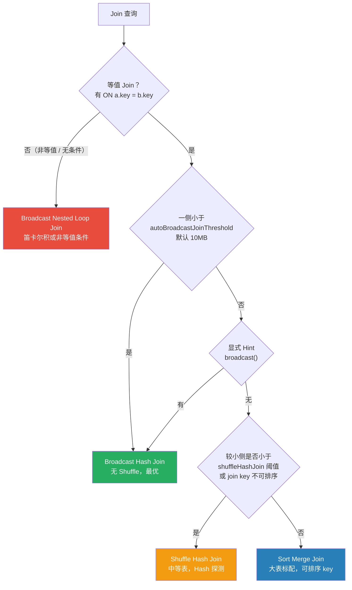

| Join 类型 | Shuffle | 内存压力 | 适用规模 | 触发条件 |
|---------|---------|---------|---------|---------|
| **Broadcast Hash Join** | 无 | 小表进内存 | 大表 + 小表 | 一侧 < 阈值 |
| **Shuffle Hash Join** | 一次 | 较小侧建 Hash 表 | 中等 + 中等 | 不适合 SMJ 时 |
| **Sort Merge Join** | 一次 | 低（流式合并） | 大表 + 大表 | 默认大表策略 |
| **Broadcast NLJ** | 无/一次 | 高 | 仅小数据集 | 非等值 / 笛卡尔积 |
| **Cartesian Join** | 无 | 极高 | 仅极小数据 | 无 ON 条件 |

---

## 二、Broadcast Hash Join（BHJ）

### 原理

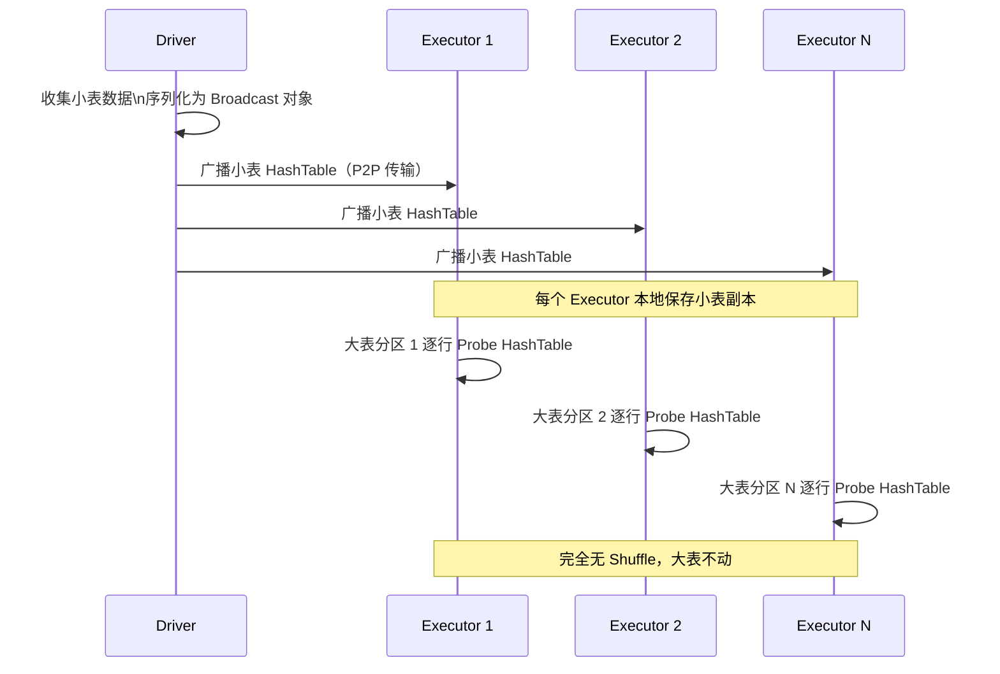

### 核心特点

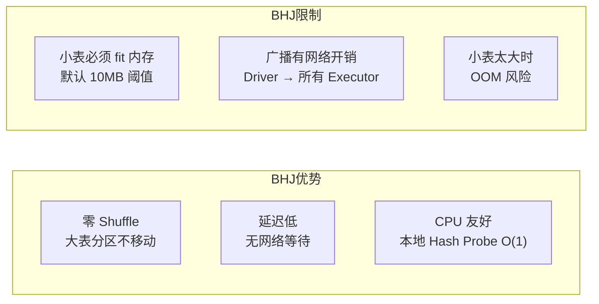

### 触发与控制

```python
# 自动触发（小表 < autoBroadcastJoinThreshold）
spark.conf.set("spark.sql.autoBroadcastJoinThreshold", "50MB")  # 调大阈值

# 手动 Hint（强制广播，绕过大小检测）
from pyspark.sql.functions import broadcast
result = large_df.join(broadcast(small_df), "key")

# SQL Hint
spark.sql("SELECT /*+ BROADCAST(small) */ * FROM large JOIN small ON large.id = small.id")

# 禁用广播
spark.conf.set("spark.sql.autoBroadcastJoinThreshold", "-1")
```

> [!tip] 面试要点
> BHJ 的广播过程：小表先被 Driver collect → 序列化 → 通过 BitTorrent 式 P2P 传输到各 Executor → 各 Executor 反序列化建立 HashTable。**小表超过 8GB 时广播会失败。**

---

## 三、Shuffle Hash Join（SHJ）

### 原理

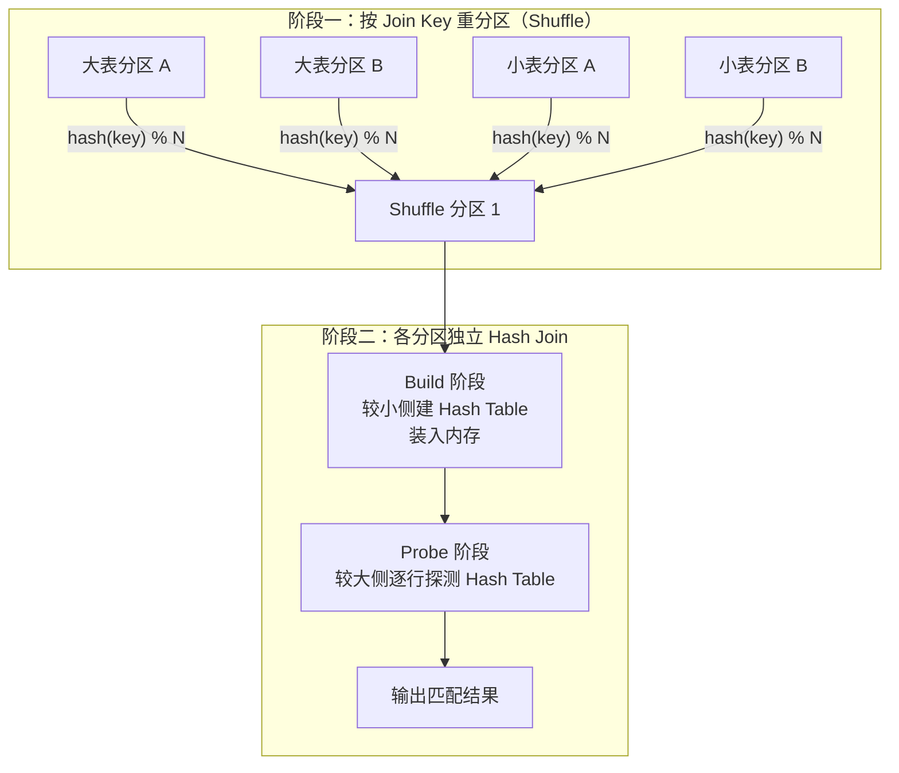

### 与 BHJ / SMJ 的区别

| 维度 | BHJ | SHJ | SMJ |
|------|-----|-----|-----|
| Shuffle 次数 | 0 | 1（双侧） | 1（双侧） |
| 内存压力 | 驱动端 + Executor 存整表 | 每分区小侧建 Hash 表 | 低，流式合并 |
| 要求 key 可排序 | 否 | 否 | **是** |
| 适合场景 | 一侧很小 | 两侧都是中等 | 两侧都是大表 |

> [!warning] SHJ 的风险
> 每个 Shuffle 分区都要把**较小侧**完整装入内存建 Hash Table。若数据倾斜导致某分区极大，容易 OOM。Spark 默认在大多数场景优先选 SMJ 而非 SHJ。

---

## 四、Sort Merge Join（SMJ）

### 原理

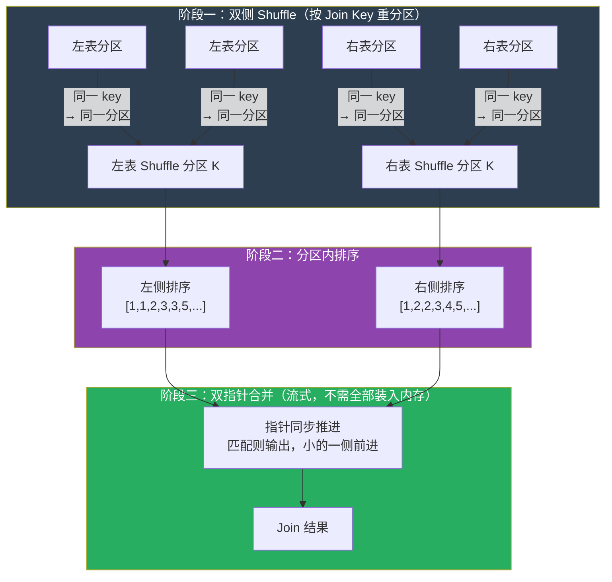

### 为什么 SMJ 是大表默认选择？

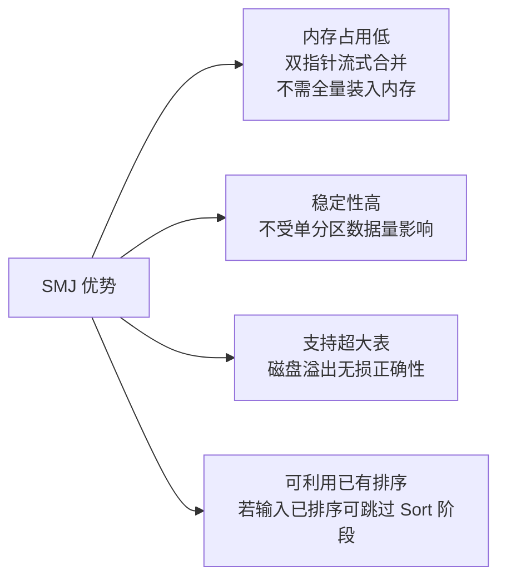

```python
# 强制使用 SMJ（禁用 BHJ 时的默认行为）
spark.conf.set("spark.sql.autoBroadcastJoinThreshold", "-1")
spark.conf.set("spark.sql.join.preferSortMergeJoin", "true")

# SQL Hint
spark.sql("SELECT /*+ MERGE(t1, t2) */ * FROM t1 JOIN t2 ON t1.key = t2.key")
```

---

## 五、Broadcast Nested Loop Join & Cartesian Join

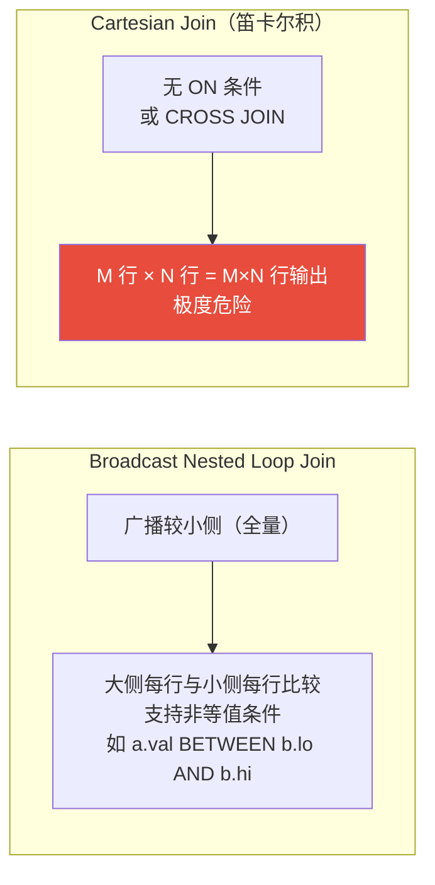

> [!warning] 生产禁忌
> Cartesian Join 结果行数 = 左表 × 右表，百万级数据会产生万亿行，几乎必然 OOM 或超时。生产环境务必避免无条件 JOIN。

---

## 六、AQE 对 Join 的动态优化

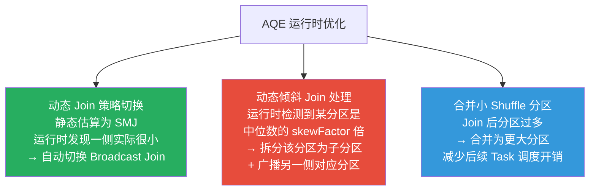

```python
# AQE 关键配置
spark.conf.set("spark.sql.adaptive.enabled", "true")
spark.conf.set("spark.sql.adaptive.skewJoin.enabled", "true")
# 倾斜判定：分区大小 > max(skewedPartitionFactor × 中位数, skewedPartitionThresholdInBytes)
spark.conf.set("spark.sql.adaptive.skewJoin.skewedPartitionFactor", "5")
spark.conf.set("spark.sql.adaptive.skewJoin.skewedPartitionThresholdInBytes", "256MB")
```

---

## 七、数据倾斜：识别与诊断

### 7.1 倾斜的本质

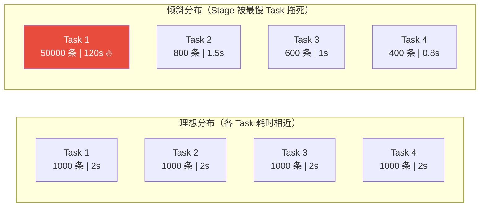

> [!note] 核心原理
> **Stage 的完成时间 = 最慢 Task 的完成时间。** 一个 Task 处理 5 万条而其他只处理几百条，整个 Stage 将被这一个 Task 拖死，其他 Executor 空等。

### 7.2 诊断步骤

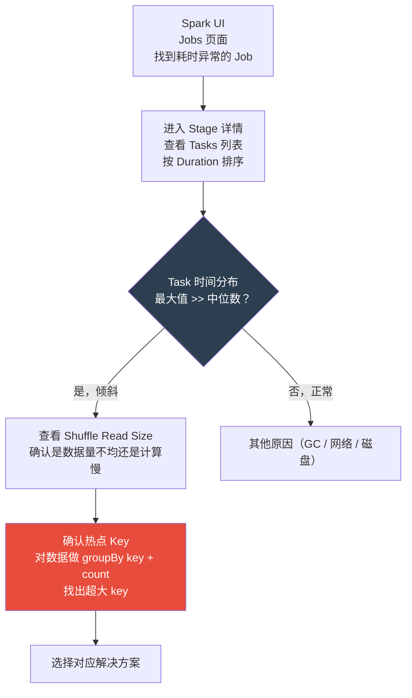

```python
# 快速定位热点 key
df.groupBy("join_key") \
  .count() \
  .orderBy("count", ascending=False) \
  .show(20)
```

---

## 八、数据倾斜场景与解决方案

### 场景一：GroupBy 聚合倾斜

**现象：** 某些 key（如 VIP 用户、热门商品）的数据量远超其他 key，聚合 Task 极慢。

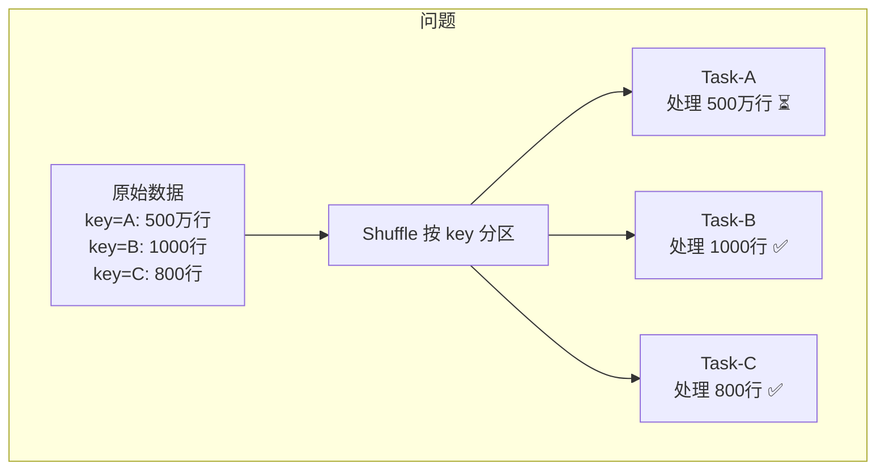

**解决：两阶段加盐聚合**

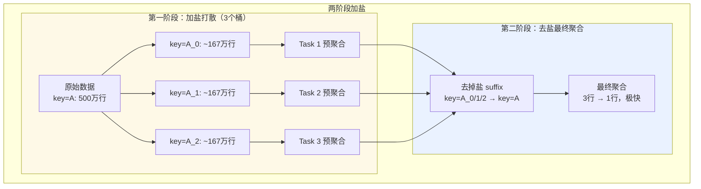

```python
import pyspark.sql.functions as F
from pyspark.sql.functions import col, concat, lit, floor, rand

SALT_NUM = 64  # 盐的桶数，根据倾斜程度调整

# 第一阶段：加盐预聚合
salted = df.withColumn("salted_key",
    concat(col("key"), lit("_"), (rand() * SALT_NUM).cast("int").cast("string"))
)
pre_agg = salted.groupBy("salted_key").agg(F.sum("value").alias("partial_sum"))

# 第二阶段：去盐最终聚合
final_agg = pre_agg \
    .withColumn("key", F.regexp_replace("salted_key", "_\\d+$", "")) \
    .groupBy("key") \
    .agg(F.sum("partial_sum").alias("total_sum"))
```

> [!warning] 注意事项
> 加盐仅适用于**可交换可结合的聚合函数**（sum / count / max / min）。`collect_list` 等有序聚合不能直接用此方案。

---

### 场景二：大表 Join 小表倾斜

**现象：** 大表 Join 一张"不够小"但又不是很大的表，未触发 BHJ，走 SMJ 时某 key 大量集中。

**解决：手动广播（扩大阈值 or Hint）**

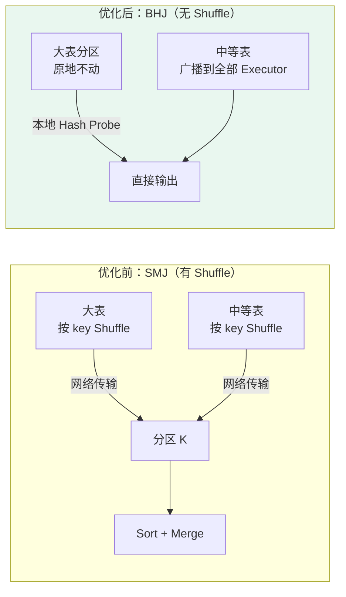

```python
# 方案 1：调大阈值（影响全局，谨慎）
spark.conf.set("spark.sql.autoBroadcastJoinThreshold", "200MB")

# 方案 2：Hint（只影响当前 Join，推荐）
result = large_df.join(broadcast(medium_df), "key", "inner")

# 方案 3：查看当前执行计划确认 BHJ
result.explain(mode="formatted")
# 应看到 BroadcastHashJoin 节点
```

---

### 场景三：大表 Join 大表——热点 Key 倾斜

**现象：** 两张大表 Join，`user_id = 'anonymous'` 或 `city_id = 'beijing'` 等热点 key 导致单 Task 极慢。

**解决方案 A：AQE 自动处理（Spark 3.x 首选）**

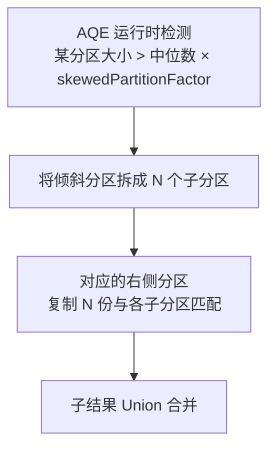

**解决方案 B：手动加盐 Join（双侧处理）**

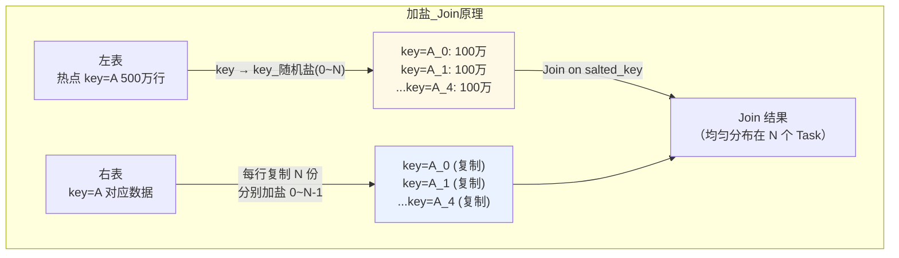

```python
SALT_NUM = 10

# 左表：随机加盐
left_salted = left_df.withColumn("salt", (rand() * SALT_NUM).cast("int")) \
    .withColumn("salted_key", concat(col("key"), lit("_"), col("salt").cast("string")))

# 右表：每行复制 SALT_NUM 份
salt_range = spark.range(SALT_NUM).toDF("salt")
right_expanded = right_df.crossJoin(salt_range) \
    .withColumn("salted_key", concat(col("key"), lit("_"), col("salt").cast("string")))

# Join on salted_key
result = left_salted.join(right_expanded, "salted_key") \
    .drop("salt", "salted_key")
```

> [!warning] 右表膨胀代价
> 右表会被扩大 SALT_NUM 倍。若右表本身较大，此方案会显著增加 Shuffle 数据量。**SALT_NUM 不宜过大，通常 8~32。**

**解决方案 C：单独处理倾斜 Key + Union**

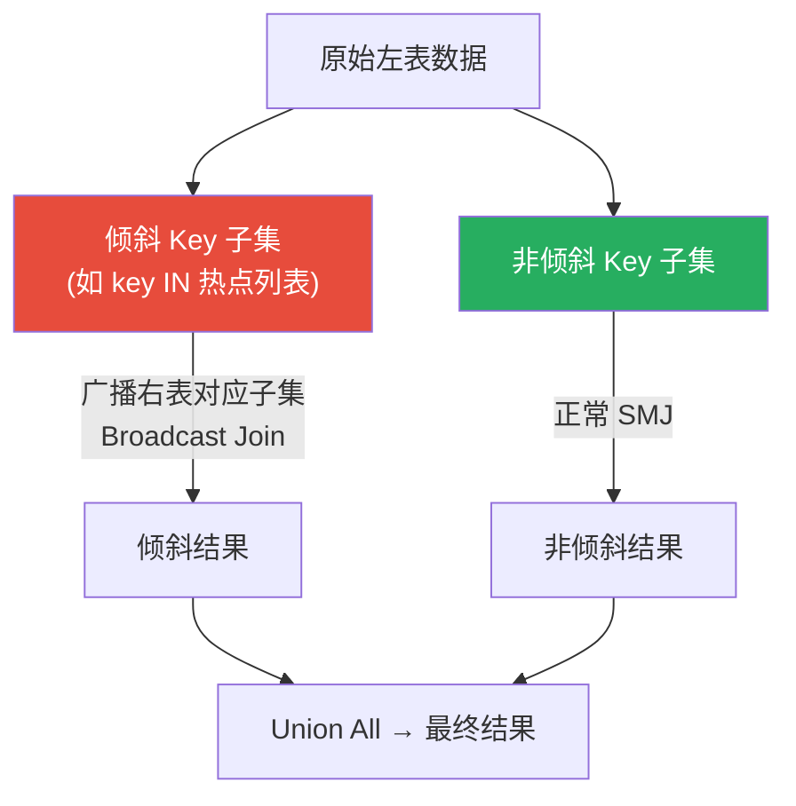

```python
# 识别倾斜 key（通过统计或业务知识）
skew_keys = ["anonymous", "guest"]

# 拆分数据集
skew_left = left_df.filter(col("key").isin(skew_keys))
normal_left = left_df.filter(~col("key").isin(skew_keys))

# 倾斜部分：广播右表中对应 key 的数据
skew_right = right_df.filter(col("key").isin(skew_keys))
skew_result = skew_left.join(broadcast(skew_right), "key")

# 非倾斜部分：正常 Join
normal_result = normal_left.join(right_df.filter(~col("key").isin(skew_keys)), "key")

# 合并
final = skew_result.union(normal_result)
```

---

### 场景四：NULL 值倾斜

**现象：** Join Key 中存在大量 NULL，SQL 标准中 `NULL ≠ NULL`，但 Spark 在 SMJ 中会将 NULL 分到同一分区，导致巨大的 NULL 分区。

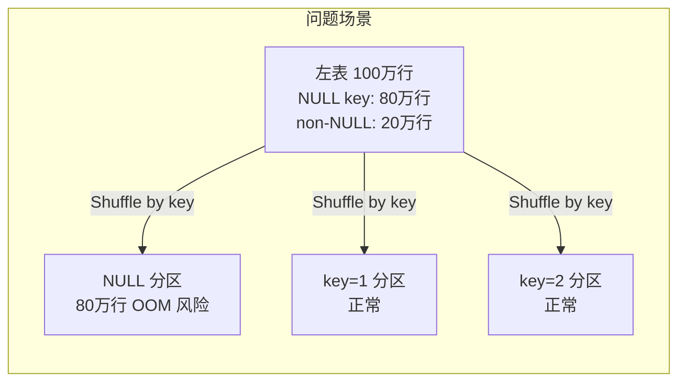

```python
# NULL Join 不参与匹配（SQL 标准）→ 直接过滤，消除无意义 Shuffle
result = left_df.filter(col("key").isNotNull()) \
    .join(right_df.filter(col("key").isNotNull()), "key")

# 若业务需要保留 NULL（如 LEFT JOIN）
# 先处理非 NULL 部分，NULL 单独处理后 Union
non_null = left_df.filter(col("key").isNotNull()).join(right_df, "key", "left")
null_rows = left_df.filter(col("key").isNull())  # NULL key 行直接保留（LEFT JOIN 语义）
final = non_null.union(null_rows)
```

> [!tip] NULL 倾斜规律
> 常见于用户 ID / 订单 ID 字段存在大量未登录用户（NULL），或数据质量问题导致 key 字段缺失。**JOIN 前先过滤 NULL 是最简单有效的优化。**

---

### 场景五：数据源分区不均（非 Shuffle 倾斜）

**现象：** 数据来自 HDFS/S3，文件大小极不均衡（有 GB 级大文件和 KB 级小文件），导致读取阶段 Task 不均。

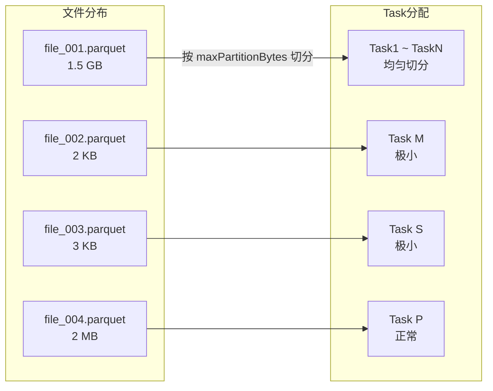

```python
# 方案 1：读取后立即 repartition 均匀分区
df = spark.read.parquet("/path/to/uneven/data") \
    .repartition(200)  # 或按 key 列 repartition

# 方案 2：调整 maxPartitionBytes（控制单个分区文件大小）
spark.conf.set("spark.sql.files.maxPartitionBytes", "128MB")  # 默认 128MB

# 方案 3：AQE 合并小分区（Spark 3.x）
spark.conf.set("spark.sql.adaptive.coalescePartitions.enabled", "true")
spark.conf.set("spark.sql.adaptive.advisoryPartitionSizeInBytes", "64MB")

# 方案 4：离线整理小文件（推荐根治）
df.repartition(100).write.mode("overwrite").parquet("/path/to/compact/")
```

---

### 场景六：Join 后分区数过多 / 过少

**现象：** `spark.sql.shuffle.partitions` 默认 200，数据量很大时每分区仍然很大；数据量小时大量空分区浪费调度资源。

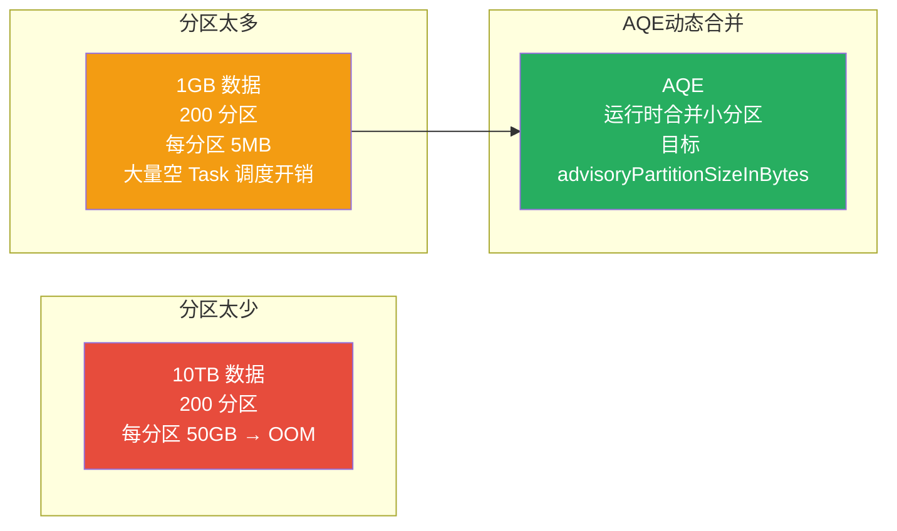

```python
# 数据量大：调大分区数
spark.conf.set("spark.sql.shuffle.partitions", "2000")

# 数据量小 + Spark 3.x：让 AQE 自动合并
spark.conf.set("spark.sql.adaptive.enabled", "true")
spark.conf.set("spark.sql.adaptive.coalescePartitions.enabled", "true")
spark.conf.set("spark.sql.adaptive.coalescePartitions.minPartitionNum", "1")
spark.conf.set("spark.sql.adaptive.advisoryPartitionSizeInBytes", "128MB")
```

---

## 九、解决方案选型决策树

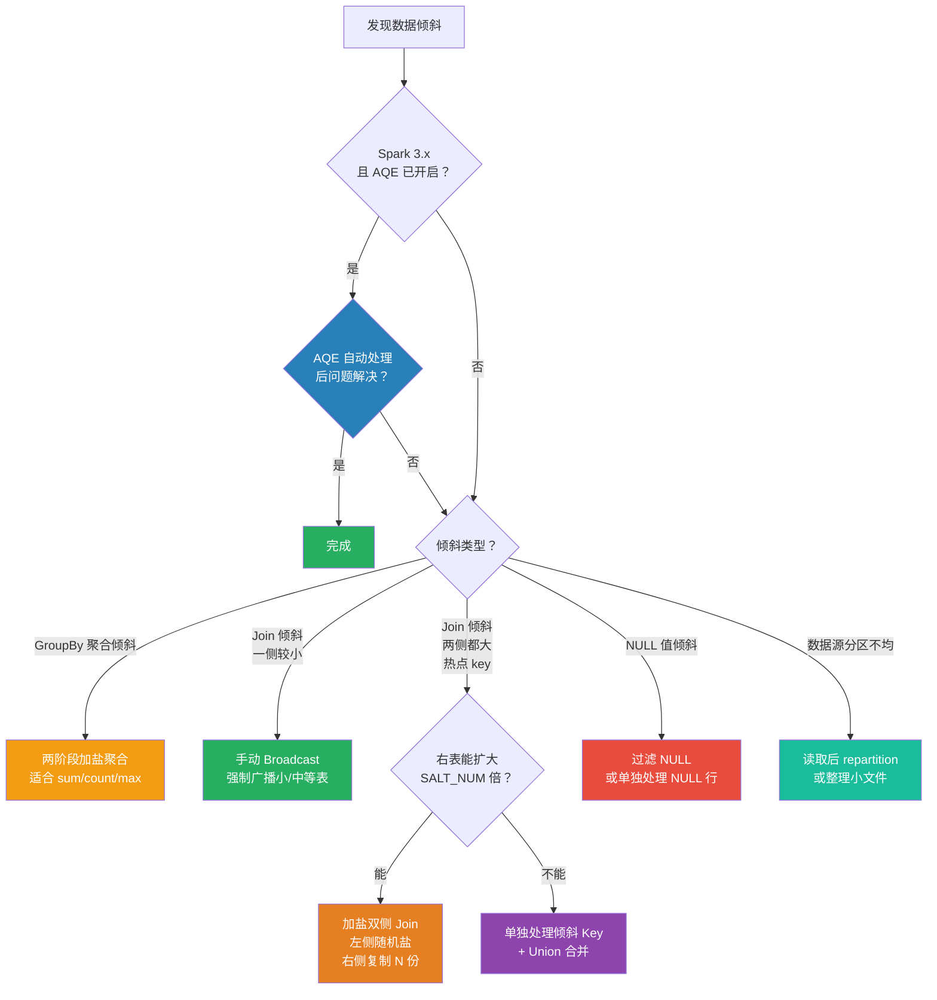

---

## 十、面试高频问答

**Q1：Spark 有哪几种 Join 实现？各自的触发条件是什么？**

> [!tip] 标准答案框架
> 五种：BHJ（无 Shuffle，小表广播）→ SHJ（一次 Shuffle，中表 Hash）→ SMJ（一次 Shuffle + 排序，大表默认）→ BNLJ（非等值）→ Cartesian（无条件，危险）。触发优先级：BHJ > SHJ > SMJ，由 Catalyst CBO + 统计信息决定，AQE 可运行时动态切换。

---

**Q2：BHJ 和 SMJ 各自的缺点是什么？**

| 维度 | BHJ 缺点 | SMJ 缺点 |
|------|---------|---------|
| 内存 | 小表必须 fit 所有 Executor 内存，太大 OOM | 需要 Shuffle 阶段，磁盘 IO 开销 |
| 数据规模 | 小表不能超过 8GB（广播上限） | 对于极小表有不必要的 Shuffle 开销 |
| 网络 | 广播时 Driver 是瓶颈 | 双侧全量 Shuffle，网络压力大 |
| Key 要求 | 无 | Key 必须可比较排序 |

---

**Q3：加盐方案中，Join 的右表为什么要复制 N 份？**

> [!tip] 回答要点
> 左表每行 key 被随机加了 0~N-1 的盐，变成 `key_0` / `key_1` / ... / `key_N-1`。右表中对应 key 的行只有**原始** key，如果不复制 N 份，左表 `key_3` 的行找不到右表 `key_3` 的匹配行，会造成数据丢失。复制 N 份确保左表每个盐值都能找到对应右表行。

---

**Q4：AQE 的 Skew Join 优化原理？和手动加盐有何区别？**

```mermaid
graph LR
    subgraph 手动加盐
        M1["需要提前知道热点 key"]
        M2["需修改业务代码"]
        M3["适合 Spark 2.x"]
    end

    subgraph AQE_Skew["AQE Skew Join"]
        A1["运行时自动检测倾斜分区"]
        A2["零代码改动"]
        A3["仅 Spark 3.x"]
        A4["将大分区拆成子分区\n另一侧对应范围复制匹配"]
    end
```

> [!note]
> AQE 本质上也是"拆分倾斜分区 + 局部复制另一侧数据"，与手动加盐思路一致，但由框架自动完成，无需感知热点 key。优先开启 AQE，手动加盐作为兜底。

---

**Q5：如何在面试中系统化回答数据倾斜问题？**

> [!abstract] 回答模板（STAR 结构）
> 1. **判断**：Spark UI → Stage 详情 → Task 时间分布，最大值远超中位数 → 确认 Shuffle Read Size 不均
> 2. **定位**：`groupBy join_key + count` 找热点 key，区分 GroupBy 倾斜 / Join 倾斜 / NULL 倾斜
> 3. **方案选择**：
>    - Spark 3.x → 先开 AQE，观察效果
>    - 一侧小 → Broadcast Join
>    - GroupBy 聚合 → 两阶段加盐
>    - 大表 Join 大表热点 → 加盐双侧 / 单独处理倾斜 key
>    - NULL 倾斜 → 提前过滤
> 4. **验证**：对比优化前后 Stage 耗时、Task 分布、Shuffle Read Size

---

## 十一、核心参数速查

| 参数 | 默认值 | 作用 |
|------|--------|------|
| `spark.sql.autoBroadcastJoinThreshold` | 10MB | BHJ 触发阈值，-1 禁用 |
| `spark.sql.shuffle.partitions` | 200 | Shuffle 分区数 |
| `spark.sql.adaptive.enabled` | true（3.2+） | 开启 AQE |
| `spark.sql.adaptive.skewJoin.enabled` | true | AQE 倾斜 Join |
| `spark.sql.adaptive.skewJoin.skewedPartitionFactor` | 5 | 倾斜判定倍数 |
| `spark.sql.adaptive.skewJoin.skewedPartitionThresholdInBytes` | 256MB | 倾斜判定绝对阈值 |
| `spark.sql.adaptive.coalescePartitions.enabled` | true | AQE 合并小分区 |
| `spark.sql.adaptive.advisoryPartitionSizeInBytes` | 64MB | AQE 目标分区大小 |
| `spark.sql.join.preferSortMergeJoin` | true | 优先 SMJ |
| `spark.sql.broadcastTimeout` | 300s | 广播超时时间 |
