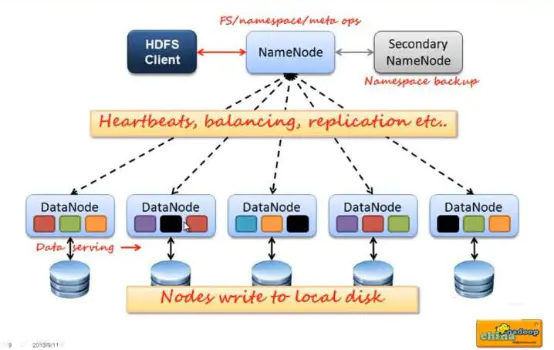

HDFS（Hadoop Distributed File System）, 用于存储,读取和管理文件，通过目录树来定位文件；

- 适用于：
	- 存储非常大的文件，可拓展性好
	- 流式的数据访问方式: 即一次写入、多次读取
	- 高容错性
- 不适用于：
	- 低延时的数据访问
	- 大量小文件
	- 多方读写，需要任意的文件修改
	- 一致性要求高


> [!success] 

HDFS是一个主/从（Mater/Slave）体系结构，
HDFS由四部分组成：
- HDFS Client：文件切分与重组；与NameNode沟通获得读写权限和文件信息；与DataNode沟通读写文件。
- NameNode：存储元数据，包括文件命名空间，文件到块的映射，块的具体位置信息等。
- DataNode：
	- 存储数据，读写数据
	- 当 DataNode 读取 Block 的时候，它会计算 CheckSum
- Secondary NameNode：
	- 辅助 NameNode，分担其工作量，帮助恢复。
	- 并非NameNode的热备。当NameNode挂掉的时候，它并不 能马上替换NameNode并提供服务


### 块大小 128M
- 太小：
	- 一个文件被分为太多块，元数据增多，namenode压力大
	- 每个块需要寻址，寻址时间变长
- 太大：
	- 小文件会单独占用一个块
	- map每次处理一个块，快太大处理慢，不如多个小块并行处理的快。

HDFS中的文件都是一次性写入的，并且严格要求在任何时候只能有一个写入者。
Namenode全权管理数据块的复制，它周期性地从集群中的每个Datanode接收心跳信号和块状态报告(Blockreport)。接收到心跳信号意味着该Datanode节点工作正常。块状态报告包含了一个该Datanode上所有数据块的列表。


### HDFS 文件读取


1. Client 向 NameNode 发起 RPC 请求，来确定请求文件 block 所在的位置；
2. NameNode 会视情况返回文件的部分或者全部 block 列表，对于每个 block，NameNode 都会返回含有该 block 副本的 DataNode 地址；
3. 这些返回的 DataNode 地址，会按照集群拓扑结构得出 DataNode 与客户端的距离，然后进行排序，排序两个规则：网络拓扑结构中距离Client近的排靠前；心跳机制中超时汇报的 DataNode 状态为 STALE，这样的排靠后；
4. Client 选取排序靠前的 DataNode 来读取 block，如果客户端本身就是 DataNode，那么将从本地直接获取数据；底层上本质是建立 Socket Stream（FSDataInputStream），重复的调用父类 DataInputStream 的 read 方法，直到这个块上的数据读取完毕；
5. 当读完列表的 block 后，若文件读取还没有结束，客户端会继续向 NameNode 获取下一批的 block 列表；
6. 读取完一个 block 都会进行 checksum 验证，如果读取 DataNode 时出现错误，客户端会通知 NameNode，然后再从下一个拥有该 block 副本的 DataNode 继续读。
7. read 方法是并行的读取 block 信息，不是一块一块的读取；NameNode 只是返回 Client 请求包含块的 DataNode 地址，并不是返回请求块的数据；
8. 最终读取来所有的 block 会合并成一个完整的最终文件。

### HDFS 文件写入


1. client 发起文件上传请求，通过 RPC 与 NameNode 建立通讯，NameNode 检查目标文件是否已存在，父目录是否存在，返回是否可以上传；
2. client 请求第一个 block 该传输到哪些 DataNode 服务器上；
3. NameNode 根据配置文件中指定的备份数量及副本放置策略进行文件分配，返回可用的 DataNode 的地址，如：A，B，C；
4. client 请求3台 DataNode 中的一台A上传数据（本质上是一个 RPC 调用，建立 pipeline），A收到请求会继续调用B，然后B调用C，将整个 pipeline 建立完成，后逐级返回 client；
5. client 开始往A上传第一个 block（先从磁盘读取数据放到一个本地内存缓存），以 packet 为单位（默认64K），A收到一个 packet 就会传给B，B传给C；A每传一个 packet 会放入一个应答队列等待应答。
6. 数据被分割成一个个 packet 数据包在 pipeline 上依次传输，在 pipeline 反方向上，逐个发送 ack（ack 应答机制），最终由pipeline中第一个 DataNode 节点A将 pipeline ack 发送给client;
7. 当一个 block 传输完成之后，client 再次请求 NameNode 上传第二个 block 到服务器。


### 副本存放: 机架感知
通过一个机架感知的过程，Namenode可以确定每个Datanode所属的机架id。一个简单但没有优化的策略就是将副本存放在不同的机架上。这样可以有效防止当整个机架失效时数据的丢失，并且允许读数据的时候充分利用多个机架的带宽。这种策略设置可以将副本均匀分布在集群中，有利于当组件失效情况下的负载均衡。但是，因为这种策略的一个写操作需要传输数据块到多个机架，这增加了写的代价。

在大多数情况下，副本系数是3，HDFS的存放策略是将一个副本存放在本地机架的节点上，一个副本放在同一机架的另一个节点上，最后一个副本放在不同机架的节点上。这种策略减少了机架间的数据传输，这就提高了写操作的效率。机架的错误远远比节点的错误少，所以这个策略不会影响到数据的可靠性和可用性。于此同时，因为数据块只放在两个（不是三个）不同的机架上，所以此策略减少了读取数据时需要的网络传输总带宽。在这种策略下，副本并不是均匀分布在不同的机架上。三分之一的副本在一个节点上，三分之二的副本在一个机架上，其他副本均匀分布在剩下的机架中，这一策略在不损害数据可靠性和读取性能的情况下改进了写的性能。

> 副本选择：HDFS会尽量让读取程序读取离它最近的副本


### Namenode容错

- 备份，日志
- hdfs系统中只一个namenode，namenode故障会导致整个系统崩溃。因此，配置多个namenode作为备用能增加系统安全性，就是高可用性机制（HA），利用zookeeper来实现。


### 安全模式

安全模式是hadoop的一种保护机制，用于保证集群中的数据块的安全性。当集群启动的时候，会首先进入安全模式。当系统处于安全模式时会检查数据块的完整性。
假设我们设置的副本数（即参数dfs.replication）是3，那么在datanode上就应该有3个副本存在，假设只存在2个副本，那么比例就是2/3=0.666。hdfs默认的副本率0.999。我们的副本率0.666明显小于0.999，因此系统会自动的复制副本到其他dataNode，使得副本率不小于0.999。如果系统中有5个副本，超过我们设定的3个副本，那么系统也会删除多于的2个副本。

在安全模式状态下，文件系统只接受读数据请求，而不接受删除、修改等变更请求。在，当整个系统达到安全标准时，HDFS自动离开安全模式。


## hdfs的命令行使用

```
hdfs  dfs   -ls  
hdfs  dfs [-p] -mkdir <paths>
hdfs dfs -put  /rooot/a.txt  /dir1
hdfs dfs  -get   /install.log  /export/servers
hdfs  dfs  -mv  /dir1/a.txt   /dir2        //该命令不能夸文件系统
hdfs  dfs  -rm  -r  /dir1
hdfs dfs  -cat /install.log
```

