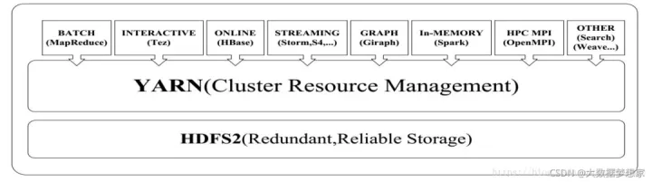
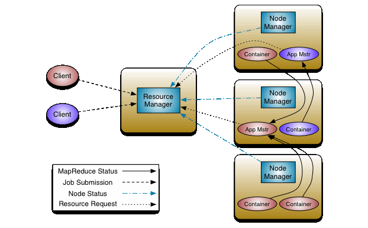
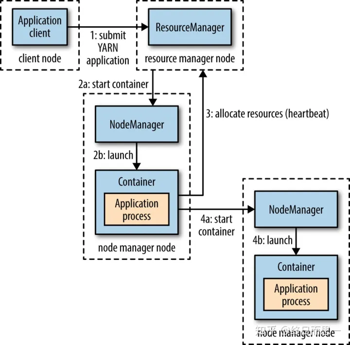

### 0.1 Hadoop Yarn 是什么

Yarn 的全称是 **Yet Another Resource Negotiator**，意思是“另一种资源调度器”，是一种通用的资源管理系统和调度平台。

动机：在 Hadoop1.0 中，MapReduce 的 JobTracker 负责了太多的工作包括：
- 任务调度
- 任务进度监控
- 资源调度
- 存储已完成的作业历史
这种单点实现更多功能的做法，虽然实现上简单了事，但存在许多问题：
- 单点压力大，容易成为性能瓶颈，扩展性受限
- 功能紧耦合（计算执行和资源调度耦合），拓展性差

这自然是不合理的，于是 Hadoop 在 1.0 到 2.0 的升级过程中，便将 JobTracker 的资源调度工作独立了出来，而这个独立出来的资源管理框架，就是 Yarn 。
YARN的基本思想是将资源管理和作业调度/监视的功能划分为单独的守护进程。其想法是拥有一个全局资源管理器ResourceManager（RM）和每个应用程序一个的应用程序管理员ApplicationMaster（AM）。应用程序可以是单个作业，也可以是多个作业组成的DAG（有向无环图）。
yarn不关系程序的计算内容，只关心程序所需的资源，在程序申请资源的时候根据调度算法分配资源，计算结束之后回收计算资源。
相比于MRv1，Yarn的优点如下：
- 可扩展性更好：可以融入更多的节点， 解决了第一代mapreduce的jobtracker瓶颈问题
- 资源利用率更好：MRv1中资源静态分配成固定的slot，而yarn中的容器资源分配更加精细化
- 支持更多的计算框架：多租户，使用yarn可以在hadoop上使用MR之外的计算引擎。

- Yarn设计的初衷就是为了在同一套集群上面跑不同的应用框架，或者跑多个任务。跑不同的应用则是出于提高集群资源利用率的角度考虑的。
	- 比如MapReduce能更好的处理大批量的ETL业务而Spark则相对更为专注于Machine Learning。如果我们想同时运行这两个任务，两个任务之间如何进行资源分配交给Yarn就行。
- 不是必须，但是省事儿。
	- MapReduce Spark 没有yarn是可以一样跑，然而如果有多人同时用，那谁的任务先执行，该在哪台机器上执行，执行多久，这些你都得手工写代码实现
	- Yarn为多种不同的作业提供了统一的集群资源视图，降低了集群资源管理复杂性，同时可以提高整个集群的资源利用率
	- 某种程度上也可以降低分布式计算系统的设计和开发难度，因为你可以不用管资源调度了，只需要负责计算调度就行。

### 0.2 主要结构

主要组件：
- **ResourceManager**
	- 整个系统有且只有一个 RM ，来负责资源的管理和调度
	- 定时调度器(Scheduler)： 
		- Client 提交一个任务的时候，它会根据所需要的资源以及当前集群的资源状况进行分配。
		- 只负责向应用程序分配资源，并不做监控以及应用程序的状态跟踪
	- 应用管理器(**ApplicationManager**)：
		- 管理 Client 用户提交的应用， 监控ApplicationMaster，并且在遇到失败的时候重启ApplicationMaster。
- **NodeManager**
	- 负责容器的管理，并监控他们的资源使用情况（cpu，内存，磁盘及网络等）
	- 向 ResourceManager/Scheduler 提供这些资源使用报告。

应用
- **ApplicationMaster**
	- Client 提交一个 Application 时候，就会新建一个 ApplicationMaster
	- ApplicationMaster 去与 ResourceManager 申请容器资源
	- 获得资源后会将要运行的程序发送到容器上启动，然后进行分布式计算。

### 0.3 Container 容器
容器（Container）这个东西是 Yarn 对节点资源（cpu核数，内存大小）做的一层抽象。

容器由 NodeManager 启动和管理，并被它所监控。
容器被 ResourceManager 进行调度。

每一个Container就是一个独立的JVM实例，每一个任务都是在Container中独立运行，例如：MapTask、ReduceTask。

### 0.4 提交 Application 到 Yarn 的流程

1. Client 向 Yarn 提交 Application，要求它运行一个ApplicationMaster进程。
2. ResourceManager 向 NodeManager 通信，为该 Application 分配第一个容器。并在这个容器中运行这个应用程序对应的 ApplicationMaster。
3. ApplicationMaster 启动以后，对 作业（也就是 Application） 进行拆分，拆分 task 出来，这些 task 可以运行在一个或多个容器中。然后向 ResourceManager 申请要运行程序的容器，并定时向 ResourceManager 发送心跳。
4. 申请到容器后，ApplicationMaster 会去和容器对应的 NodeManager 通信，而后将作业分发到对应的 NodeManager 中的容器去运行，这里会将拆分后的 MapReduce 进行分发，对应容器中运行的可能是 Map 任务，也可能是 Reduce 任务。
5. 容器中运行的任务会向 ApplicationMaster 发送心跳，汇报自身情况。当程序运行完成后， ApplicationMaster 再向 ResourceManager 注销并释放容器资源。

1，客户端向ResourceManager中的ApplicationManager提交作业申请，申请jobID。
2，ApplicationManager 返回一个jobID，以及运行的hdfs临时路径(hdfs://… jobID)。
3，客户端将作业的jar包，配置信息等上传到分配的hdfs临时路径(hdfs://… jobID)中。
4，客户端上传文件成功后，向ApplicationManager发送执行作业请求。
5，ApplicationManager将请求转发给Scheduler，申请执行所需资源。
6，调度器将作业放置到相关队列中，当执行到该作业时，开始让ApplicationManager分配Containers。
7，ApplicationManager命令NodeManager使用分配的container资源启动ApplicationMaster。
8，ApplicationMaster启动后去分配的hdfs临时路径(hdfs://… jobID)中读取作业的具体信息，根据分片信息创建map任务，reduce任务。
9，ApplicationMaster向Scheduler请求资源来执行map任务，reduce任务。
10，Scheduler返回申请结果。
11，AppMaster通知NodeManager，启动map，reduce任务。
12，NodeManager启动map，reduce任务。
13，map，reduce任务读取数据，进行逻辑计算。计算过程中如果有map，reduce任务执行失败了，AppMaster负责重启任务。
14，程序执行成功后，AppMaster向Scheduler发送请求，释放资源。

### 0.5 Yarn中的资源调度策略

- FIFO Scheduler 
	- 先进先出，顺序来
	- 先给队列中最头上的应用进行分配资源，待最头上的应用需求满足后再给下一个分配，以此类推。
	- 不适用于共享集群。大的应用可能会占用所有集群资源，这就导致其它应用被阻塞。
	- 
- Capacity Scheduler
	- 默认使用容量调度器
	- 有一个专门的队列用来运行小任务，但是为小任务专门设置一个队列会预先占用一定的集群资源，这就导致大任务的执行时间会落后于使用FIFO调度器时的时间。
	- 
- Fair Scheduler
	- 用户之间实现了公平共享。
	- 每人用可以独占，有人用且竞争则一人一半。
	- 

延迟调度
