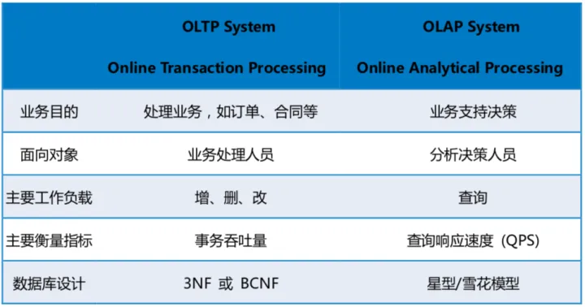

### 定义
- 数仓工具：hive是基于Hadoop的一个数据仓库工具，hive 是用于大数据分析，存储基于 HDFS,计算基于 MapReduce 或 Spark，提供类 SQL 查询。
- SQL查询：hive数据仓库工具能将结构化的数据文件映射为一张数据库表，并提供SQL查询功能，能将SQL语句转变成MapReduce任务来执行
- ==Hive并不存储数据==，只是建立了HDFS文件到结构化数据的映射，所以需要建表时指定的分隔符与文件中的分隔符相同。而MYSQL数据文件的管理与存储都是由MYSQL自身完成
- 数据存储基于HDFS，计算基于MapReduce或Spark

- 优点：
	- 提供类SQL查询，容易上手，开发方便；
	- 封装了很多方法，尽量避免了开发MapReduce程序，减少开发成本; 
	- 支持多种计算引擎，MR和Spark都可以
	- 支持自定义函数，可以根据需求实现函数
	- 适用于处理大规模数据
- 缺点
	- 小数据的处理没有优势
	- 执行延迟较高，适合用于数据分析，不适合对时效性要求较高的场景

### 数据库和数据仓库

> hive 除了可以通过类 SQL 查询这一点和数据库有点关系外，其它基本没啥关联。

#### OLTP和OLAP：
- OLTP（on-line transaction processing）翻译为联机事务处理， OLAP（On-Line Analytical Processing）翻译为联机分析处理，
- OLTP是做事务处理，OLAP是做分析处理。
- 从对数据库操作来看，OLTP主要是对数据的增删改，OLAP是对数据的查询。
- OLTP要求实时性高、稳定性强、确保数据及时更新成功； OLAP主要考虑大量数据的快速查询和计算。
- OLAP分析的数据都是由OLTP所产生的，也可以看作OLAP是OLTP的一种延展，一个让OLTP产生的数据发现价值的过程。


总的来说：
- OLTP(业务支撑): 面向的是支撑当前业务的数据，业务的正确处理依赖于这些数据，所以数据的准确，稳定，实时性要求很高；
- OLAP(决策支撑): 面向前面业务结束后收集到的数据，不再影响当前业务，但依旧有潜在的价值可以拿去分析，为后续决策提供支撑。


#### 数据库和数据仓库
- 用途区分
	- 数据库 Database (Oracle, Mysql, PostgreSQL) 主要用于事务处理  ==OLTP==
	- 数据仓库 Datawarehouse (Amazon Redshift, Hive)主要用于数据分析  ==OLAP==
- 数据特点
	- 数据库：存储结构化数据。相对复杂的表格结构，存储结构相对紧致，少冗余数据。读和写都有优化。相对简单的read/write query，单次作用于相对的少量数据。
	- 数据仓库：存储结构化/半结构化/非结构化数据 。相对简单的(Denormalized)表格结构，存储结构相对松散，==多冗余数据==。一般==只是读优化==。相对复杂的read query，单次作用于相对大量的数据（历史数据）。数据库为了去除冗余可能将信息放到几个表中，需要时再连接。而数据仓库倾向于将所有信息全放到一个表中，这样查询更方便（不用连接多个表），数据仓库相当于牺牲了空间换取了查询效率。
- 性能表现：
	- 数据库：适合小数据读取， 适合写。事务性操作，所以一般是读写优化的。
	- 数据仓库：适合大数据读取， 不适合写（冗余行数太多，有时候只是改一个很小的字段，也会修改大量的行数），一般仅仅是读优化的。

Hive与传统数据库的对比：


### hive的架构


Hive主要由以下三个模块组成：
- 元数据存储模块： MetaStore：
	- 元数据，数据的数据，比如某个表的元数据，包括表名、表所属的数据库、表的类型、表的数据目录等；
	- 数据存储在hdfs， 但元数据存储在这里
	- hive默认将元数据存储在derby数据库中，但其仅支持单线程操作，若有一个用户在操作，其他用户则无法使用，造成效率不高；==因此一般用MySQL存储元数据。==
- 用户接口模块
	- 含CLI(命令行接口)、HWI、JDBC、Thrift Server等
- 驱动模块（Driver）：负责把HiveQL语句转换和优化成一系列MR作业
	- Sql Parser 解析器：将SQL转换成抽象语法树，一般用第三方工具库完成；对抽象语法树进行语法分析，比如表是否存在、字段是否存在、SQL语义是否有误；
	- Physical Plan 编译器：将抽象语法树编译生成逻辑执行计划；
	- Query Optimizer 优化器：对逻辑执行计划进行优化；
	- Execution 执行器：把逻辑执行计划转换成可以运行的物理计划。对Hive而言，就是 MR/Spark；

> 讲解：hive主要由三部分组成：元数据存储模块，用户交互模块；驱动模块。
> 元数据模块存储各种表的信息和元数据，一般由mysql管理。用户交互模块提供命令行和JDBC两种交互模式, 用户将HQL命令写好后交给driver,driver包含4个部分，解析器解析命令，检查语法，匹配元数据中的表，然后将解析的内容发给编译器，编译器将命令转为MR程序，然后交给优化器优化，最后转给执行器，执行器将这一些列MR任务提交到集群执行。

最终生成的MR/Spark会在hdfs上执行。


### hive运行机制
当创建表的时候，需要指定HDFS文件路径，表和其文件路径会保存到MetaStore，从而建立表和数据的映射关系。当数据加载如表时，根据映射获取到对应的HDFS路径，将数据导入。
用户输入SQL后，hive会将其翻译成MapReduce或者Spark任务，提交到Yarn上面执行，执行成功将返回结果。

> hive默认将元数据存储在derby数据库中，但其仅支持单线程操作，若有一个用户在操作，其他用户则无法使用，造成效率不高；而且当在切换目录后，重新进入Hive会找不到原来已经创建的数据库和表， 因此一般用MySQL存储元数据。


### Hive内部表和外部表的区别?

- 内部表和外部表最根本的区别在于，是否由 Hive 管理表的全生命周期。如，Hive 管理内部表的元数据以及实际的表数据，而对于外部表，则只管理它的元数据。
- 外部表在建表的时候需要加关键字 EXTERNAL；
- ==创建内部表时，会将数据移动到数据仓库指向的路径==；若创建外部表，仅记录数据所在的路径， 不对数据的位置做任何改变；
- 删除内部表会直接删除元数据【metadata】及存储数据，删除外部表仅仅删除元数据，HDFS上的文件不会被删除；这样外部表相对来说更加安全些，数据组织也更加灵活，方便共享源数据。
- 内部表数据存储在hive.metastore.warehouse.dir【默认:/user/hive/warehouse】，外部表数据存储位置由用户自己决定。
- 当需要通过Hive完全管理控制表的整个生命周期时，请使用内部表；当文件已经存在或位于远程位置时，请使用外部表，因为即使删除表，文件也会被保留


### Hive的cluster by、sort by、distribute by、order by区别?
- order by：
	- 全局排序，一个reducer；
	- order by 在处理大规模的数据集效率较低。
- sort by：
	- 分区内排序；
	- 在很多情况下，并不需要全局排序，此时可以使用 sort by。
	- Sort by 为每个 reducer 产生一个排序文件。每个 Reducer 内部进行排序，但对全局结果集来说无序。
- distribute by：
	- distribute by 采集hash算法，在map端将查询结果中hash值相同的结果分发到对应的reduce文件中，可以对数据进行分区，==结合 sort by 使用==。
	- 控制map结果的分发，相同值会被分发到同一个map；
	- distribute by 要分配多个 reduce 进行处理，否则无法看到 distribute by 的效果。
- cluster by：
	- 当distribute by和sort by用的同一个字段，可以用这个关键字，但不能指定排序顺序，只能升序。

```sql
-- 这两条 SQL 语句效果相同
select * from table_name cluster by col1; 
select * from table_name distribute by col1 sort by col1;
```

### 大量小文件

小文件产生的原因：
- 动态分区插入数据的时候，会产生大量的小文件；
- 数据源本身就包含有大量的小文件；
- reduce个数越多，生成的小文件也越多
- 做增量导入，比如Sqoop数据导入，一些增量insert等；
- 分桶表，分桶表通常也会遇到小文件，本质上还是增量导入的问题；
- 可以修改的表，这种Hive表是可以进行修改的，通过配置stored as orc TBLPROPERTIES ("transactional"="true")，这种表最坑，每天都会有一个快照，到后面10G大小的数据，表文件体积可以达到600G，时间越长越大；
小文件的问题有很多，实际中各种原因，由于自己的不小心，前期没有做好预防都会产生大量小文件，让线上的离线任务神不知鬼不觉，越跑越慢。

## 分区和分桶

分区对整个数据进行划分，划分到多个目录下，每个目录下可能有多个文件。
分桶就是将数据按照字段进行划分，可以将数据按照字段划分到多个文件当中去。

- 分区
	- 当Hive表对应的数据量大、文件多时，为了避免查询时全表扫描数据，Hive支持根据用户指定的字段进行分区，分区的字段可以是日期、地域、种类等具有标识意义的字段。
	- 分区可以提高查询效率，实际上 hive 的一个分区就是 HDFS 上的一个目录，目录里放着属于该分区的数据文件。
	- 二级分区: 相当于在一级分区对应的目录上新增一个目录，一般用于单个分区数据量很大，需要做拆解的情况。
	- 一般对于查询比较频繁的列设置为分区列。
	- 数据倾斜：不合理的数据分区划分方式可能导致有的分区数据过多，而某些分区没有什么数据的尴尬情况
- 分桶： 更细粒度的划分
	- hive可以将数据进行分桶，不同于分区是针对存储路径进行分类，分桶是在数据文件中对数据进行划分的一种技术。
	- 分桶是指定某一列，让该列数据按照哈希取模的方式随机、均匀地分发到各个桶文件中。
	- 分桶是相对分区进行更细粒度的划分。分桶将整个数据内容按照某列属性值的hash值进行区分
	- 可以加快某些操作，比如join，key相同的行只需要去相同分区号里面匹配
	- 分桶会使采样更高效，直接选一个桶作为采样结果


对于静态分区，表的分区数量和分区值是固定的。新增分区或者是加载分区数据时，需要提前指定分区名。
对于动态分区，分区的值是不确定的，会根据数据自动的创建新的分区。

1、尽量不要用动态分区，因为动态分区的时候，将会为每一个分区分配reducer数量，当分区数量多的时候，reducer数量将会增加，对服务器是一种灾难。
2、动态分区和静态分区的区别，静态分区不管有没有数据都将会创建该分区，动态分区是有结果集将创建，否则不创建。

动态分区的值是MapReduce任务在reduce运行阶段确定的，也就是所有的记录都会distribute by，相同字段(分区字段)的map输出会发到同一个reduce节点去处理，如果数据量大，这是一个很弱的运行性能。
而静态分区在编译阶段就确定了，不需要reduce任务处理。所以如果实际业务场景静态分区能解决的，尽量使用静态分区即可。


> 如果按照name 属性分为3个桶，就是对name属性值的hash值对3取模，按照取模结果对数据分桶。如取模结果为0的数据记录存放到一个文件，取模为1的数据存放到一个文件，取模为2的数据存放到一个文件

区别：
- 从表现形式形式上：
	- 分区就是 HDFS 上的一个目录，分桶表是文件
- 从创建语句上
	- 分区表使用partitioned by 子句指定，以指定字段为伪列，分区字段不能是表中已经存在的字段，需要指定字段类型
	- 分桶表由clustered by 子句指定，指定字段为真实字段，需要指定桶的个数
- 从数量上：
	- 分区表的分区个数可以增长，分桶表一旦指定，不能增长
- 作用上：
	- 分区避免全表扫描，根据分区列查询指定目录提高查询速度
	- 分桶保存分桶查询结果的分桶结构（数据已经按照分桶字段进行了hash散列)
	- 分桶表数据进行抽样和join时可以提高MR程序效率

## 数据倾斜

数据倾斜是指在分布式处理中， 数据并没有均匀分配给所有节点，某些节点得到了远比其他节点更多的数据
这会导致：
- 该节点处理时间特别长，其他节点执行完可能还需要等他
- 内存溢出/存储不够
- 该节点成为性能瓶颈

> 简而言之，就是分配活儿的时候，没有合理的，公平分配。


在具体任务中，导致数据倾斜的操作主要是发生在 group by、join 等需要数据shuffle的操作中，这些过程需要根据 key 进行数据汇集处理，其中容易卡住的往往是 join 操作。当某个或者某些 key 的数据量远大于其他 key 时，处理这些 key 的任务运行时间也远大于其他任务，从而拖累整个任务时长。

造成数据倾斜的原因：
- 业务本身造成的；
- key 分布不均；
- 某些 SQL 操作容易造成数据倾斜；

造成数据倾斜的主要操作：
- Map 数据倾斜
	- 缩小读入数据量： 
		- 行裁剪: 过滤不需要的脏数据和空数据； 把NULL值转为随机值来作为reduce的key值
		- 列裁剪:去掉不需要的列
	- 合理使用参数控制上游小文件的合并：
		- 小文件合并
		- 大文件切分，控制每个输入mapper的数据量不会太大
	- 能在map一个阶段完成的任务，就不要reduce
	- 使用combiner,减少数据传输量 ；开启map端聚合，效率更高但需要更多的内存
- Join 数据倾斜
	- 大表join小表-MapJoin，可将小表放入内存中， 表的JOIN操作是在Map端且在内存进行的，所以其并不需要启动Reduce任务也就不需要经过shuffle阶段
	-  大表join大表-Skewjoin， 可将倾斜的 key 过滤出来单独 join，则会分散到多个 task 进行 join 操作，最后再进行 union
- Reduce 数据倾斜
	- count distinct转成group by （由于COUNT DISTINCT操作是用一个reduce任务来完成，这一个reduce需要处理的数据量太大，就会导致整个job很难完成，这也可以归纳为一种数据倾斜。）
	- 有数据倾斜时进行负载均衡 ： 当设定hive.groupby.skewindata为true
- 不同数据类型引发的数据倾斜
	- 默认的Hash操作会按int型的id来进行分配，这样所有的string类型都被分配成同一个id，结果就是所有的string类型的字段进入到一个reduce中，引发数据倾斜。
	- 如果key字段既有string类型也有int类型，默认的hash就都会按int类型来分配，那我们直接把int类型都转为string就好了，这样key字段都为string，hash时就按照string类型分配了

```
set hive.map.aggr=true；
set hive.groupby.skewindata=true;
```


> MAPJION会把小表全部加载到内存中，在map阶段直接拿另外一个表的数据和内存中表数据做匹配，由于在map端是进行了join操作，省去了reduce运行的时间，算是hive中的一种优化

## HQL

除了基本的数据结构外，hive除此外还至此一些复合类型：
- Array：数组
- Map：哈希表
- Struct：结构体


HQL装载/导出数据
```
# 装载数据
	LOAD DATA INPATH '文件路径.txt' INTO TABLE 表名; 

# 导出数据
	INSERT [OVERWRITE] DIRECTORY '目录'
	ROW FORMAT DELIMITED FIELDS TERMINATED by '\t'
	select * from 表名;
```


MYSQL中可以用ORDER BY语句排序， HIVE的ORDER BY与MYSQL无异。此外HIVE还有:
- SORT BY （Reduce内排序）: 在一个Reduce内排序无法保证全局有序
- Distribute by（分区排序） ：仅分区不排序，需要配合 sort by 使用，放在sort by 的前面。


查询语句执行顺序
HQL: FROM > WHERE > SELECT > GROUP BY > 聚合函数 > HAVING > ORDER BY >LIMIT
SQL: FROM > WHERE > GROUP BY > 聚合函数 > HAVING > SELECT > ORDER BY >LIMIT


1、Hive不支持等值连接
不支持等值连接，一般使用left join、right join 或者inner join替代。
例如：
		SQL中内关联可以这样写： select * from a , b where a.key = b.key
		Hive中应该这样写： select * from a join b on a.key = b.key
		hive中不能使用省去join的写法。
2、分号字符
分号是sql语句的结束符号，在hive中也是，但是hive对分号的识别没有那么智能，有时需要进行转义 “；” --> “\073”
3、NULL
sql中null代表空值，但是在Hive中，String类型的字段若是空(empty)字符串，即长度为0，那么对它 is null 判断结果为False
4、Hive不支持将数据插入现有的表或分区中
	Hive仅支持覆盖重写整个表。insert overwrite 表 (重写覆盖)
5、Hive不支持 Insert into 表 Values()， UPDATA , DELETE 操作；insert into 就是往表或者分区中追加数据。
6、Hive支持嵌入mapreduce程序，来处理复杂的逻辑暂时没有例子可以提供。
7、Hive支持将转换后的数据直接写入不同的表，还能写入分区，hdfs和本地目录避免多次扫描输入表的开销。
8、HQL不支持行级别的增、改、删，所有数据在加载时就已经确定，不可更改。


- hive 3.1支持在SELECT, FROM, WHERE中使用子查询，不支持IF CASE WHEN中的子查询
- 子查询集合中含有NULL时，不能使用not in 可以使用in

Hive 可以向SQL 一样利用rand()进行随机抽样：

```
SELECT * FROM tb_emp ORDER BY RAND() LIMIT 10;
```


```

import table table_name from 'HDFS_PATH';
export table table_name to 'HDFS_PATH';
```
注意：export/import 命令中的路径必须是目录，而不能是文件

##  用户自定义函数

- UDF：用户自定义函数，user defined function。一对一的输入输出。
- UDTF：用户自定义表生成函数。user defined table-generate function.一对多的输入输出。
- UDAF：用户自定义聚合函数。user defined aggregate function，多对一的输入输出比如count sum等。


## 存储
hive 存储格式有很多，但常用的一般是 TextFile、ORC、Parquet 格式，使用最多的也是这三种。

hive 默认的文件存储格式是 TextFile。

除 TextFile 外的其他格式的表不能直接从本地文件导入数据，要先导入到 TextFile 格式的表中，再从表中用 insert 导入到其他格式的表中。

- EXTFILE：
	 - 按行存储；不支持块压缩
	 - 磁盘开销大，加载数据的速度最高
- SEQUENCEFILE：
	 - 按行存储
	 - Hadoop API提供的一种二进制文件，以<key,value>的形式序列化到文件中
- PARQUET：
	 - 按列存储
	 - 压缩比较低，查询效率低
- RCFILE：
	 - 数据按行分块，每块按列存储
	 - 同一行的数据位于同一节点，元组重构开销很低
	 - 能够利用列维度的数据压缩，并且能跳过不必要的列读取
- ORCFILE:
	 - RCFILE的改良版本，使用了索引
	 - 提高了hive读、写和处理数据的能力