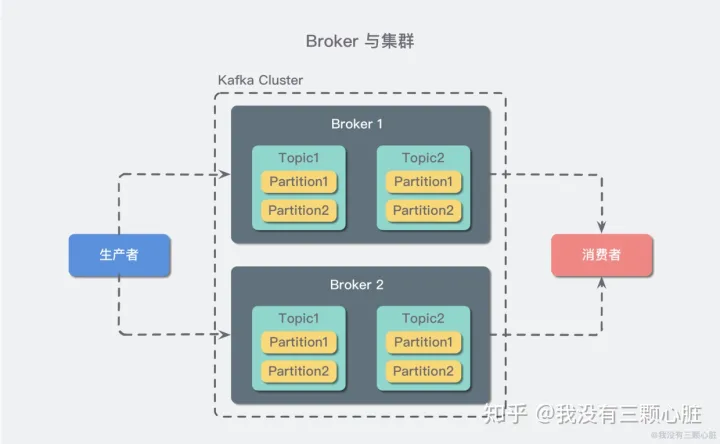
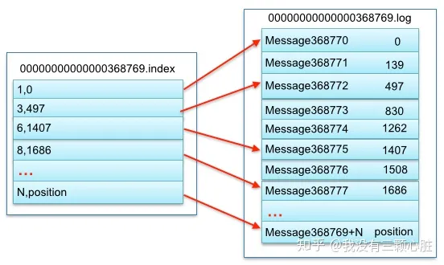
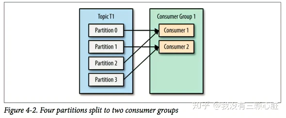
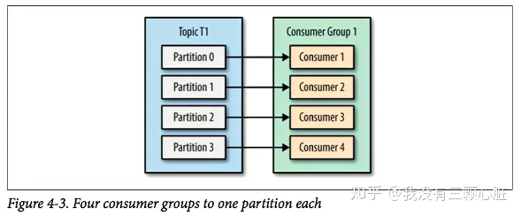
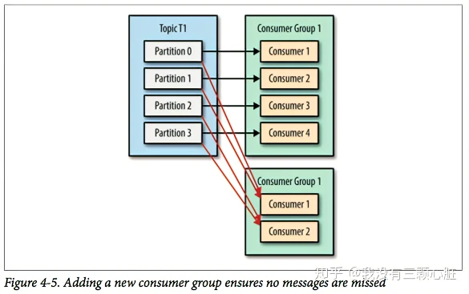

### Kafka 简介

Kafka 是一种分布式的，基于发布 / 订阅的消息系统。

一台Kafka服务器叫做Broker，Kafka集群就是多台Kafka服务器

### Kafka 基础概念

#### 生产者与消费者:
- 生产者（也称为发布者）创建消息，而消费者（也称为订阅者）负责消费or读取消息。

#### 主题（Topic）与分区（Partition）

- 消息以主题（Topic）来分类，每一个主题都对应一个「消息队列」，这有点儿类似于数据库中的表。

> 为什么kafka中主题要分区？
> Kafka中主题的分区是为了实现可伸缩性和高可用性。具体来说，分区可以实现以下功能：
> - 并行处理：每个分区可以被单独处理，多个消费者可以同时读取不同分区的数据，从而提高处理效率。
> - 负载均衡：多个分区可以均匀地分布在不同的节点上，避免某个节点负载过大。
> - 容错性：如果某个节点故障，其他节点仍然可以继续工作，确保数据不会丢失。
> - 顺序性：每个分区内的消息是有序的，但不同分区之间的消息可能是无序的。
> 因此，分区是Kafka中非常重要的概念，可以帮助我们构建高效、可靠的消息系统。

#### Broker 和集群（Cluster）

- 一个 Kafka 服务器也称为 Broker，
-  Broker接受生产者发送的消息并存入磁盘；
- Broker 同时服务消费者拉取分区消息的请求，返回目前已经提交的消息
- 若干个 Broker 组成一个集群（Cluster）
- 其中集群内某个 Broker 会成为集群控制器（Cluster Controller），它负责管理集群，包括分配分区到 Broker、监控 Broker 故障等。
- 在集群内，一个分区由一个 Broker 负责，这个 Broker 也称为这个分区的 Leader；
- 一个分区可以被复制到多个 Broker 上来实现冗余，这样当存在 Broker 故障时可以将其分区重新分配到其他 Broker 来负责。~

Kafka 的一个关键性质是日志保留（retention），我们可以配置主题的消息保留策略，譬如只保留一段时间的日志或者只保留特定大小的日志。
当超过这些限制时，老的消息会被删除。我们也可以针对某个主题单独设置消息过期策略，这样对于不同应用可以实现个性化。

#### 多集群:
随着业务发展，我们往往需要多集群，通常处于下面几个原因：
基于数据的隔离；
基于安全的隔离；
多数据中心（容灾）

当构建多个数据中心时，往往需要实现消息互通。举个例子，假如用户修改了个人资料，那么后续的请求无论被哪个数据中心处理，这个更新需要反映出来。又或者，多个数据中心的数据需要汇总到一个总控中心来做数据分析。

上面说的分区复制冗余机制只适用于同一个 Kafka 集群内部，对于多个 Kafka 集群消息同步可以使用 Kafka 提供的 MirrorMaker 工具。本质上来说，MirrorMaker 只是一个 Kafka 消费者和生产者，并使用一个队列连接起来而已。它从一个集群中消费消息，然后往另一个集群生产消息.

## Kafka 存储

### 分区存储
为什么要分区？
- 方便扩展：一个主题的消息可能很多，一台机器放不下，分区后可以放到多台机器上，方便拓展。
- 提高并发： 一个消费者消费一个分区，多个消费者可以同时消费多个分区，提高效率。

如何分区？
kafka中有几个原则：
1、 partition在写入的时候可以指定需要写入的partition，如果有指定，则写入对应的partition。
2、 如果没有指定partition，但是设置了数据的key，则会根据key的值hash出一个partition。
3、 如果既没指定partition，又没有设置key，则会轮询选出一个partition。

### 存入磁盘

Kafka 的消息是存在于文件系统之上的。

Kafka是将partition的数据写在磁盘的(消息日志)，不过==Kafka只允许追加写入(顺序访问)==，避免缓慢的随机 I/O 操作。
Kafka也不是partition一有数据就立马将数据写到磁盘上，它会先缓存一部分，等到足够多数据量或等待一定的时间再批量写入(flush)。

> 顺序写入和随机写入之间的区别？
> A: 顺序写入和随机写入是两种不同的数据写入方式，它们的区别在于数据写入的顺序和方式。
> 顺序写入是指按照顺序依次写入数据，比如在磁盘上写入一个大文件时，数据是按照连续的顺序写入的。这种方式的优点是可以提高磁盘的读写效率，减少磁盘寻道时间，因为读写头不需要频繁地跳跃到不同的位置。同时，顺序写入也有利于缓存和预读，可以提高系统的性能。
> 随机写入是指按照任意的顺序写入数据，比如在数据库中插入或更新记录时，数据是按照随机的顺序写入的。这种方式的缺点是会导致频繁的磁盘寻道，因为读写头需要频繁地跳跃到不同的位置，这会降低磁盘的读写效率，同时也会增加系统的开销。

现代的操作系统针对磁盘的读写已经做了一些优化方案来加快磁盘的访问速度:
- 预读会提前将一个比较大的磁盘快读入内存。
- 后写会将很多小的逻辑写操作合并起来组合成一个大的物理写操作。并且
- 操作系统还会将主内存剩余的所有空闲内存空间都用作磁盘缓存，所有的磁盘读写操作都会经过统一的磁盘缓存（除了直接 I/O 会绕过磁盘缓存）

- Topic 其实是逻辑上的概念（同一个主题的分区可能在不同的broker中），面相消费者和生产者，物理上存储的其实是 Partition，每一个 Partition 最终对应一个目录，里面存储所有的消息和索引文件。
- 默认情况下，每一个 Topic 在创建时如果不指定 Partition 数量时只会创建 1 个 Partition。
- 任何发布到 Partition 的消息都会被追加到 Partition 数据文件的尾部，这样的顺序写磁盘操作让 Kafka 的效率非常高
- 每一条消息被发送到 Broker 中，会根据 Partition 规则选择被存储到哪一个 Partition。如果 Partition 规则设置的合理，所有消息可以均匀分布到不同的 Partition中。
-  Segment
	- 每个 Partition 都为一个目录，而每一个目录又被平均分配成多个大小相等的 Segment File 中
	- ==Segment 是 Kafka 文件存储的最小单位。== （在Kafka中，消费者消费的最小单位是消息。所以消费者可以只读几条消息，然后记录offset）
	- Segment File 又由 index file 和 data file 组成，他们总是成对出现，后缀 ".index" 和 ".log" 分表表示 Segment 索引文件和数据文件。
	- Segment 文件命名规则：Partition 全局的第一个 Segment 从 0 开始，后续每个 Segment 文件名为上一个 Segment 文件最后一条消息的 offset 值。数值最大为 64 位 long 大小，19 位数字字符长度，没有数字用0填充。如 00000000000000368769.index 和 00000000000000368769.log。

以上面的一对 Segment File 为例，说明一下索引文件和数据文件对应关系：

注意该 index 文件并不是从0开始，也不是每次递增1的，这是因为 Kafka 采取稀疏索引存储的方式，每隔一定字节的数据建立一条索引，它减少了索引文件大小，使得能够把 index 映射到内存，降低了查询时的磁盘 IO 开销，同时也并没有给查询带来太多的时间消耗。

因为其文件名为上一个 Segment 最后一条消息的 offset ，==所以当需要查找一个指定 offset 的 message 时==，==通过在所有 segment 的文件名中进行二分查找就能找到它归属的 segment== ，再在其 index 文件中找到其对应到文件上的物理位置，就能拿出该 message 。

由于消息在 Partition 的 Segment 数据文件中是==顺序读写==的，且==消息消费后不会删除（删除策略是针对过期的 Segment 文件）==，这种顺序磁盘 IO 存储设计师 Kafka 高性能很重要的原因。

Kafka 是如何准确的知道 message 的偏移的呢？这是因为在 Kafka 定义了标准的数据存储结构，在 Partition 中的每一条 message 都包含了以下三个属性：
- offset：表示 message 在当前 Partition 中的偏移量，是一个逻辑上的值，唯一确定了 Partition 中的一条 message，可以简单的认为是一个 id；
- MessageSize：表示 message 内容 data 的大小；
- data：message 的具体内容

> Kafka 只会保证在 Partition 内消息是有序的，而不管全局的情况。

### 删除文件

无论消息是否被消费，kafka都会保存所有的消息。
那对于旧数据（已经消费过的数据）有什么删除策略呢？
1、 基于时间，默认配置是168小时（7天）。
2、 基于大小，默认配置是1073741824。
需要注意的是，kafka读取特定消息的时间复杂度是O(1)，所以这里删除过期的文件并不会提高kafka的性能！

Kafka不会自动删除未消费的数据，除非设置了相应的参数。

## 生产者设计概要

1. 首先，我们需要创建一个ProducerRecord，这个对象需要包含消息的主题（topic）和值（value），可以选择性指定一个键值（key）或者分区（partition）。
2. 发送消息时，生产者会对键值和值序列化成字节数组，然后发送到分配器（partitioner）。
3. 如果我们指定了分区，那么分配器返回该分区即可；否则，分配器将会基于键值来选择一个分区并返回。
4. 选择完分区后，生产者知道了消息所属的主题和分区，它将这条记录添加到相同主题和分区的批量消息中，另一个线程负责发送这些批量消息到对应的Kafka broker。
5. 当broker接收到消息后，如果成功写入则返回一个包含消息的主题、分区及位移的RecordMetadata对象，否则返回异常。
6. 生产者接收到结果后，对于异常可能会进行重试。

## 消费者设计概要

### 简述
Kafka消费者是消费组的一部分，消费者来处理消息分区
- 每个消息分区只需要一个消费者处理，
- 当消费者少于消息分区时，每个消费者处理多个消息分区的内容
- 当消费者多余消息分区时， ==多余的消费者空闲==

总而言之，我们可以通过增加消费组的消费者来进行水平扩展提升消费能力。
这也是为什么==建议创建主题时使用比较多的分区数，这样可以在消费负载高的情况下增加消费者来提升性能。==
另外，==消费者的数量不应该比分区数多，因为多出来的消费者是空闲的，没有任何帮助。==

最小消费单位：
在Kafka中，最小的消费单位是消息，而不是单个数据记录。因此，消费者可以消费单个消息，而不必消费整个数据集。此外，Kafka的消费模式可以根据需求进行配置，以保证灵活性和可扩展性。具体而言，消费者可以消费单个消息，也可以消费整个分区，甚至可以消费整个主题。这些灵活性和可配置性的特点是Kafka在实际生产环境中得以广泛应用的重要原因之一。

- Kafka一个很重要的特性就是，只需==写入一次消息，可以支持任意多的应用读取这个消息==。
- 每个消费组都可以读到全量的消息。
- 如果应用需要读取全量消息，那么请为该应用设置一个消费组；
- 如果该应用消费能力不足，那么可以考虑在这个消费组里增加消费者。

在这个场景中，消费组G1和消费组G2都能收到T1主题的全量消息，在逻辑意义上来说它们属于不同的应用。

### 消费进度
- Kafka就是用offset来表示消费者的消费进度到哪了，每个消费者会都有自己的offset。说白了offset就是表示消费者的消费进度。
- 在以前版本的Kafka，这个offset是由Zookeeper来管理的，后来Kafka开发者认为Zookeeper不合适大量的删改操作，于是把offset在broker以内部topic(_ _ consumer_offsets ) 的方式来保存起来。
- 每次消费者消费的时候，都会提交这个offset，Kafka可以让你选择是自动提交还是手动提交。

Zookeeper虽然在新版的Kafka中没有用作于保存客户端的offset，但是Zookeeper是Kafka一个重要的依赖。
- 探测broker和consumer的添加或移除。
- 负责维护所有partition的领导者/从属者关系（主分区和备份分区），如果主分区挂了，需要选举出备份分区作为主分区。
- 维护topic、partition等元配置信息

### 消费组与分区重平衡

根据业务需求，一个消费者可以订阅一个或多个主题的消息，然后拉取消息并处理。
但通常情况是：每个主题的消息很多， 单个消费者难以处理一个或多个主题的消息。所以这时候就需要多个消费者形成一个消费者组，作为一个整体来消费信息。

> 当然，某个消费者可以指定只消费某些分区， 如 consumer.assign(Arrays.asList(new TopicPartition("my-topic", 0)));
> 但是， 这需要手动管理消费者组中的消费者数量和分区分配的平衡，这个消费者少干活了，但活儿还是得干。不建议使用这种手动分配的方式， 通常建议使用subscribe方法来订阅一个或多个主题，让Kafka自动管理消费者和分区的分配。

重平衡是指：
- 当新的消费者加入消费组，它会消费一个或多个分区，而这些分区之前是由其他消费者负责的；
- 当消费者离开消费组（比如重启、宕机等）时，它所消费的分区会分配给其他分区

重平衡是 Kafka 一个很重要的性质，这个性质保证了高可用和水平扩展。

不过也需要注意到：
- ==在重平衡期间，会Stop The World ， 所有消费者都不能消费消息，因此会造成整个消费组短暂的不可用。==
- 分区进行重平衡也会导致原来的消费者状态过期，从而导致消费者需要重新更新状态，这段期间也会降低消费性能。

==重平衡非常重要，它为消费者群组带来了高可用性 和 伸缩性==，我们可以放心的添加消费者或移除消费者，不过在正常情况下我们并不希望发生这样的行为。

消费者通过定期（比如3s）发送心跳（hearbeat）到一个作为组协调者（group coordinator）的 broker 来保持在消费组内存活。
这个 broker 不是固定的，每个消费组都可能不同。当消费者拉取消息或者提交时，便会发送心跳。
如果消费者超过一定时间（比如10s）没有发送心跳，那么它的会话（session）就会过期，组协调者会认为该消费者已经宕机，然后触发重平衡。
> 通常情况下，我们可以进行优雅关闭（主动联系关闭），这样消费者会发送离开的消息到组协调者，这样组协调者可以立即进行重平衡而不需要等待会话过期。

###  消息拉取

Kafka 遵循了传统的方式，选择由 ==Producer 向 broker push 消息并由 Consumer 从 broker pull 消息==
> 一些 logging-centric system，比如 Facebook 的Scribe和 Cloudera 的Flume，采用 push 模式。事实上，push 模式和 pull 模式各有优劣。
> - push 模式很难适应消费速率不同的消费者，因为消息发送速率是由 broker 决定的。而 pull 模式则可以根据 Consumer 的消费能力以适当的速率消费消息。
> - pull 模式可简化 broker 的设计，Consumer 可自主控制消费消息的速率，同时 Consumer 可以自己控制消费方式——即可批量消费也可逐条消费，同时还能选择不同的提交方式从而实现不同的传输语义。
> - 采用 Push 的方式时，一旦消息到达，服务端即可马上将其推送给消费端，这种方式的实时性显然是非常好的

### 重复消费数据
凡是分布式就无法避免网络抖动/机器宕机等问题的发生，很有可能消费者A读取了数据，还没来得及消费，就挂掉了。Zookeeper发现消费者A挂了，让消费者B去消费原本消费者A的分区，等消费者A重连的时候，发现已经重复消费同一条数据了。(各种各样的情况，消费者超时等等都有可能...)

为了避免数据重复消费，Kafka提供了以下几种解决方案：
1. 设置消费者组的消费者数量：通过调整消费者组的消费者数量，可以控制每个分区只被一个消费者消费，避免多个消费者同时消费同一个分区的消息。
2. 使用幂等生产者：幂等生产者可以确保消息只会被写入一次，这样就可以避免重复消费。
3. 使用事务：通过使用事务来保证消息的原子性和一致性，可以避免重复消费。
4. 保存已消费消息的偏移量：消费者可以将已经消费过的消息的偏移量保存下来，下次消费者重新消费时，可以跳过已经消费过的消息。
综上所述，通过合理地设置消费者数量、使用幂等生产者、使用事务或者保存已消费消息的偏移量等方法，可以有效地避免Kafka中的数据重复消费问题。

## 其他
### Kafka 如何保证可靠性

- 对于一个分区来说，它的消息是有序的。如果一个生产者向一个分区先写入消息A，然后写入消息B，那么消费者会先读取消息A再读取消息B。
- 当消息写入所有in-sync状态的副本后，消息才会认为已提交（committed）。这里的写入有可能只是写入到文件系统的缓存，不一定刷新到磁盘。生产者可以等待不同时机的确认，比如等待分区主副本写入即返回，后者等待所有in-sync状态副本写入才返回。
- 一旦消息已提交，那么只要有一个副本存活，数据不会丢失。
- 消费者只能读取到已提交的消息。

### Kafka 为何如此之快
- 顺序读写
- 零拷贝
- 消息压缩
- 分批发送
	- 批处理能够进行更有效的数据压缩并减少 I/O 延迟

### 高可用

为了防止意外，每个partition都有备份。
备份分区仅仅用作于备份，不做读写。
如果某个Broker挂了，那就会选举出其他Broker的partition来作为主分区，这就实现了高可用。

### kafka和redis
kafka和redis有以下区别：
- redis是一个基于内存的kv数据库，而kafka是分布式发布订阅消息系统。
- redis的queue数据类型可以用来做发布/订阅系统，但是不保证可靠性，而kafka是一个完整的系统，提供了消息持久化、高吞吐、分布式、多客户端支持、实时等特性。
- redis queue数据是存储在内存中，速度快但容量有限，而kafka是存储在硬盘上，速度慢但容量大。

