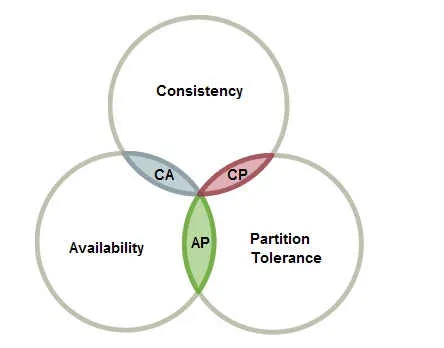

为什么使用分布式？
1. 大容量设备造价昂贵，大量廉价设备来代替
2. 多个机器可以并行运行，提高效率

资源允许的情况下，能单机执行就不要分布式执行，分布式执行会让问题变得更加复杂。

### 分布式面临的问题
- 并行
- 容错
- 通讯
- 安全

### CAP理论
一个分布式系统，不可能同时做到这三点:
- Consistency（一致性）
	- 对于客户端的每次读操作，要么读到的是最新的数据，要么读取失败。换句话说，一致性是站在分布式系统的角度，对访问本系统的客户端的一种承诺：要么我给您返回一个错误，要么我给你返回绝对一致的最新数据，不难看出，其强调的是数据正确。
- Availability（可用性）
	- 任何客户端的请求都能得到响应数据，不会出现响应错误。换句话说，可用性是站在分布式系统的角度，对访问本系统的客户的另一种承诺：我一定会给您返回数据，不会给你返回错误，但不保证数据最新，强调的是不出错。
- Partition tolerance（分区容忍性）
	- 由于分布式系统通过网络进行通信，网络是不可靠的。当任意数量的消息丢失或延迟到达时，系统仍会继续提供服务，不会挂掉。换句话说，分区容忍性是站在分布式系统的角度，对访问本系统的客户端的再一种承诺：我会一直运行，不管我的内部出现何种数据同步问题，强调的是不挂掉。

理解CAP理论最简单的方式是想象两个副本处于分区两侧，即两个副本之间的网络断开，不能通信。
- 如果允许其中一个副本更新，则会导致数据不一致，即丧失了C性质。
- 如果为了保证一致性，将分区某一侧的副本设置为不可用，那么又丧失了A性质。
- 除非两个副本可以互相通信，才能既保证C又保证A，这又会导致丧失P性质。

> 一般来说使用网络通信的分布式系统，无法舍弃P性质，谁也无法保证网络一定不出错，那么就只能在一致性和可用性上做一个艰难的选择。  有些算法强调强一致性，有些算法则强调强可用性。

在CAP理论提出十二年之后，其作者又出来辟谣。“三选二”的公式一直存在着误导性，它会过分简单化各性质之间的相互关系：
- 首先，由于分区很少发生，那么在系统不存在分区的情况下没什么理由牺牲C或A。
- 其次，C与A之间的取舍可以在同一系统内以非常细小的粒度反复发生，而每一次的决策可能因为具体的操作，乃至因为牵涉到特定的数据或用户而有所不同。
- 最后，这三种性质都可以在程度上衡量，并不是非黑即白的有或无。可用性显然是在0%到100%之间连续变化的，一致性分很多级别，连分区也可以细分为不同含义，如系统内的不同部分对于是否存在分区可以有不一样的认知。

所以一致性和可用性并不是水火不容，非此即彼的。Paxos、Raft等分布式一致性算法就是在一致性和可用性之间做到了很好的平衡的见证。

总结：如果系统发生“分区”，我们要考虑选择 CP 还是 AP。如果系统没有发生“分区”的话，我们要思考如何保证 CA

### Base 理论

BASE 是 Basically Available（基本可用） 、Soft-state（软状态） 和 Eventually Consistent （最终一致性） 三个短语的缩写。
- 基本可用：
	- 是指分布式系统在出现不可预知故障的时候，允许损失部分可用性。但是，这绝不等价于系统不可用
	- 损失部分可用性： 响应时间变长或者部分功能不可用
- 软状态：
	- 指允许系统中的数据存在中间状态（CAP 理论中的数据不一致），并认为该中间状态的存在不会影响系统的整体可用性，即允许系统在不同节点的数据副本之间进行数据同步的过程存在延时
- 最终一致性：
	- 强调的是系统中所有的数据副本，在经过一段时间的同步后，最终能够达到一个一致的状态。因此，最终一致性的本质是需要系统保证最终数据能够达到一致，而不需要实时保证系统数据的强一致性

BASE 理论本质上是对 CAP 的延伸和补充，更具体地说，是对 CAP 中 AP 方案的一个补充。

即使无法做到强一致性，但每个应用都可以根据自身业务特点，采用适当的方式来使系统达到最终一 致性。
也就是牺牲数据的一致性来满足系统的高可用性，系统中一部分数据不可用或者不一致时，仍需要保持系统整体“主要可用”

那实现最终一致性的具体方式是什么呢? 
- 读时修复 : 在读取数据时，检测数据的不一致，进行修复。比如 Cassandra 的 Read Repair 实现，具体来说，在向 Cassandra 系统查询数据的时候，如果检测到不同节点的副本数据不一致，系统就自动修复数据。
- 写时修复 : 在写入数据，检测数据的不一致时，进行修复。比如 Cassandra 的 Hinted Handoff 实现。具体来说，Cassandra 集群的节点之间远程写数据的时候，如果写失败 就将数据缓存下来，然后定时重传，修复数据的不一致性。
- 异步修复 : 这个是最常用的方式，通过定时对账检测副本数据的一致性，并修复。 

比较推荐 写时修复，这种方式对性能消耗比较低
