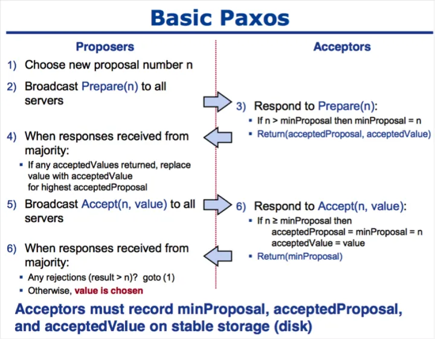

Paxos算法是一种基于消息传递的分布式一致性算法

Google的很多大型分布式系统都采用了Paxos算法来解决分布式一致性问题：
- 如Chubby、Megastore以及Spanner等。
- 开源的ZooKeeper，以及MySQL 5.7推出的用来取代传统的主从复制的MySQL Group Replication等纷纷采用Paxos算法解决分布式一致性问题。

Paxos算法解决的问题正是分布式一致性问题，即一个分布式系统中的各个进程如何就某个值（决议）达成一致。

Paxos算法除了难懂之外，还难以实现。但还是有公司利用它或其修改版。
Paxos算法运行在允许宕机故障的异步系统中，不要求可靠的消息传递，可容忍消息丢失、延迟、乱序以及重复。它利用大多数 (Majority) 机制保证了2F+1的容错能力，即2F+1个节点的系统最多允许F个节点同时出现故障。

## 基本框架

Paxos算法中的节点有以下3种可能的角色：
- Proposer：
	- 一个或多个提议进程 (Proposer) 可以发起提案 (Proposal)，并向Acceptor发送提案。
	- Proposal信息包括提案编号 (Proposal ID) 和提议的值 (Value)。这个值指一个操作，但paxos并不关心具体操作。
- Acceptor：参与决策，回应提案。如果提案获得多数（过半）Acceptor接受，则认为提案被批准。
- Learner：不参与决策，只学习最新达成一致的提案。
> 在多副本状态机中，每个副本同时具有Proposer、Acceptor、Learner三种角色。

Paxos算法中的决议过程分两种：
- Basic Paxos： 对单个value（值）的决议过程，也就是对单个值达成一致；
- Multi Paxos ：针对连续多个value的决议过程。

## Basic Paxos

Basic Paxos的过程如下：
1. Proposer生成全局唯一且递增的proposal id，并向所有Acceptor发送prepare请求。
2. Acceptor收到请求后，如果proposal id正常，则回复已接受的proposal id中最大的决议id和value。
3. Proposer接收到多数Acceptor的响应后，从应答中选择proposal id最大的value，并发送给所有Acceptor。
4. Acceptor收到proposal之后，接收并持久化当前proposal id和value。
5. Proposer收到多数Acceptor的响应之后形成决议，Proposer发送决议给所有Learner。

> accepter记录两个N，一个是最大的prepare N，这个只是准备阶段记录的； 一个是accepted N， 这个是已经接受提议的最大N;

Paxos算法也可以细分为两个决策阶段和一个学习阶段。具体如下：

### 阶段一：Prepare阶段
(a)Proposer生成全局唯一且递增的Proposal ID (可使用时间戳加Server ID)，假设为N, 并向所有Acceptors发送Prepare请求，这里无需携带提案内容，只携带Proposal ID即可。
(b) 如果一个Acceptor收到一个编号为N的Prepare请求，且N大于该Acceptor已经响应过的所有Prepare请求的编号，那么它就会将它已经接受过的编号最大的提案（如果有的话）作为响应反馈给Proposer，Acceptors收到Prepare请求后，做出“两个承诺，一个应答”：
两个承诺：
1. 不再接受Proposal ID小于等于（注意：这里是<= ）当前请求的Prepare请求。
2. 不再接受Proposal ID小于（注意：这里是< ）当前请求的Propose请求。
一个应答：
不违背以前作出的承诺下，回复已经Accept过的提案中Proposal ID最大的那个提案的Value和Proposal ID，没有则返回空值。

### 阶段二：Accept阶段
(a) 如果Proposer收到半数以上Acceptor对其发出的编号为N的Prepare请求的响应，那么它就会发送一个针对[N,V]提案的Accept请求给半数以上的Acceptor。注意：V就是收到的响应中编号最大的提案的value，如果响应中不包含任何提案，那么V就由Proposer自己决定。
(b) 如果Acceptor收到一个针对编号为N的提案的Accept请求，只要该Acceptor没有对编号大于N的Prepare请求做出过响应，它就接受该提案。

### 阶段三：Learn阶段。（非决策阶段）
Proposer在收到多数Acceptors的Accept之后，标志着本次Accept成功，决议形成，将形成的决议发送给所有Learners。

### 如何保证Paxos算法的活性
axos算法可能形成活锁而永远不会结束，如下图实例所示：

回顾两个承诺之一，Acceptor不再应答Proposal ID小于等于当前请求的Prepare请求。意味着需要应答Proposal ID大于当前请求的Prepare请求。两个Proposers交替Prepare成功，而Accept失败，形成活锁（Livelock）。

通过选取主Proposer，就可以保证Paxos算法的活性。至此，我们得到一个既能保证安全性，又能保证活性的分布式一致性算法——Paxos算法。

## Multi Paxos
Multi Paxos的基本思想是先使用Basic Paxos决议出Leader，再由Leader推进决议。
Multi Paxos和Basic Paxos具体有以下不同。
1. 针对每一个要确定的值，运行一次Paxos算法实例（Instance），形成决议。每一个Paxos实例使用唯一的Instance ID标识。
2. 在所有Proposers中选举一个Leader，由Leader唯一地提交Proposal给Acceptors进行表决。这样没有Proposer竞争，解决了活锁问题。在系统中仅有一个Leader进行Value提交的情况下，Prepare阶段就可以跳过，从而将两阶段变为一阶段，提高效率。

Multi-Paxos首先需要选举Leader，Leader的确定也是一次决议的形成，所以可执行一次Basic Paxos实例来选举出一个Leader。选出Leader之后只能由Leader提交Proposal，在Leader宕机之后服务临时不可用，需要重新选举Leader继续服务。在系统中仅有一个Leader进行Proposal提交的情况下，Prepare阶段可以跳过。
