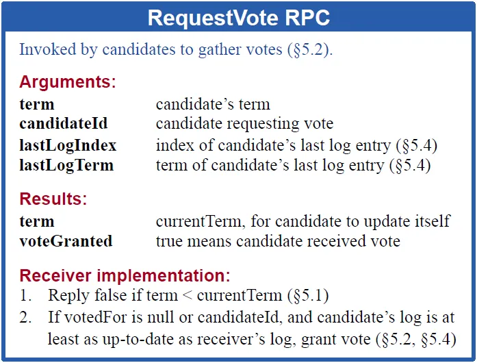
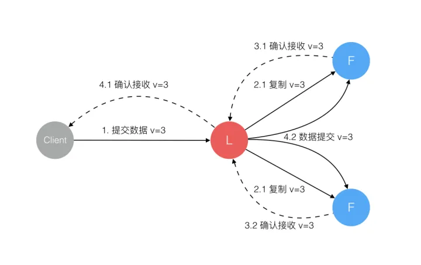
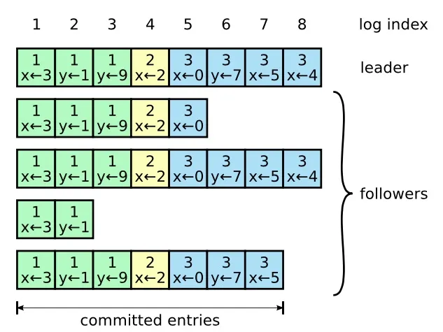
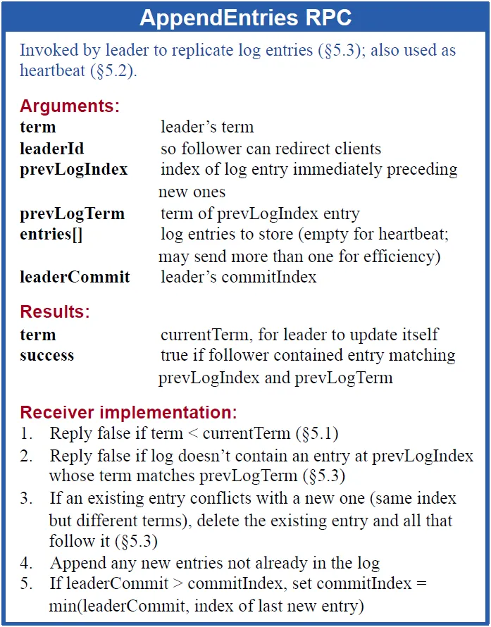
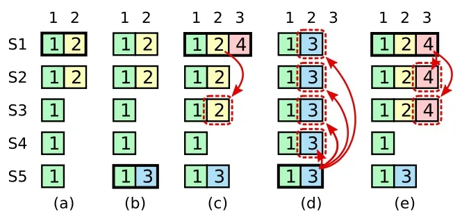
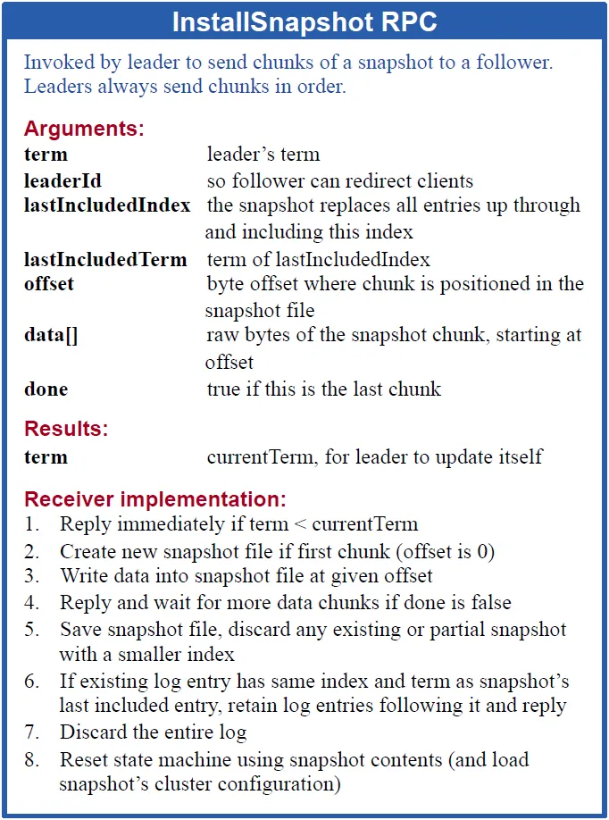
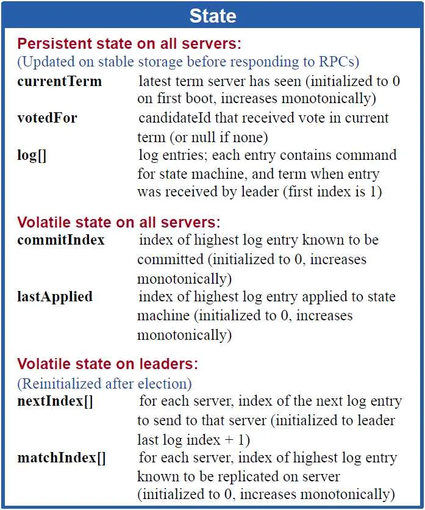
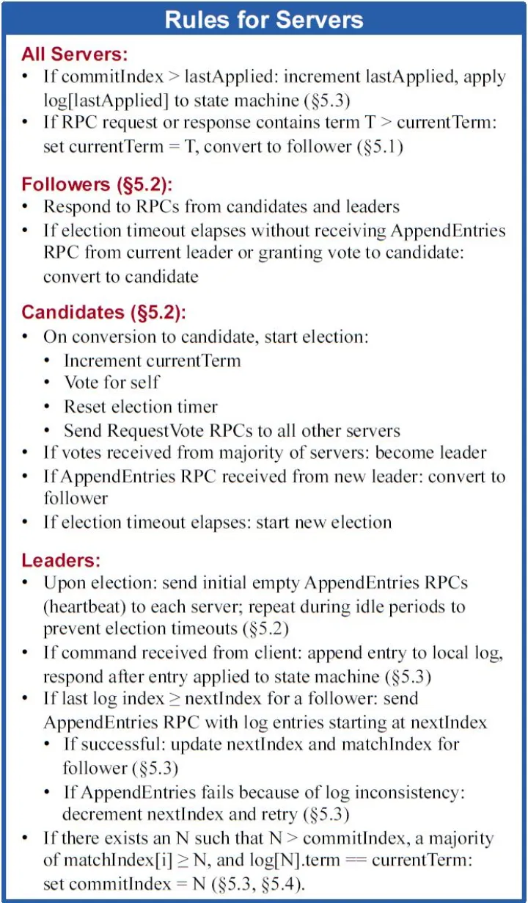

## 介绍
Raft实现了和Paxos相同的功能，它将一致性分解为多个子问题：Leader选举（Leader election）、日志同步（Log replication）、安全性（Safety）、日志压缩（Log compaction）、成员变更（Membership change）等。同时，Raft算法使用了更强的假设来减少了需要考虑的状态，使之变的易于理解和实现。

Raft将系统中的角色分为领导者（Leader）、跟从者（Follower）和候选人（Candidate）：
- Leader：仅一个。接受客户端请求，并向Follower同步请求日志，当日志同步到大多数节点上后告诉Follower提交日志。
- Follower：接受并持久化Leader同步的日志，在Leader告之日志可以提交之后，提交日志。
- Candidate：Leader选举过程中的临时角色。

正常工作期间只有Leader和Followers。Candidate是leader失效之后临时产生的。

如果Follower超时没有收到Leader的消息，它会成为一个Candidate并且开始一次Leader选举。收到大多数服务器投票的Candidate会成为新的Leader。Leader在宕机之前会一直保持Leader的状态。

Raft算法将时间分为一个个的任期（term），每一个term的开始都是Leader选举。在成功选举Leader之后，Leader会在整个term内管理整个集群。如果Leader选举失败，该term就会因为没有Leader而结束。

## Leader选举

- Raft 使用心跳（heartbeat）触发Leader选举。当服务器启动时，初始化为Follower。
- Leader向所有Followers周期性发送heartbeat, 维持其统治。
- 如果Follower在选举超时时间内没有收到Leader的heartbeat，就会等待一段随机的时间后发起一次Leader选举。

Follower将其当前term加一然后转换为Candidate。它首先给自己投票并且给集群中的其他服务器发送 RequestVote RPC 。结果有以下三种情况：
1. 赢得了多数的选票，成功选举为Leader；
2. 收到了Leader的消息，表示有其它服务器已经抢先当选了Leader；
3. 没有服务器赢得多数的选票，Leader选举失败，等待选举时间超时后发起下一次选举。

并非所有的follower都可以成为Leader, Raft保证选举出的Leader上一定具有最新的已提交的日志。
follower不会接受那些日志比自己旧的Candidate的请求。

## 日志同步

总结： 多数成功才提交，leader执行强覆盖。

- Leader选出后，就开始接收客户端的请求。
- Leader把请求作为日志条目（Log entries）加入到它的日志中，然后并行的向其他服务器发起 AppendEntries RPC 复制日志条目。
- 当这条日志被复制到大多数服务器上，Leader将这条日志应用到它的状态机并向客户端返回执行结果。
- 某些Followers可能没有成功的复制日志，Leader会无限的重试 AppendEntries RPC直到所有的Followers最终存储了所有的日志条目

日志： 由有序编号（log index）的日志条目组成。
日志条目：包含它被创建时的任期号（term），和用于状态机执行的命令。
如果一个日志条目被复制到大多数服务器上，就被认为可以提交（commit）了。

Raft日志同步保证如下两点：
- 如果不同日志中的两个条目有着相同的索引和任期号，则它们所存储的命令是相同的。
	- Leader在一个term内在给定的一个log index最多创建一条日志条目，同时该条目在日志中的位置也从来不会改变。
- 如果不同日志中的两个条目有着相同的索引和任期号，则它们之前的所有条目都是完全一样的。
	- AppendEntries 时有一个简单的一致性检查。当发送一个 AppendEntries RPC 时，Leader会把新日志条目紧接着之前的条目的log index和term都包含在里面。如果Follower没有在它的日志中找到log index和term都相同的日志，它就会拒绝新的日志条目。

- 一个Follower可能会丢失掉Leader上的一些条目，也有可能包含一些Leader没有的条目，也有可能两者都会发生。丢失的或者多出来的条目可能会持续多个任期。
- ==Leader通过强制Followers复制它的日志来处理日志的不一致==，Followers上的不一致的日志会被Leader的日志覆盖。
- Leader需要找到Followers同它的日志一致的最后位置，然后覆盖Followers在该位置之后的条目。
- Leader会从后往前试，每次AppendEntries失败后尝试前一个日志条目，直到成功找到每个Follower的日志一致位点，然后向后逐条覆盖Followers在该位置之后的条目。

## 安全性

安全性：是防止已提交的日志不会被覆盖，保障客户端收到反馈和实际执行是一致的。

> 简单来说，raft 通过 落后的不能成为领导/ 新领导先做好自己的事（提交自己的），再管上届的烂摊子 来保障安全性。简而言之，就是： 紧跟时代，做好自己。

Raft增加了如下两条限制以保证安全性：
- 拥有==最新的log entry==的Follower才有资格成为Leader。
	- 在RequestVote RPC中做的，Candidate在发送RequestVote RPC时，要带上自己的最后一条日志的term和log index，其他节点收到消息时，如果发现自己的日志比请求中携带的更新，则拒绝投票。
	- 日志比较的原则是，如果本地的最后一条log entry的term更大，则term大的更新，如果term一样大，则log index更大的更新。
- Leader只能推进commit index来提交当前term的已经复制到大多数服务器上的日志，==旧term日志的提交要等到提交当前term的日志来间接提交==（log index 小于 commit index的日志被间接提交）
	- 新leader不会直接官上一届领导的烂摊子。其他foller的一些日志可能比前面的烂摊子要新，直接提交前面的又崩掉之后，会导致已提交的烂摊子被覆盖，而这是我们不希望的。
	- 只有把自己任期内的事情做好（提交），才会顺便管管前面term的提交。

在阶段c中， s1拥有任期号4，如果s1上来直接将前面任期的烂摊子直接提交（即日志2.2）并告知客户端，提交后又突然崩掉。
此时拥有3.2的s5成为Leader，会直接覆盖掉日志2.2， 导致客户端收到错误的信息。

## 日志压缩

在实际的系统中，不能让日志无限增长，否则系统重启时需要花很长的时间进行回放，从而影响可用性。

- Raft采用对整个系统进行snapshot来解决，==snapshot之前的日志都可以丢弃==。
- 每个副本独立的对自己的系统状态进行snapshot，并且==只能对已经提交的日志记录进行snapshot==。
- Snapshot中包含:
	- 日志元数据。最后一条已提交的 log entry的 log index和term。这两个值在snapshot之后的第一条log entry的AppendEntries RPC的完整性检查的时候会被用上。
	- 系统当前状态。
- 对于一些日志落后太多的follower或者一台新机器， Leader会选择发送snapshot而非日志。使用命令 InstalledSnapshot RPC
- 为snapshot选择合适的生成频率： 做snapshot既不要做的太频繁，否则消耗磁盘带宽， 也不要做的太不频繁，否则一旦节点重启需要回放大量日志，影响可用性。
- 做一次snapshot可能耗时过长，会影响正常日志同步。可以通过使用copy-on-write技术避免snapshot过程影响正常日志同步。

## 成员变更

成员变更是在集群运行过程中副本发生变化，如增加/减少副本数、节点替换等。

成员变更不能影响服务的可用性，但是成员变更过程的某一时刻，可能出现在Cold和Cnew中同时存在两个不相交的多数派，进而可能选出两个Leader，形成不同的决议，破坏安全性。

Raft提出了两阶段的成员变更方法。集群先从旧成员配置Cold切换到一个过渡成员配置，称为共同一致（joint consensus），共同一致是旧成员配置Cold和新成员配置Cnew的组合Cold U Cnew，一旦共同一致Cold U Cnew被提交，系统再切换到新成员配置Cnew。

> [!question] leader直接把新配置发给follower会怎样？ 
> Cnew如果是删除/替换部分机器，新配置发给部分follower后leader崩掉， 没收到新配置的机器重新选举，但永远得不到大多数投票，因为前面的机器被删除了。
>  Cnew如果是添加部分机器，新配置发给部分旧follower后leader崩掉，这部分旧follower也可能选不出领导，因为新机器还没加入，不能投票。

Raft两阶段成员变更过程如下：
- Leader收到成员变更请求从Cold切成Cold,new；
- Leader在本地生成一个新的log entry，其内容是Cold∪Cnew，代表当前时刻新旧成员配置共存，写入本地日志，同时将该log entry复制至Cold∪Cnew中的所有副本。在此之后新的日志同步需要保证得到Cold和Cnew两个多数派的确认；
- Follower收到Cold∪Cnew的log entry后更新本地日志，并且此时就以该配置作为自己的成员配置；
- 如果Cold和Cnew中的两个多数派确认了Cold U Cnew这条日志，Leader就提交这条log entry并切换到Cnew；
- 接下来Leader生成一条新的log entry，其内容是新成员配置Cnew，同样将该log entry写入本地日志，同时复制到Follower上；
- Follower收到新成员配置Cnew后，将其写入日志，并且从此刻起，就以该配置作为自己的成员配置，并且如果发现自己不在Cnew这个成员配置中会自动退出；
- Leader收到Cnew的多数派确认后，表示成员变更成功，后续的日志只要得到Cnew多数派确认即可。Leader给客户端回复成员变更执行成功。

异常分析：
- 如果Leader的Cold U Cnew尚未推送到Follower，Leader就挂了，此后选出的新Leader并不包含这条日志，此时新Leader依然使用Cold作为自己的成员配置。
- 如果Leader的Cold U Cnew推送到大部分的Follower后就挂了，此后选出的新Leader可能是Cold也可能是Cnew中的某个Follower。
- 如果Leader在推送Cnew配置的过程中挂了，那么同样，新选出来的Leader可能是Cold也可能是Cnew中的某一个，此后客户端继续执行一次改变配置的命令即可。
- 如果大多数的Follower确认了Cnew这个消息后，那么接下来即使Leader挂了，新选出来的Leader肯定位于Cnew中。

如果增强成员变更的限制，假设Cold与Cnew任意的多数派交集不为空，这两个成员配置就无法各自形成多数派，那么成员变更方案就可能简化为一阶段。
可从数学上严格证明，==只要每次只允许增加或删除一个成员==，Cold与Cnew不可能形成两个不相交的多数派。

一阶段成员变更：
- 成员变更限制每次只能增加或删除一个成员（如果要变更多个成员，连续变更多次）。
- 成员变更由Leader发起，Cnew得到多数派确认后，返回客户端成员变更成功。
- 一次成员变更成功前不允许开始下一次成员变更，因此新任Leader在开始提供服务前要将自己本地保存的最新成员配置重新投票形成多数派确认。
- Leader只要开始同步新成员配置，即可开始使用新的成员配置进行日志同步。

## Raft与Multi-Paxos的异同

Raft与Multi-Paxos都是基于领导者的一致性算法，相似点：

不同点：

## Raft算法总结和相关RPC

Raft算法各节点维护的状态：

Raft状态机：
