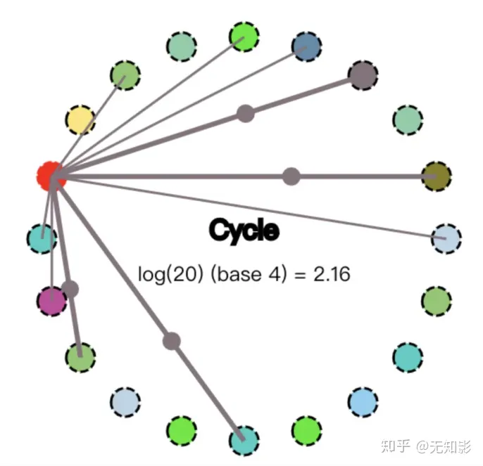
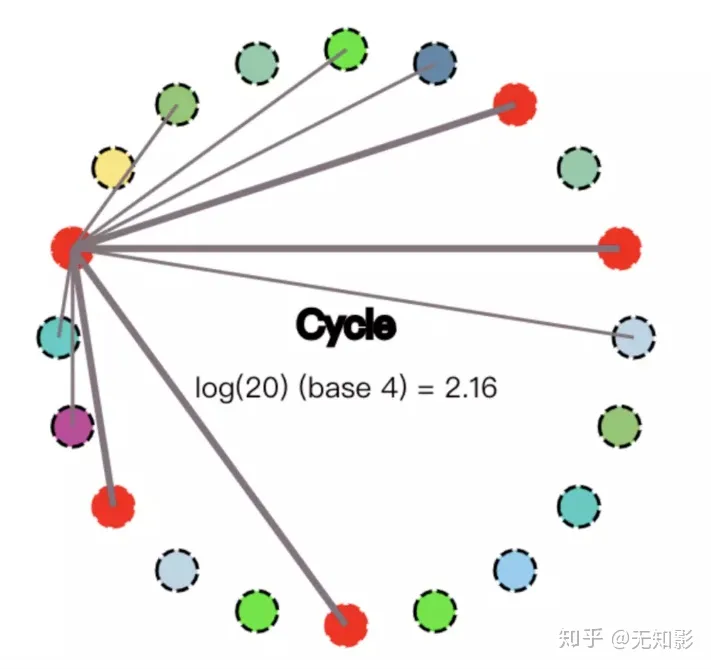

### 为什么需要一致性
1. 数据不能存在单个节点（主机）上，否则可能出现单点故障。
2. 多个节点（主机）需要保证具有相同的数据。
3. 一致性算法就是为了解决上面两个问题。

“共识”的意思是保证所有的参与者都有相同的认知（可以理解为强一致性）。
共识算法（consensus），即达成共识的过程，而非一致性算法。一致性（consistency）是终态，共识算法是达成一致性的一种实现手段和过程。

常见的共识算法有raft（reliable，replicated，redundant，And fault-tolerated）和Poxos算法，raft算法相对更清晰好理解，是poxos的替代，如etcd。poxos比较复杂难懂，用于zookeeper。

- 共识算法，解决多个副本不一致的问题/
	- 分布式系统通常会是多个副本，那么多个副本复制会存在延迟 ，上图中每个副本就是一个数据库，但是看到了数据库复制中发生的一些时序问题 ，从而让外界看到多个副本的状态是不一致的，导致了一致性问题
	- 也可能是副本发生了损坏
	- 一致性其实主要是描述了在故障和延迟的情况下副本间的状态协调的问题
- 复制状态机：相同的初始状态 + 相同的输入/操作 =  相同的结束状态
	- 复制状态机是一种很有效的容错技术，基于复制日志来实现，每个 Server 存储着一份包含命令序列的日志文件，状态机会按顺序执行这些命令。因为日志中的命令和顺序都相同，因此所有节点会得到相同的数据。因此保证系统一致性就简化为保证操作日志的一致，这种复制日志的方式被大量运用，如 GSF、HDFS、ZooKeeper和 etcd 都是这种机制。

### 一致性的分类

强一致性和弱一致性只是一种统称，按照从强到弱，可以划分为
- 线性一致性Linearizability consistency ，也叫原子性
	- 全局时钟，多个用户的所有操作记录执行顺序唯一
	- 任何人都不会看到过时数据
	- 系统表现得和只有一份数据完全一样
- 顺序一致性 Sequential consistency
	- 非全局时钟，但保证同一个用户的一系列操作顺序不变
- 因果一致性 Causal consistency
- 最终一致性 Eventual consistency
	- 不保证在任意时刻任意节点上的同一份数据都是相同的，但是随着时间的迁移，不同节点上的同一份数据总是在向趋同的方向变化。

按照应用分：
- 强一致性
	- 说明：保证系统改变提交以后立即改变集群的状态。
	- 某些对数据一致要求十分严格的场景比如银行转账还是要保证强一致性。
	- 模型：
		- Paxos
		- Raft（muti-paxos）
		- ZAB（muti-paxos）
- 弱一致性
	- 说明：也叫最终一致性，系统不保证改变提交以后立即改变集群的状态，但是随着时间的推移最终状态是一致的。
	- 模型：
		- DNS系统
		- Gossip协议

## Paxos 算法
Paxos算法除了难懂之外，还难以实现。但还是有公司利用它或其修改版。
Paxos算法运行在允许宕机故障的异步系统中，不要求可靠的消息传递，可容忍消息丢失、延迟、乱序以及重复。它利用大多数 (Majority) 机制保证了2F+1的容错能力，即2F+1个节点的系统最多允许F个节点同时出现故障。

Paxos算法中的节点有以下3种可能的角色：
- Proposer：一个或多个提议进程 (Proposer) 可以发起提案 (Proposal)，并向Acceptor发送提案。
- Acceptor：参与决策，回应提案。如果提案获得多数（过半）Acceptor接受，则认为提案被批准。
- Learner：不参与决策，只学习最新达成一致的提案。

> 在多副本状态机中，每个副本同时具有Proposer、Acceptor、Learner三种角色。

Paxos算法中的决议过程分两种：
- Basic Paxos： 对单个value（值）的决议过程，也就是对单个值达成一致；
- Multi Paxos 另一种是针对连续多个value的决议过程。

Basic Paxos的过程如下：
1. Proposer生成全局唯一且递增的proposal id，并向所有Acceptor发送prepare请求。
2. Acceptor收到请求后，如果proposal id正常，则回复已接受的proposal id中最大的决议id和value。
3. Proposer接收到多数Acceptor的响应后，从应答中选择proposal id最大的value，并发送给所有Acceptor。
4. Acceptor收到proposal之后，接收并持久化当前proposal id和value。
5. Proposer收到多数Acceptor的响应之后形成决议，Proposer发送决议给所有Learner。

Multi Paxos的基本思想是先使用Basic Paxos决议出Leader，再由Leader推进决议。
Multi Paxos和Basic Paxos具体有以下不同。
1. 每个Proposer使用唯一的id标识。
2. 使用Basic Paxos在所有Proposer中选出一个Leader，由Leader提交proposal给Acceptor表决，这样Basic Paxos中的1~3步可以跳过，提高效率。

## Raft
Raft实现了和Paxos相同的功能，它将一致性分解为多个子问题：Leader选举（Leader election）、日志同步（Log replication）、安全性（Safety）、日志压缩（Log compaction）、成员变更（Membership change）等。同时，Raft算法使用了更强的假设来减少了需要考虑的状态，使之变的易于理解和实现。

Raft将系统中的角色分为领导者（Leader）、跟从者（Follower）和候选人（Candidate）：
- Leader：仅一个。接受客户端请求，并向Follower同步请求日志，当日志同步到大多数节点上后告诉Follower提交日志。
- Follower：接受并持久化Leader同步的日志，在Leader告之日志可以提交之后，提交日志。
- Candidate：Leader选举过程中的临时角色。

正常工作期间只有Leader和Followers。Candidate是leader失效之后临时产生的。

如果Follower超时没有收到Leader的消息，它会成为一个Candidate并且开始一次Leader选举。收到大多数服务器投票的Candidate会成为新的Leader。Leader在宕机之前会一直保持Leader的状态。

Raft算法将时间分为一个个的任期（term），每一个term的开始都是Leader选举。在成功选举Leader之后，Leader会在整个term内管理整个集群。如果Leader选举失败，该term就会因为没有Leader而结束。

## zookeeper & ZAB

### ZAB算法
说明：ZAB也是对Multi Paxos算法的改进，大部分和raft相同
和raft算法的主要区别：
对于Leader的任期，raft叫做term，而ZAB叫做epoch
在状态复制的过程中，raft的心跳从Leader向Follower发送，而ZAB则相反。

- 定义：Zookeeper 是用来协调分布式应用的服务框架。
- 用途：它是一个为分布式应用提供一致性服务的软件，提供的API 可以实现：
	- 配置管理、
	- 集群管理、
	- 领导人选举：让新的最小编号作为Master
	- 分布式锁等 ：访问同一个节点的客户，分别给予临时编号，按照编号最小的优先执行再释放

在这些基础上可以实现一些分布式应用程序（ 如 GFS 、MapReduce 、VM-FT 的 test-and-set server 以及雅虎的 Fetching Service 、Katta 、YMB 等 ）。

ZooKeeper的写是线性一致性，读是顺序一致性。

因为zk的写操作是通过一个FIFO队列实现顺序的，所以每个操作都是有顺序的。
但是写操作则不能保证，因为zk中有些节点可能没有读到最新的数据，但是如果是对于他自己这个节点来说，他自己所有的读写操作是顺序的。但是如果加了sync是可以保证线性一致性的，因为可以刷回最新的数据在读。
自己这个节点来说，他自己所有的读写操作是顺序的。但是如果加了sync是可以保证线性一致性的，因为可以刷回最新的数据在读。

## Gossip算法

说明：Gossip算法每个节点都是对等的，即没有角色之分。Gossip算法中的每个节点都会将数据改动告诉其他节点（类似传八卦）。有话说得好："最多通过六个人你就能认识全世界任何一个陌生人"，因此数据改动的消息很快就会传遍整个集群。

1.集群启动，如下图所示（这里设置集群有20个节点）

2. 某节点收到数据改动，并将改动传播给其他4个节点，传播路径表示为较粗的4条线

3. 收到数据改动的节点重复上面的过程直到所有的节点都被感染
