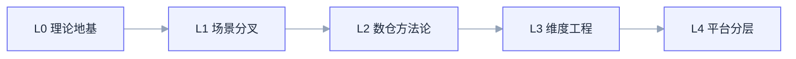
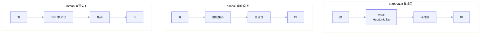
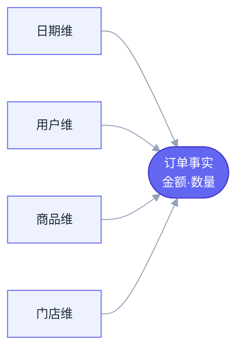
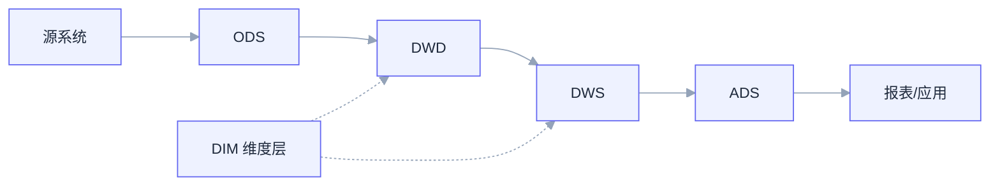

> 一份自底向上的地图。底层是「怎么把现实世界抽象成数据结构」的理论地基,顶层是「在特定场景下怎么组织这些结构」的工程方法论。越往上越贴近业务、越多取舍,越往下越接近数学本原。

---

## 0. 全景层次地图

|层次|这一层回答的问题|代表内容|
|---|---|---|
|**L0 理论地基**|怎么把现实世界抽象成数据?|关系模型、ER 模型、范式理论、三层抽象|
|**L1 场景分叉**|这份数据是用来写还是用来读?|OLTP vs OLAP;关系型 vs NoSQL|
|**L2 数仓方法论**|OLAP 场景下整个数仓怎么搭?|Inmon、Kimball、Data Vault|
|**L3 维度建模工程**|维度模型里每张表怎么设计?|事实表/维度表分类、SCD、星型/雪花|
|**L4 平台与分层**|工业级数仓怎么落地、怎么治理?|ODS→DWD→DWS→ADS、OneData、湖仓一体、Data Mesh|

> 箭头方向 = 逐层向上构建。左端是数学本原,右端最贴近业务、取舍最多。

**关键认知**:L2 的三大方法论不是「底层思想」,而是 L0 范式理论在分析场景下做不同取舍后的**应用策略**。Kimball 故意反范式换查询性能,Inmon 坚持 3NF 换一致性,Data Vault 是又一种拆分范式。

---

## L0 第一层:理论地基

这一层与「数仓」无关,是所有结构化数据建模的数学根基。

### L0.1 关系模型(Codd, 1970)

用**关系(二维表)**和**关系代数**(选择、投影、连接、并、差等)描述数据,以集合论为基础。它是 SQL 的理论来源,也是后续一切的起点。

- **优点**:理论严密、声明式查询、数据独立性强(逻辑与物理解耦)。
- **缺点**:对层次/网状/高维关系表达笨拙,大规模分布式下 join 成本高。
- **使用场景**:几乎所有关系型数据库(MySQL、PostgreSQL、Hive、Spark SQL 底层语义)。

### L0.2 ER 模型(Chen, 1976)

用**实体(Entity)、属性(Attribute)、关系(Relationship)**描述现实世界,是最通用的概念建模工具。一对一/一对多/多对多刻画实体间联系。

- **优点**:贴近现实直觉、与具体数据库无关、便于沟通。
- **缺点**:只到概念层,落地仍需转成关系表;复杂业务下图会爆炸。
- **使用场景**:需求分析、概念设计阶段;Inmon 的范式化中央仓本质就是企业级 ER 建模。

### L0.3 范式理论(Normalization)

围绕**消除冗余和更新异常**对表结构逐级约束:

|范式|约束|解决的问题|
|---|---|---|
|1NF|字段原子、不可再分|重复组|
|2NF|非主属性完全依赖主键|部分依赖|
|3NF|消除传递依赖|传递依赖|
|BCNF|每个决定因素都是候选键|主属性间异常|

- **范式化**(高范式):冗余低、一致性强、写入高效 → 适合 OLTP。
- **反范式化**(故意冗余、宽表):减少 join、查询快 → 适合 OLAP。
- **本质是权衡**:范式优化写一致性,反范式优化读性能。维度建模就是有意识地反范式。

### L0.4 概念 / 逻辑 / 物理三层抽象

任何严肃建模都走这三步,**这是真正的底层方法论**:

1. **概念模型**:画 ER 图,只关心业务实体和关系,不管数据库。
2. **逻辑模型**:落成表、字段、主外键、范式/维度结构,仍与具体引擎无关。
3. **物理模型**:落到具体引擎——分区、分桶、索引、存储格式(ORC/Parquet)、压缩、排序键。

> 数仓里 Kimball/Inmon 的差异主要发生在「逻辑模型」层,而 ODS/DWD 这些分层、存储格式选择属于「物理模型」层。

---

## L1 第二层:场景分叉

同样的底层理论,因「读多还是写多」「结构化程度」分出不同建模取向。

### L1.1 OLTP vs OLAP

|维度|OLTP(交易)|OLAP(分析)|
|---|---|---|
|目标|高并发写、事务一致|大批量读、复杂聚合|
|建模取向|高度范式化(3NF)|反范式、维度建模|
|典型|订单/账户系统|数仓、BI、报表|
|单次操作|改几行|扫几亿行|

数仓建模(L2 以上)讨论的全是 **OLAP** 场景。

### L1.2 关系型 vs NoSQL 建模

NoSQL 不追求范式,而是**按查询模式建模(query-driven)**:

- **KV**(Redis):按 key 设计,模型即访问路径。
- **文档**(MongoDB):嵌套聚合,按业务对象组织,反范式为主。
- **列族**(HBase/Cassandra):按 rowkey + 列族设计,rowkey 决定一切。
- **图**(Neo4j):实体为点、关系为边,天然适合关系密集场景(社交、风控、知识图谱)。

> 共性:放弃「先规范化再查询」,改成「先想清楚怎么查,再决定怎么存」。

---

## L2 第三层:数仓建模三大方法论

OLAP 场景下,如何搭建**整个企业数仓**的三套经典思想。

### L2.1 Inmon —— CIF,自顶向下

先建一个**高度范式化(3NF)、面向主题、企业级集成**的中央数仓(EDW),作为唯一可信源,再从中派生各部门数据集市。

- **优点**:一致性强、冗余低、企业集成度高、单一事实来源。
- **缺点**:建设周期长、成本高、对建模能力要求高、业务响应慢。
- **场景**:数据治理严格、强一致性的传统大企业(银行、电信、保险)。

### L2.2 Kimball —— 维度建模,自底向上

围绕**业务过程**(下单、支付、浏览)建**事实表 + 维度表**,先建单个业务域的数据集市,再用**一致性维度(conformed dimension)**和**总线矩阵(bus matrix)**拼成企业数仓。

- **优点**:贴近业务、查询快、上手快、迭代灵活、BI 友好。
- **缺点**:跨集市一致性靠规范约束、冗余较多、企业级单一事实源较弱。
- **场景**:互联网公司主流,尤其 DWS/ADS 层、报表与自助分析。

### L2.3 Data Vault(Dan Linstedt)

为解决前两者在**审计、可追溯、源系统频繁变更**下的痛点而生。拆成三类表:

- **Hub**:业务主键(稳定不变的业务键)。
- **Link**:实体间关系(多对多)
- **Satellite**:描述性属性 + 历史版本。
- **优点**:扩展性极强、历史可追溯、加新源系统不破坏已有结构。
- **缺点**:表数量爆炸、join 极复杂、不直接面向查询,下游通常还要再转成 Kimball 维度模型给 BI。
- **场景**:作为企业级集成层(EDW 层),强审计/合规需求。
    

### L2.4 三者对比

三者最直观的差别在**数据从源系统到 BI 的流向**:

|维度|Inmon|Kimball|Data Vault|
|---|---|---|---|
|方向|自顶向下|自底向上|集成层导向|
|核心结构|3NF 中央仓|星型/雪花(事实+维度)|Hub/Link/Satellite|
|范式取向|范式化|反范式|另一种拆分范式|
|一致性|强|靠一致性维度约束|强(可追溯)|
|查询友好|一般|好|差(需再转换)|
|建设速度|慢|快|中,但前期重|
|一句话|先建大一统规范化中心仓再分发|先建业务集市再拼成企业仓|可追溯的集成中转层|

---

## L3 第四层:维度建模工程细节

Kimball 落地时每张表的具体设计。面试高频。

### L3.1 事实表(Fact)

存度量值(可加性数值)+ 维度外键。三种类型:

|类型|含义|例子|
|---|---|---|
|事务事实表|每个业务事件一行|每笔订单、每次点击|
|周期快照|固定周期一个快照|每日账户余额、每日库存|
|累积快照|一行记录一个流程多个里程碑|订单从下单→支付→发货→签收|

度量可加性:**完全可加 / 半可加(余额类不能跨时间加)/ 不可加(比率类)**。

### L3.2 维度表(Dimension)与 SCD

存描述性属性,通常反范式宽表。核心难点是**缓慢变化维(Slowly Changing Dimension)**:

|类型|处理方式|后果|
|---|---|---|
|SCD Type 1|直接覆盖|不留历史|
|SCD Type 2|新增一行 + 生效/失效时间 + 版本标记|保留完整历史(最常用)|
|SCD Type 3|加「上一个值」字段|只留有限历史|

其他概念:**退化维度**(维度直接放事实表,如订单号)、**杂项维度**(零散标志位打包)、**桥接表**(处理多对多,如一个账户多个持有人)。

### L3.3 星型 vs 雪花

- **星型**:维度表完全反范式、不再拆分,事实表直接连维度。join 少、查询快,**首选**。
- **雪花**:维度表再按范式拆成多级。省空间但 join 多、性能差,仅在维度极大且复用时考虑。

星型模型——各维度表挂在一张事实表周围,查询时事实表直接 join 维度:

### L3.4 总线矩阵与一致性维度

- **一致性维度**:同一个维度(如「日期」「用户」)在所有集市中定义一致,是拼成企业仓的粘合剂。
- **总线矩阵**:行是业务过程、列是维度,规划哪些过程共享哪些维度,是 Kimball 企业级规划的核心工具。

---

## L4 第五层:平台与分层(工业落地)

### L4.1 经典分层 ODS → DWD → DWS → ADS

|层|全称|职责|
|---|---|---|
|ODS|操作数据存储|贴源,原始数据落地,几乎不加工|
|DWD|明细数据层|清洗、规范、维度退化,最细粒度事实明细|
|DWS|汇总数据层|按主题轻度聚合,公共指标宽表|
|ADS|应用数据层|面向具体报表/应用的高度聚合结果|

> DWD/DWS 大量采用 Kimball 维度建模思想;分层本身是工程规范,不是建模理论。

### L4.2 OneData(阿里数据中台方法论)

在 Kimball 维度建模基础上,叠加**强规范的数据公共层、一致性维度治理、指标体系管理(原子指标/派生指标)**。可理解为「工程化、规范化加强版的 Kimball」,核心是消灭烟囱式重复建设。

### L4.3 混合架构(现实里的主流)

很少有人纯用一派。常见:**底层用 Inmon/Data Vault 做集成、保一致性和可追溯,上层(DWS/ADS)用 Kimball 维度模型面向分析**。

### L4.4 数据湖 / 湖仓一体 / 数据网格

- **数据湖(Data Lake)**:存原始多源数据(结构化+非结构化),schema-on-read,灵活但易变「数据沼泽」。
- **湖仓一体(Lakehouse)**:Delta Lake / Iceberg / Hudi 在湖上加表事务、schema 管理,兼顾湖的灵活与仓的可靠。维度建模思想依然适用,只是落地在 Iceberg 表上。
- **数据网格(Data Mesh)**:组织架构理念——把数据按业务域拆给各域团队自治,「数据即产品」,去中心化。它解决的是规模化下的**组织与所有权**问题,不替代上面的建模方法。

---

## 总结:决策速记

**怎么选建模思想:**

- 交易系统、强写一致 → 范式化(3NF)。
- 分析报表、查询性能优先 → Kimball 维度建模(星型 + SCD2)。
- 强审计、源系统频繁变更、合规 → Data Vault 做集成层,再转 Kimball。
- 传统大企业、强治理 → Inmon 中央仓 + 派生集市。
- 大厂数据中台 → OneData(强化版 Kimball)。
- 现代架构 → 湖仓一体承载存储,维度建模承载逻辑,Data Mesh 管组织。

**层次速记:**

> L0 关系/ER/范式/三层抽象(真底层)→ L1 OLTP/OLAP 分叉 → L2 Inmon/Kimball/Data Vault(数仓方法论)→ L3 维度建模工程(事实/维度/SCD/星型)→ L4 分层/OneData/湖仓/Data Mesh(平台落地)。

**一句话区分三大方法论:**

> Inmon = 规范化中央仓;Kimball = 维度集市;Data Vault = 可追溯集成层。实际多分层混用。